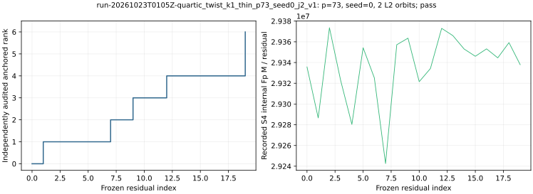

# run-20261023T0105Z-quartic_twist_k1_thin_p73_seed0_j2_v1

[Raw record](../../quartic_twist_k1_thin_p73_seed0_j2_v1.json) SHA-256 `17156e62b2724a8031017ec14f9da55802ec6d66b2dfad885958d40a89a44b3b`; [independent audit](../../quartic_twist_k1_thin_p73_seed0_j2_audit_v1.json) SHA-256 `e3b5b89ab638767b5648cd12af0253c0ae47806ae6a1113a299501e60cf3e595`.

Frozen native-thinning protocol commit `cadd7b9001`; [producer](../../../../examples/quartic_twist_k1_thin.rs) SHA-256 `b58e34d64a6f83ebc5dac7a1aa2670a60369515a1665aedbd37a2b46ceadd188`; [auditor](../../../../examples/quartic_twist_k1_thin_audit.rs) SHA-256 `46d6432070820bc431721a4d24bdff6e55bc8b49eda534272e274b9a6c9cc0a8`.

## Execution

Shared Intel Xeon Platinum 6975P-C host; L0 exploratory run. One public target `[271]G`.

Command: `target/release/examples/quartic_twist_k1_thin research/twist_index_calculus_20261020/quartic_twist_mixed_v1.ndjson 73 0 2` with 8 GiB address-space cap and 1,200 s watchdog.

## Recorded observations

- Native `pass`; independent point-keyed/BSGS audit `pass`; 20 residuals, anchored rank 6/6, recovered 271.
- Physical base 72 retained points from 96 constructed points; 2 complete L2 orbits. Full-base construction and map, plus a proper-subset map, are charged.
- Exact signed k=1 sets on processed prefix: 6 reference, 6 polynomial, 0 missing; 960 attempted S4 systems, 0 failures.
- Counted candidate: 593,181,104 Fp multiplications and 11,095 group operations; same-seed full-base control 888,203,272 Fp multiplications (full/candidate 1.497).
- Same-target twist24 rho: 496,841 Fp multiplications and 3,735 group operations. Independent BSGS verified 72 retained physical factor logs.

The graph plots native recorded values only. Hash/tree and allocator CPU, calibrated GAE and isolated timing are absent. Field-operation ratios do not constitute a priced IC/rho or external-solver speed claim.

[PDF](report.pdf).
