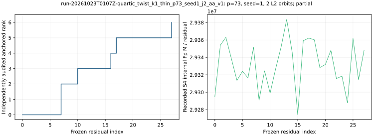

# run-20261023T0107Z-quartic_twist_k1_thin_p73_seed1_j2_aa_v1

[Raw record](../../quartic_twist_k1_thin_p73_seed1_j2_aa_v1.json) SHA-256 `f524b681975f689aba3fe96c8c69346b42310f2394f81889750b6ef6eea82bf5`; [independent audit](../../quartic_twist_k1_thin_p73_seed1_j2_audit_aa_v1.json) SHA-256 `8c7d21edf94f16f1d3acb335aba0781459b1c33ba824bb74bc5e0e91eec8dec8`.

Frozen native-thinning protocol commit `cadd7b9001`; [producer](../../../../examples/quartic_twist_k1_thin.rs) SHA-256 `b58e34d64a6f83ebc5dac7a1aa2670a60369515a1665aedbd37a2b46ceadd188`; [auditor](../../../../examples/quartic_twist_k1_thin_audit.rs) SHA-256 `46d6432070820bc431721a4d24bdff6e55bc8b49eda534272e274b9a6c9cc0a8`.

## Execution

Shared Intel Xeon Platinum 6975P-C host; L0 exploratory run. One public target `[271]G`.

Command: `target/release/examples/quartic_twist_k1_thin research/twist_index_calculus_20261020/quartic_twist_mixed_v1.ndjson 73 1 2` with 8 GiB address-space cap and 1,200 s watchdog.

## Recorded observations

- Native `partial`; independent point-keyed/BSGS audit `partial`; 28 residuals, anchored rank 6/6, recovered 271.
- Physical base 72 retained points from 96 constructed points; 2 complete L2 orbits. Full-base construction and map, plus a proper-subset map, are charged.
- Exact signed k=1 sets on processed prefix: 9 reference, 7 polynomial, 2 missing; 1,344 attempted S4 systems, 1 failures.
- Counted candidate: 829,490,482 Fp multiplications and 12,141 group operations; same-seed full-base control 1,183,617,228 Fp multiplications (full/candidate 1.427).
- Same-target twist24 rho: 366,965 Fp multiplications and 3,030 group operations. Independent BSGS verified 72 retained physical factor logs.

The graph plots native recorded values only. Hash/tree and allocator CPU, calibrated GAE and isolated timing are absent. Field-operation ratios do not constitute a priced IC/rho or external-solver speed claim.

[PDF](report.pdf).
