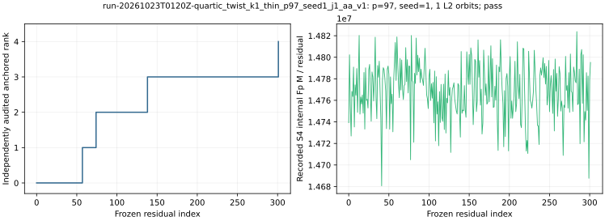

# run-20261023T0120Z-quartic_twist_k1_thin_p97_seed1_j1_aa_v1

[Raw record](../../quartic_twist_k1_thin_p97_seed1_j1_aa_v1.json) SHA-256 `2b00ee85b3fe21299beab5d5ea5b50c5533676e72ddea991898fb15ec8d6e38b`; [independent audit](../../quartic_twist_k1_thin_p97_seed1_j1_audit_aa_v1.json) SHA-256 `ab7923b5dfc325443eff44f9a719b7507d1f4709c34b91e7f62c7ae81083e436`.

Frozen native-thinning protocol commit `cadd7b9001`; [producer](../../../../examples/quartic_twist_k1_thin.rs) SHA-256 `b58e34d64a6f83ebc5dac7a1aa2670a60369515a1665aedbd37a2b46ceadd188`; [auditor](../../../../examples/quartic_twist_k1_thin_audit.rs) SHA-256 `46d6432070820bc431721a4d24bdff6e55bc8b49eda534272e274b9a6c9cc0a8`.

## Execution

Shared Intel Xeon Platinum 6975P-C host; L0 exploratory run. One public target `[271]G`.

Command: `target/release/examples/quartic_twist_k1_thin research/twist_index_calculus_20261020/quartic_twist_mixed_v1.ndjson 97 1 1` with 8 GiB address-space cap and 1,200 s watchdog.

## Recorded observations

- Native `pass`; independent point-keyed/BSGS audit `pass`; 302 residuals, anchored rank 4/4, recovered 271.
- Physical base 48 retained points from 72 constructed points; 1 complete L2 orbits. Full-base construction and map, plus a proper-subset map, are charged.
- Exact signed k=1 sets on processed prefix: 4 reference, 4 polynomial, 0 missing; 7,248 attempted S4 systems, 0 failures.
- Counted candidate: 4,496,535,068 Fp multiplications and 37,541 group operations; same-seed full-base control 3,349,559,070 Fp multiplications (full/candidate 0.745).
- Same-target twist24 rho: 500,318 Fp multiplications and 3,822 group operations. Independent BSGS verified 48 retained physical factor logs.

The graph plots native recorded values only. Hash/tree and allocator CPU, calibrated GAE and isolated timing are absent. Field-operation ratios do not constitute a priced IC/rho or external-solver speed claim.

[PDF](report.pdf).
