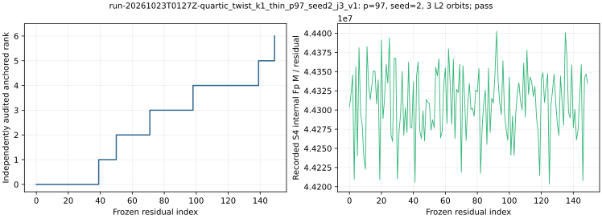

# run-20261023T0127Z-quartic_twist_k1_thin_p97_seed2_j3_v1

[Raw record](../../quartic_twist_k1_thin_p97_seed2_j3_v1.json) SHA-256 `6d9f255fe55806951f4ac36dd8d498310a5701222cea148b91b274b3fe62fa0a`; [independent audit](../../quartic_twist_k1_thin_p97_seed2_j3_audit_v1.json) SHA-256 `0e21b267b9612dcc6883225383d5738415010681adf0d6f025bf8dc3aaed64ee`.

Frozen native-thinning protocol commit `cadd7b9001`; [producer](../../../../examples/quartic_twist_k1_thin.rs) SHA-256 `b58e34d64a6f83ebc5dac7a1aa2670a60369515a1665aedbd37a2b46ceadd188`; [auditor](../../../../examples/quartic_twist_k1_thin_audit.rs) SHA-256 `46d6432070820bc431721a4d24bdff6e55bc8b49eda534272e274b9a6c9cc0a8`.

## Execution

Shared Intel Xeon Platinum 6975P-C host; L0 exploratory run. One public target `[271]G`.

Command: `target/release/examples/quartic_twist_k1_thin research/twist_index_calculus_20261020/quartic_twist_mixed_v1.ndjson 97 2 3` with 8 GiB address-space cap and 1,200 s watchdog.

## Recorded observations

- Native `pass`; independent point-keyed/BSGS audit `pass`; 150 residuals, anchored rank 6/6, recovered 271.
- Physical base 72 retained points from 72 constructed points; 3 complete L2 orbits. Full-base construction and map, plus a proper-subset map, are charged.
- Exact signed k=1 sets on processed prefix: 6 reference, 6 polynomial, 0 missing; 10,800 attempted S4 systems, 0 failures.
- Counted candidate: 6,696,848,851 Fp multiplications and 28,588 group operations; same-seed full-base control 6,696,848,851 Fp multiplications (full/candidate 1.000).
- Same-target twist24 rho: 791,504 Fp multiplications and 5,395 group operations. Independent BSGS verified 72 retained physical factor logs.

The graph plots native recorded values only. Hash/tree and allocator CPU, calibrated GAE and isolated timing are absent. Field-operation ratios do not constitute a priced IC/rho or external-solver speed claim.

[PDF](report.pdf).
