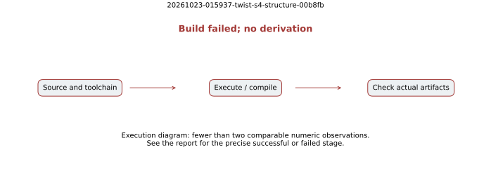

# Build failed; no derivation

Job `20261023-015937-twist-s4-structure-00b8fb`. Native execution and evidence only; no admitted elapsed-time comparison.

## Exact execution

Protocol commits: `509df89c5e`, `3ff04c056`, `40fbae5a7`, `e6fc49a7d`, as applicable to each stage. The actual executed source snapshot is retained in this job's raw tree.

Host: c7i.2xlarge Spot. Started 2026-10-23T02:00:42Z. Terminal phase `failed`, exit `101`. All launched instances terminated. Exact command: [command.sh](command.sh), SHA-256 `093184d879b191511abcba062b08e0847a55213d2c3604699cd0111ba4e0d538`. Host, environment and rusage receipts are in the extracted raw job tree.

## Recorded observations

The sparse source snapshot omitted tools/volcano-cli. Build exit 101. No mathematical experiment ran.

## Scope and limits

Structural and collector processes have an 8 GiB address-space cap and 1,200 s watchdog where invoked by the recorded command. Fixed native source and exact raw inputs are retained. No seed or failed stage is dropped. Proof-wrapper setup and extraction do not use the theorem process's cap. Counts shown are recorded native values, with no estimated intervals or timing ratios. F4 row-reduction counters are not complete solver or index-calculus costs. The final prefix A/A checks deterministic output, not timing isolation. Full cost, five-round isolated timing, strongest matched rho calibration and msolve/Magma comparison remain separate uncompleted gates.

[Round report](../../REPORT.md). [PDF](report.pdf).
