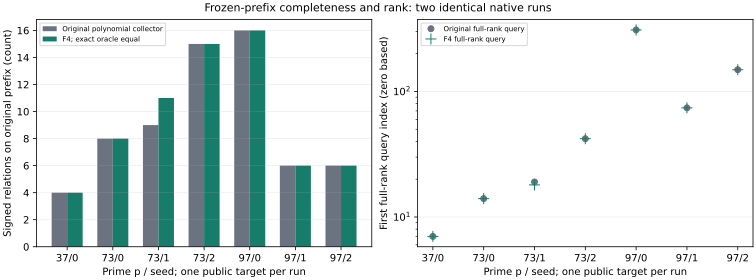

# Complete first/A/A prefix collectors

Job `20261023-025542-twist-s4-prefix-all-48c275`. Native execution and evidence only; no admitted elapsed-time comparison.

## Exact execution

Protocol commits: `509df89c5e`, `3ff04c056`, `40fbae5a7`, `e6fc49a7d`, as applicable to each stage. The actual executed source snapshot is retained in this job's raw tree.

Host: c7i.large Spot. Started 2026-10-23T02:56:23Z. Terminal phase `done`, exit `0`. All launched instances terminated. Exact command: [command.sh](command.sh), SHA-256 `220b42e75d7a718da4f1f7ac0cee2309a1e4968a1341b721993b7a2d35c68263`. Host, environment and rusage receipts are in the extracted raw job tree.

## Recorded observations

Two byte-identical complete collectors; 46,200 systems each; seven exact signed-set oracle matches; seven full ranks and all target/factor logarithms verified. Zero undetermined systems; 48 tests passed.

## Scope and limits

Structural and collector processes have an 8 GiB address-space cap and 1,200 s watchdog where invoked by the recorded command. Fixed native source and exact raw inputs are retained. No seed or failed stage is dropped. Proof-wrapper setup and extraction do not use the theorem process's cap. Counts shown are recorded native values, with no estimated intervals or timing ratios. F4 row-reduction counters are not complete solver or index-calculus costs. The final prefix A/A checks deterministic output, not timing isolation. Full cost, five-round isolated timing, strongest matched rho calibration and msolve/Magma comparison remain separate uncompleted gates.

[Round report](../../REPORT.md). [PDF](report.pdf).
