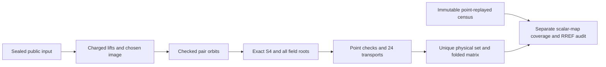

# Five-factor zero-fiber polynomial index calculus

This follows the completed 189-case image-base panel and 21 doubling controls.
Those measurements and the independent five-factor point census are reused;
none is rerun here. The [prospective protocol](PROTOCOL.md) predates the first
candidate polynomial solve. The broader twist-symmetry objective is open.

## Mechanism and attribution

At the fixed residual zero, the checked 24-element signed subgroup action can
identify ordinary/image peel pairs. One representative leaves an exact S4
system in three ordinary factors. Transport accepted solutions, deduplicate
physical tuples, and measure the resulting independent factor-log rows.
Both phi=1-psi and doubling receive the identical quotient. Orbit copies
alone do not add independent folded rows. A useful incremental phi gain must
come from distinct systems, their cost, or the rank trajectory.

## Requirement status

| Requirement | Current evidence |
|---|---|
| Registered 21 cases and both image controls | [Protocol](PROTOCOL.md); seven curves, all three presentations |
| Public-only candidate inputs and charged reconstruction | Native collector calls the original cold builder; no reference argument |
| Independent pair coverage and work-record auditing | Separate scalar-multiplication maps, exact partition, per-pair reference equality, transported union, and checked F4 counter sum |
| Native correctness gate | Before per-system journaling: 84 tests pass with source checks before/after; [receipts](results/native-completion-v1/metadata/native-tests.stdout). Journalled version's new gate is queued, not yet passed. |
| Complete physical enumeration on all 42 case-arms | Pending registered panel; a timeout is never a zero-yield observation |
| Independent complete-set and matrix comparison | Implemented; execution pending |
| Charged target descent and matched controls | Not yet implemented or executed |
| Calibrated complete IC price, strongest rho and external solver comparison | Open; this shared host admits correctness/counter diagnostics only |

## Reproduction

Run `run-native-gate.sh OUT CARGO_TARGET` through the repository's common busy
wrapper. The saved continuation `run-complete-native-gate.sh` reuses only
reconciled successful compilation artifacts and runs the missing test phase;
the artifact path and hashes are recorded. Do not overwrite an old gate.

After the gate passes, `run-panel.sh OUT PUBLIC_ROOT REFERENCE_ROOT
POINT_REPLAY_SUMMARY GATE` freezes its actual script, binary, protocol, all
21 public inputs and reference hashes. Each collector and post-run audit
gets its own busy reservation, 8 GiB address-space cap and 1,200-second outer
watchdog. The collector also uses a 1,180-second cooperative deadline.
No BSGS, scalar census or public-point census is repeated.

Raw runs stay under ignored `runs/` and will be archived with hashes, exact
commands, failed attempts and compact native summaries. See
[execution history](EXECUTION.md) and [implementation status](IMPLEMENTATION_STATUS.md).

`wait-gate-and-panel.sh` follows one verified native-gate owner. It starts
the committed panel only after a successful terminal gate receipt. A missing
or changed owner without that receipt stops the controller; it restarts no job.

The candidate and auditors share field/curve arithmetic and the exact S4
deriver. Independent physical completeness is supplied by the earlier
point-keyed census. This is executable fixture evidence, not a formal proof
of the full group/field bridges or a general impossibility/advantage theorem.
