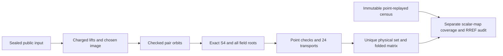

# Five-factor zero-fiber polynomial index calculus

This follows the completed 189-case image-base panel and 21 doubling controls.
Those measurements and the independent five-factor point census are reused;
none is rerun here. The [prospective protocol](PROTOCOL.md) predates the first
candidate polynomial solve. The broader twist-symmetry objective is open.

## Mechanism and attribution

At the fixed residual zero, the checked 24-element signed subgroup action can
identify ordinary/image peel pairs. One representative leaves an exact S4
system in three ordinary factors. Transport accepted solutions, deduplicate
physical tuples, and measure the resulting independent factor-log rows.
Both phi=1-psi and doubling receive the identical quotient. Orbit copies
alone do not add independent folded rows. A useful incremental phi gain must
come from distinct systems, their cost, or the rank trajectory.

## Requirement status

| Requirement | Current evidence |
|---|---|
| Registered 21 cases and both image controls | [Protocol](PROTOCOL.md); seven curves, all three presentations |
| Public-only candidate inputs and charged reconstruction | Native collector calls the original cold builder; no reference argument |
| Independent pair coverage and work-record auditing | Separate scalar-multiplication maps, exact partition, per-pair reference equality, transported union, and checked F4 counter sum |
| Native correctness gate | Phase 1: 84/84; current Phase 2: 89/89, source checks pass; [current receipts](results/phase2-native-gate-v2/metadata/native-tests.stdout). Earlier passes/failures are retained separately. |
| Complete physical enumeration on all 42 case-arms | Verified complete; 33,696 S4 systems per arm, no undetermined systems |
| Independent complete-set and matrix comparison | All 42 pass, including pair coverage, work records, RREF and corruption controls |
| Charged target descent and matched controls | Implemented; all four public p37 positive controls, independent replay and A/A pass. The 85-configuration panel is frozen and owned by `twist-zero-pipeline-panel-v1.service`; terminal results are pending. |
| Calibrated complete IC price, strongest rho and external solver comparison | Open; this shared host admits correctness/counter diagnostics only |

## Reproduction

The [results report](REPORT.md), [three-page PDF](REPORT.pdf) and
[run report](reports/run-20261024T2003Z-polynomial-panel/REPORT.md) record the
complete panel. Each arm reproduces 504 signed tuples and 15 projective rows
in case-local totals. Phi/doubling ranks are 2/2 versus 1/2 at p37, 2/8
versus 1/8 at p157, and 1/14 versus 3/14 at p337; the other tested primes
have zero factor-log rank. Equal aggregate counts do not imply equal rank.
The full registered target-recovery comparison and complete price remain open.
Small p37 target recovery is now independently verified in the Phase 2 gate.

## Phase 2 continuation

The [execution supplement](PHASE2_EXECUTION.md) fixes stopped zero
precomputation and actual target descent before the first new solve. The
[pipeline implementation and workload](phase2/README.md) retain all 21
cases, matched zero/plain phi and doubling, and the frozen best admitted
parent-family control. Exact reuse of identical controls gives 85 distinct
configurations and 255 first/A/A executions. No completed study is restarted.
The [build-and-controls report](phase2/BUILD_AND_CONTROLS.md) preserves two
failed compile checks, their corrected source binding, and the first
89-test actual recovery gate. A fresh 89-test gate also passes after adding
explicit duplicate-tuple rejection to the independent auditor.

The registered full panel is frozen in commit `af66996a19` before its
managed launch. Both final launcher controls pass, including protection of
a pre-existing phase receipt. In the retained p37 positive control, zero
plus phi uses 153 finite systems versus doubling's 288, while both plain
controls use 72. That structural phi gain within precomputation does not
reduce the matched target-query count and adds systems relative to plain.
The [control PDF](phase2/BUILD_AND_CONTROLS.pdf) preserves the exact scope.

Run `run-native-gate.sh OUT CARGO_TARGET` through the repository's common busy
wrapper. The saved continuation `run-complete-native-gate.sh` reuses only
reconciled successful compilation artifacts and runs the missing test phase;
the artifact path and hashes are recorded. Do not overwrite an old gate.

After the gate passes, `run-panel.sh OUT PUBLIC_ROOT REFERENCE_ROOT
POINT_REPLAY_SUMMARY GATE` freezes its actual script, binary, protocol, all
21 public inputs and reference hashes. Each collector and post-run audit
gets its own busy reservation, 8 GiB address-space cap and 1,200-second outer
watchdog. The collector also uses a 1,180-second cooperative deadline.
No BSGS, scalar census or public-point census is repeated.

Invoke `run-panel.sh` directly: it manages its own per-phase reservations.
An outer busy wrapper is refused before creating outputs; the bounded
[negative control](results/outer-busy-control-v1/exit) confirms exit 64.

Raw runs stay under ignored `runs/`. Their complete selected archive passes
fresh extraction, all 1,112 byte comparisons and deterministic repacking;
canonical publication and remote SHA-256 verification pass, with their own
receipt in [raw artifacts](ARTIFACTS.md). See
[execution history](EXECUTION.md) and [implementation status](IMPLEMENTATION_STATUS.md).

`wait-gate-and-panel.sh` follows one verified native-gate owner. It starts
the committed panel only after a successful terminal gate receipt. A missing
or changed owner without that receipt stops the controller; it restarts no job.

The candidate and auditors share field/curve arithmetic and the exact S4
deriver. Independent physical completeness is supplied by the earlier
point-keyed census. This is executable fixture evidence, not a formal proof
of the full group/field bridges or a general impossibility/advantage theorem.
