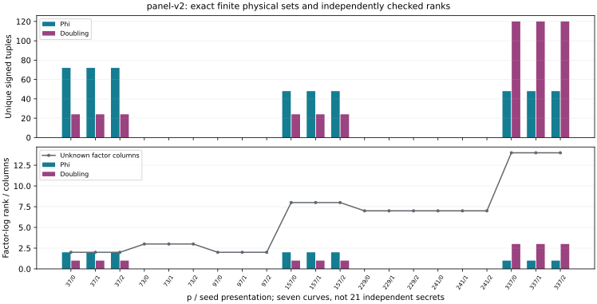
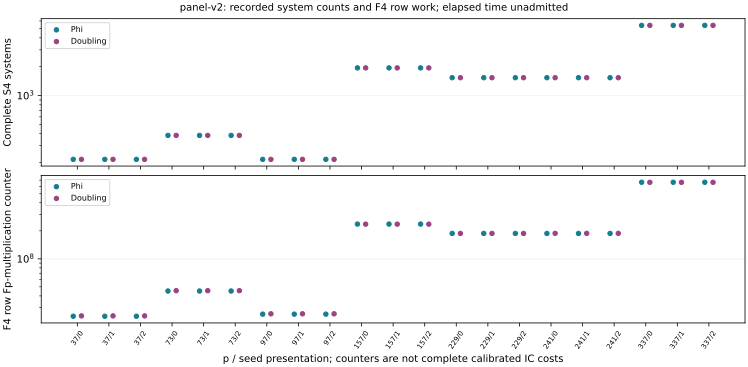

# Polynomial collection on the zero fiber

The registered 42 case-arms and their independent audits complete successfully. Each mixed arm reproduces the immutable physical census. These are case-local count sums over seven curves in three public scalar-271 presentations, not independent secret samples or an amortized DLP price.

## Recorded native totals

| Arm | Signed tuples | Projective rows | Zero rows | S4 systems |
|---|---:|---:|---:|---:|
| Phi | 504 | 15 | 0 | 33696 |
| Doubling | 504 | 15 | 0 | 33696 |

The new evidence is a complete polynomial implementation and exact physical replay of the earlier structural census. Phi determines both unanchored factor columns at p37, versus one for doubling. At p157 the ranks are 2/8 versus 1/8; at p337 they are 1/14 versus 3/14. Other tested primes give zero factor-log rank. Equal aggregate tuple/row counts do not imply equal useful rank. Transported copies supply proportional folded rows.

## All registered cases

| p / seed | Phi tuples | Phi rank / cols | Double tuples | Double rank / cols | Phi systems | Double systems |
|---|---:|---|---:|---|---:|---:|
| 37 / 0 | 72 | 2/2 | 24 | 1/2 | 216 | 216 |
| 37 / 1 | 72 | 2/2 | 24 | 1/2 | 216 | 216 |
| 37 / 2 | 72 | 2/2 | 24 | 1/2 | 216 | 216 |
| 73 / 0 | 0 | 0/3 | 0 | 0/3 | 384 | 384 |
| 73 / 1 | 0 | 0/3 | 0 | 0/3 | 384 | 384 |
| 73 / 2 | 0 | 0/3 | 0 | 0/3 | 384 | 384 |
| 97 / 0 | 0 | 0/2 | 0 | 0/2 | 216 | 216 |
| 97 / 1 | 0 | 0/2 | 0 | 0/2 | 216 | 216 |
| 97 / 2 | 0 | 0/2 | 0 | 0/2 | 216 | 216 |
| 157 / 0 | 48 | 2/8 | 24 | 1/8 | 1944 | 1944 |
| 157 / 1 | 48 | 2/8 | 24 | 1/8 | 1944 | 1944 |
| 157 / 2 | 48 | 2/8 | 24 | 1/8 | 1944 | 1944 |
| 229 / 0 | 0 | 0/7 | 0 | 0/7 | 1536 | 1536 |
| 229 / 1 | 0 | 0/7 | 0 | 0/7 | 1536 | 1536 |
| 229 / 2 | 0 | 0/7 | 0 | 0/7 | 1536 | 1536 |
| 241 / 0 | 0 | 0/7 | 0 | 0/7 | 1536 | 1536 |
| 241 / 1 | 0 | 0/7 | 0 | 0/7 | 1536 | 1536 |
| 241 / 2 | 0 | 0/7 | 0 | 0/7 | 1536 | 1536 |
| 337 / 0 | 48 | 1/14 | 120 | 3/14 | 5400 | 5400 |
| 337 / 1 | 48 | 1/14 | 120 | 3/14 | 5400 | 5400 |
| 337 / 2 | 48 | 1/14 | 120 | 3/14 | 5400 | 5400 |

## Validation and boundary

The 24-action pair quotient is available to both arms. Actual lifts, chosen map, action checks, complete S4 roots/signs, point sums, folded rows and factor-point verification are executed. No factor logs, BSGS or reference sets enter collection. The separate post-run verifier reads the immutable census previously checked by point-keyed enumeration.

The audit independently constructs scalar-multiplication action maps and the signed-pair partition, checks each representative's physical relations and their transported union, reconciles recorded F4 work and uses separate RREF. Public binding, incomplete systems, missing system, duplicate pair, counter mutation and nonempty-set tuple/sign mutations are rejected. Field/curve arithmetic and the exact S4 equation deriver are shared; the full curve/group and field-embedding Lean bridges remain open.

All equations are zero-only and have zero target coefficient. No target recovery or complete IC cost is established. F4 counters cover row reduction only; other field/group counters and memory telemetry are retained separately. Shared-host elapsed diagnostics include durable journaling and are not admitted timing. Calibrated 0/0.1/1 GAE, strongest matched rho, complete external-solver pricing, independent secret sampling and scaling remain open.

All failed launches and native tests remain. An outer reservation deadlocked the old panel before its first collector; zero native case records existed. That service was stopped with receipts retained. The corrected driver refuses the same misuse with exit 64. The journalled source passes 84 native tests with source checks. No completed old census, target stream or successful upload was repeated.

## Provenance

Native summary SHA-256: `a472fa455a2da6c691729f82b5be10f78da2cd66a700f9dba9298f763f11a2e1`.

[Protocol](PROTOCOL.md) · [Execution history](EXECUTION.md) · [Raw artifacts](ARTIFACTS.md) · [PDF](REPORT.pdf).
