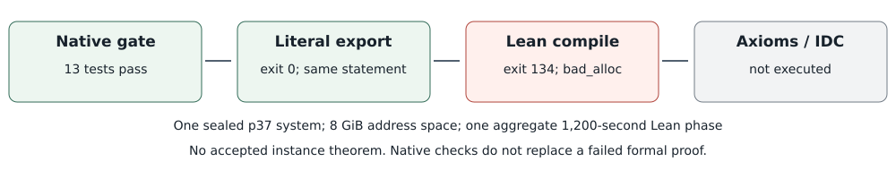

# Explicit ring normalization for the sealed instance

This is a third encoding of the same literal p37 seed0 phi system-0
certificate after both previous managed proof runs terminated with memory
panics. Their statements, failures, source freezes and inspected report are
preserved unchanged. No original science run is repeated.

Only the generated instance's product, integer-lift and characteristic-37
proof tactics change from `grind` to explicit `grobner`. The prior component
proof uses this explicit ring tactic. The generic prefix, literal f_i/h_i/R,
balanced expressions, four proved product lemmas and all three final
statements remain unchanged. The same dense integer statement hash must be
reproduced. No instance identity or desired conclusion is assumed.

Native gate v3 actually passes all 13 tests, zero failures; formatting,
release build and source seals pass. Verifier SHA-256:
`c11767d4ec2b4bb30ae729586f9db650c29205fb111b39235d69a7a1eadac833`.
Its raw and compact metadata are `../runs/certificate-instance-native-gate-v3/`
and `../results/certificate-instance-proof-v3/native-gate/`.
After committing this source freeze, one distinct
managed proof owner receives the same aggregate 1,200-second/8 GiB Lean
phase, not a larger budget per lemma. All ten axiom sets and the standard
integer-lift IDC still require actual success; no result is prewritten.
The raw path is reserved as `../runs/certificate-instance-proof-v3/`.
Inspect native terminal receipts and the managed owner before any action.

Source freeze: `bc818088c1afab64804dde156853df3e6ca3f3e9`, committed before
the real export. One owner was accepted at **2026-10-25T07:10:27Z**:
`twist-certificate-instance-proof-v3.service`, PID **3851339** at
acceptance, `Restart=no`. Its static launch receipts are under
`../results/certificate-instance-proof-v3/launch/`. Acceptance alone does
not establish actual science admission, a theorem, an axiom audit or an IDC.

Any successful formalization would establish this one literal polynomial
instance and its stated characteristic/no-zero-divisor consequences. The
native parser, field/group/decoder, parametric-family, relation-rank and
complete-cost obligations remain open. Failed attempts are retained rather
than relabelled as mathematical impossibility.

## Actual terminal outcome

Export exits 0 and reproduces the same integer statement hash
`e7dd6d7622171f18c1d80ea9c1d26d182b08dbf664c3a3046115eb6715e5eb45`.
The actual Lean phase starts at 07:20:28 UTC and terminates at
07:32:28 UTC with phase/terminal exit **134**, signal 6, an uncaught
`std::bad_alloc`. Recorded maximum RSS is **3,772,392 KiB** under the
unchanged 8 GiB address-space bound. RSS and address space differ.
GNU time also prints an `Exit status: 0` footer after reporting signal 6;
that footer is not success. The authoritative phase and terminal receipts
are 134. No elapsed timing is admitted.

No axiom audit or IDC is executed after the failed Lean phase and no
instance theorem is accepted. The three resource failures do not disprove
the original finite-field certificate. They also do not establish where
elaboration or normalization exhausted memory. Before another large proof
attempt, independently check the serialized integer statement and isolate
small definition/product blocks. Any subsequent encoding must retain the
same full theorem, explicit hypotheses, ten axiom audits and aggregate bound.
The parser, field/group/decoder and family claims remain unresolved.

See [the inspected verification PDF](PROOF-V3.pdf) and its Typst source.
`runs-v3.tar.xz` retains the v3 native gate, terminal proof run and inspected
layout; it does not overwrite the historical v1/v2 archive. Extract its
parent-rooted paths under the collector and verify the local checksum.
