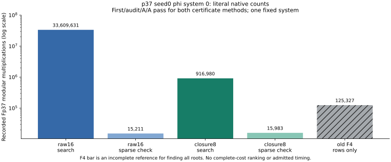

# Literal certificate verification and first matched construction diagnostic

## Scope and observed counts

This report concerns p37 seed0 phi system index 0, fixed before production
in the twelve-configuration degree/closure workload. Both first executions,
independent coefficient/root audits and deterministic A/A comparisons now
pass. It is one polynomial system from one public synthetic fixture. The
three presentations of scalar 271 are not independent secret samples.
The full twelve configurations, 42-arm certificate panel and 85-configuration
target pipeline remain under their original owners.

| Method, same system | Last working degree | Actual product degree | Power | Search multiplications | Sparse-check multiplications |
|---|---:|---:|---:|---:|---:|
| raw16 | 12 | 12 | 2 | 33,609,631 | 15,211 |
| closure8 | 7 | 12 | 2 | 916,980 | 15,983 |

Search additions are 33,300,873 versus 896,786; inversion calls are 1,562
versus 177. Inversion exponentiation products are already counted as
multiplications. The raw4..8 ranks and arithmetic prefix reproduce the old
degree-8 record exactly. Both methods return independently checked
certificates for q squared. Their multipliers differ; no coefficient-byte
equality between the two algorithms is claimed.

The original F4 reference records 125,327 row-reduction multiplications for
this system. That is a partial count for a different task, finding all
field roots. Its other work is unpriced. Even the closure search alone
exceeds that partial reference count; these values do not price a complete
fallback/filter or establish a full-pipeline ranking. No admitted time or
fastest-tool claim is made.

The native historical snapshot `../runs/degree-closure-probe-progress-v1/summary.json`
retains all twelve expected positions. Three configurations were verified
there: the two system-0 methods above and system-1 raw16. The latter finds
no q-power certificate through degree 16 for powers 1,2,3, after 142,494,025
search multiplications. The other nine rows remain unverified/null in that
snapshot, even if later live outputs have appeared. That snapshot exits 2
as partial; it is not a completed panel or a nonexistence proof.

## Exact concrete identity and proof scope

The raw source certificate is fixed as
`35d1890ef4aa04d3a7568dca950f85274097079a4813db64e8022025a57ba2ec`.
The workload is
`254581dfebfcb992e8ce0c6b7896cbd7cb402259b0a5b72e34fd8c711cc0c88a`.
The exporter binds the original public input, equation-only packet,
complete-enumeration reference, prior audit, pair, peeled abscissa and old
raw8 record. It checks the one retained finite root and absence of an
accepted physical tuple for this distinct-factor system.

Let q=a^3-a^2*s1+a*s2-s3. A fresh dense integer expansion, independent of
the producer's sparse check, verifies all 2,197 coefficient-array positions
and obtains 454 nonzero coefficients of R in

    sum(h_i*f_i) = q^2 + 37*R.

Every coefficient division by 37 has zero remainder. The statement JSON
SHA-256 is `e7dd6d7622171f18c1d80ea9c1d26d182b08dbf664c3a3046115eb6715e5eb45`.
The literal Lean target first proves this integer identity in an arbitrary
commutative ring. Characteristic 37 then gives q squared in the original
ideal. At a common zero, the explicit no-zero-divisor hypothesis implies
q=0; the checked cubic identity gives a=x or a=y or a=z.

No instance certificate identity is assumed by the target theorem. The
generic prefix is copied verbatim, SHA-256
`fe7fbef221b2d391f3793976fd3babbe14673ef08b0ddaa3b5ae74664764773c`.
Its three generic declarations have prior checked proofs. A new instance
proof remains a separate verification obligation.

## Actual failed attempt and revised attempt

Native gates v1 and v2 each pass 13 tests: four instance controls plus nine
unchanged standard IDC tests. Their format, build and source seals pass.

Attempt v1's export passes. Its Lean phase exits 1 with
`INTERNAL PANIC: out of memory` under the 8 GiB address-space limit.
Recorded maximum RSS is 3,775,120 KiB; address space and RSS differ. No
accepted instance theorem or IDC comes from v1. Its full source, candidate,
integer lift, tool logs and resource receipt remain in the versioned raw run.

Attempt v2 balances polynomial sum syntax and proves four literal products
separately before combining them. The same three final statements, all
coefficients and one aggregate 1,200-second/8 GiB Lean phase are retained.
Its export passes and produces the identical statement JSON hash. Its Lean
phase also exits 1 with `INTERNAL PANIC: out of memory`; maximum recorded
RSS is 3,772,400 KiB. Both managed proof owners are terminal. Neither
attempt produces an accepted instance theorem, a transitive axiom audit or
an IDC. These are resource failures of the chosen proof encodings, not
counterexamples to the identity. Both failed modules and logs are retained.

All ten transitive axiom sets still need to be checked against only
propext, Classical.choice and Quot.sound. Native evaluation, custom axioms
and unchecked assumptions are not accepted. A further proof encoding must
preserve the literal identity and the aggregate execution bound; no third
attempt has been launched for this report. See the existing
[problem record](../../../../problems/quartic-twist-polynomial-ic-pricing.md)
for the remaining obligations (repository-relative path:
`problems/quartic-twist-polynomial-ic-pricing.md`).

| Requirement | Status at report preparation |
|---|---|
| Source/public/pair bindings and exact integer lift | Native checks pass |
| Literal ring, characteristic-37 and repeated-factor instance theorems | V1 and V2 memory failures; unverified |
| Ten theorem axiom sets and standard integer-lift IDC | Not executed after failed Lean phases |
| Native parser, Fp implementation and curve/group/decoder bridges | Not formalized by this proof |
| Parametric family, all twelve systems or all seven primes | Not established by one instance |
| Complete cold cost, strongest IC/rho and fastest external comparison | Open |

## What a repeated factor does and does not show

The existing collector explicitly requires four distinct ordinary
abscissae and one disjoint image abscissa. It rejects cubics with fewer
than three distinct roots and roots containing the peeled ordinary ID.
The certificate supports rejection within that family.

A repeated-factor root could instead encode a signed multiset or a
lower-arity relation after opposite signs cancel. Whether such rows vanish
after the checked action fold, reproduce known rows or add rank is a
different question. It has not been answered by this proof. A follow-up
must cover all 42 source arms, combine multiplicities and cancellations
before deduplication, retain zero rows, compute independent rank, preserve
the old distinct set as a subset, and compare phi with doubling. Any
subsequent collector must use public inputs and charge the full pipeline;
an oracle-assisted root census would not itself be that algorithm.

The atlas match includes the known Semaev framework and the transported-base
yield lead. The latter's pure prime-field transport comparison is not this
mixed quartic-extension family. No novelty, global closure or atlas
saturation is claimed.

Callgrind 3.19.0 is available, but no profiling or cross-method run was
performed here. Client instruction counts alone would not price kernel/I/O
or provide matched rho and calibration. Future cross-method work follows
the repository's native `ecbench-measure` workflow. See the
[official Callgrind manual](https://valgrind.org/docs/manual/cl-manual.html).

## Reproduce and retained requirements

See [protocol](PROTOCOL.md), [native exporter](native/src/main.rs), build/run
scripts and raw `../runs/certificate-instance-{native-gate,proof}-v{1,2}/`.
The first proof source freeze is `379d5880d0c2dc656d552ab4fbb3c95d7f8a5d65`;
the revised source freeze is `7cc1b7241991469fcef7dc166f8f617cebca46f0`.
Both occur before their actual exports. Both managed proof units are
terminal with exit 1. Inspect their receipts before any follow-up; no
observation timeout authorizes a restart. This report freezes their actual
outcome on 2026-10-25; later proof work must add a new version.

All 189+21 original audits and the 42 distinct zero-fiber collections remain
complete and are not repeated. Full target/certificate/degree panels still
need their terminal seals and reports. The original unique-yield, factor-log
rank, complete cost and reference requirements remain intact. Canonical
IC/rho plots and the benchmark index receive no new row because the full
comparison, price and VALIDATION gates are unmet. Any report copy is unlisted.
