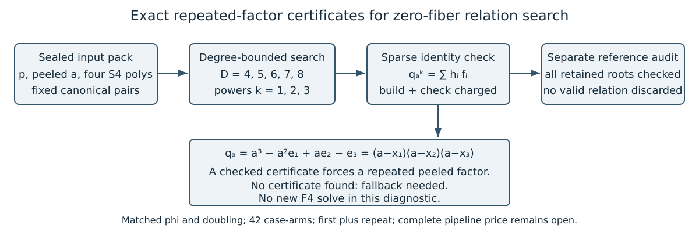

# Collision certificates: checked construction and proof

Checkpoint, 2026-10-25. The production comparison is pending in this report.

The native implementation looks for exact identities
`q_a^k = sum(h_i f_i)` with
`q_a=a^3-a^2 e1+a e2-e3`. Since
`q_a=(a-x1)(a-x2)(a-x3)`, a certificate forces a repeated peeled factor.
The dense construction and a separate sparse identity check are charged.
An unsuccessful bounded search leaves fallback work pending.

Gate v3 passes five Rust tests, the production build and three Lean lemmas.
The cubic and rejection lemmas use only `propext`, `Classical.choice`,
`Quot.sound`; the power-zero lemma has no axioms. The theorem exposes its
no-zero-divisor and evaluated-certificate hypotheses. The actual parser,
finite-field representation, polynomial/group bridge and decoder remain
outside that formalization. [The proof map](proof/PROOF_MAP.md) records this
scope and the earlier failed proof check.

The universal cubic identity also has standard certificate
[IDC1h10810f17e0f6c8f6](proof/identity.json), with 64 derived and 64 extra
points and a digest pointer to the checked Lean source. The false-identity
control is refused. Each actual small-prime certificate still needs its own
exact coefficient expansion.

All 42 case-arms retain the original canonical pairs and public bindings.
First plus one repeat gives 84 producer executions; 42 independent audits
and parity checks remain required. The first two p37 seed-0 arms also serve
as the actual implementation gate and are retained in the full experiment.
No old F4 solve, point census or target-recovery study is repeated.

The model compares certificate search/check multiplications plus retained
fallback row counts with the old F4 row count. Polynomial construction,
other solver primitives, memory and I/O remain unpriced. No actual fallback
execution, integrated target/rank result, admitted timing or complete-cost
gain follows. Canonical IC/rho charts and the benchmark index remain unchanged.

[Inspected PDF](BUILD_AND_PROOF.pdf), [protocol](PROTOCOL.md),
[execution](EXECUTION.md), [diagnostic criteria](EXECUTION_SUPPLEMENT.md).
Native runner SHA-256:
`4c49d77faa9b5ef3fd54459bd0ac0cf69ee077eef43ec84361753f7dbc3555f5`.

The prior-art match advances existing symmetry/solving leads without a
novelty claim. The publisher abstract of
[Faugère et al., EUROCRYPT 2014](https://link.springer.com/chapter/10.1007/978-3-642-55220-5_3)
describes prior symmetrized/torsion-assisted relation solving; its full text
was unavailable to the browsing tool.
