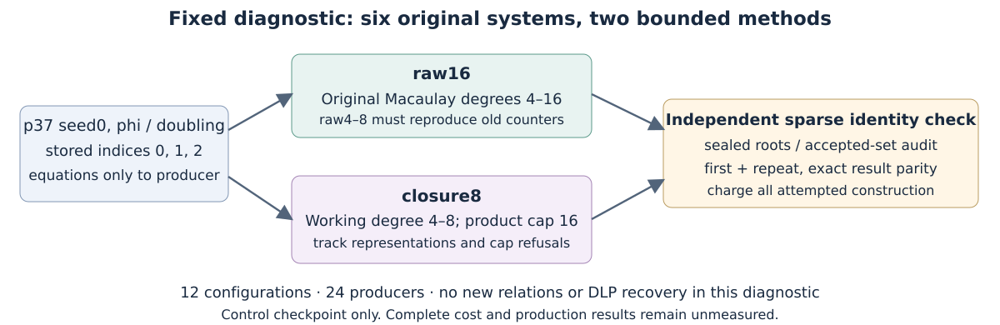

# Native control checkpoint, 25 October 2026

**Observed:** native gate v2 passes five Rust tests, zero failures, the
release build and source checks. This is an implementation checkpoint;
none of the twelve registered comparison configurations has executed at
the time this report was written. Input preparation and guarded-launch
controls have their separate receipts.

## Question, boundary and fixed workload

The previous raw-degree-8 certificate search missed certificates on the
first matched phi/doubling case. The new diagnostic compares a larger raw
bound with degree-fall closure on exactly six original systems: p37 seed0,
phi and doubling, indices 0,1,2. Each receives both modes and one A/A repeat.
All 12 configurations, 24 producers, 12 audits and 12 parities remain
required. This smaller diagnostic supplements the unchanged full panels.

The exact curve, subgroup, field representation, base and point data are
the existing [public input](../runs/panel-v2/inputs/p37-seed0.json), SHA-256
`5a55715c3d8f532634722ff6f58562e8f7e9f7d339f529cda724677da0f9b393`,
and its existing catalog references. No curve, target or factor-base point
is generated here. The public synthetic known-answer fixture is reused;
system indices and presentation arms are not independent secrets.

## Actual controls and commands

Gate: `../runs/degree-closure-probe-native-gate-v2/`.
Command: `python3 tools/isolated_bench.py busy -- bash
research/twist_index_calculus_20261020/zero_fiber_collector/degree_closure_probe/build-native.sh
research/twist_index_calculus_20261020/zero_fiber_collector/runs/degree-closure-probe-native-gate-v2
/home/ec2-user/scratch/twist-degree-closure-probe-target-v1`.
Python supplies the existing reservation only. Every mathematical operation,
test, certificate, audit and result reducer is Rust.

| Control | Observed outcome |
|---|---|
| Degree-fall example: working degree 2, original product degree 3 | Pass; certificate independently expanded |
| Nonradical system requiring a square; altered multiplier | Power 2 found; altered identity rejected |
| Common root with nonzero repeated-factor polynomial | Neither bounded method returns a certificate |
| Product-degree limit smaller than a proposed identity | Sparse verifier rejects |
| Raw cap 4 with actual original-product degree 1 | Reported separately; identity independently expanded |
| Native format, tests, release build, final source seals | Exit 0; 5 passed, 0 failed |

Executable SHA-256:
`d6e4f2f6d562f0a67bd5735123d63a6d744c9e685939f4c73d9c427ad0c7a92b`.
The build receipt records parent commit `6b16155b7ae747d2f00f74857b3d5b032f5a58d3`
and the then-uncommitted diagnostic source snapshot and hashes. Production
must use a later committed source/input freeze. No control result is
presented as a relation-yield or performance improvement.

Before production, source review caught that the raw certificate's search
cap had been labelled as its actual product degree in the audit summary.
V2 computes the actual degree from the retained multipliers, checks it
independently and emits it separately from the cap. The new fifth test
exercises a cap of 4 with actual degree 1. Original audit/reference/public
bindings are also checked explicitly. No comparison case ran with v1.
The v1 four-test build and inspected report remain in their versioned raw
gate/layout directories. Only its own queued orchestration control was
quiesced before admission; it is not reported as passing. V2's distinct
launch-control receipts must pass before production. The two original
science services were neither stopped nor edited.

## Construction, verification and accounting

`raw16` preserves the raw algorithm through degree 8 and extends it through
16. `closure8` performs row reductions at working degrees 4..8 and multiplies
new lower-degree basis rows by variables, refusing a representation when
its original-product degree would exceed 16. Refusals are counted. This
bounded, representation-dependent closure need not decide ideal membership.

Both search powers 1,2,3 in order and charge all preceding degrees and
target construction. The producer counts modular multiplications,
additions and inversion calls; inversion exponentiation products are
already in multiplication counts. Sparse certificate expansion is charged
separately. The audit recomputes coefficient identities with sparse maps,
checks source/input bindings, all retained roots for certified systems,
the absence of accepted physical relations there, degree prefixes,
counter telescoping and exact raw4..8 replay. A/A compares every result
field except diagnostic elapsed time. Neither a negative search nor A/A
alone proves mathematical completeness.

The existing conditional Lean rejection lemma and cubic IDC
`IDC1h10810f17e0f6c8f6` are reused with their stated scope. They do not
formalize this parser, finite-field implementation, polynomial
representation or group/decoder bridge. The independent native identity
check remains necessary.

## Resources, limits and requirement status

Host: Linux x86-64, Intel Xeon 6975P-C, 32 logical CPUs; Rust
1.99.1 (`58cf8f9c3`, 2026-10-13). Build uses one worker and a separate Cargo
target. Production uses one worker, common busy reservation, 8 GiB address
space, a 1,200-second watchdog and a 1,180-second cooperative producer
deadline, starting after the queue wait. No admitted isolation/timing is
claimed on this shared migrated host. RSS is retained but unpriced.

| Original requirement | Current status |
|---|---|
| Historical 189 cases plus 21 controls | Complete; retained, not repeated |
| Mixed-component unique relations and relation rank | Full recovery panel running under its original owner |
| All 42 certificate arms with doubling control | Full panel running under its original owner |
| Twelve fixed degree/closure configurations | Implemented and unit checked; production pending |
| Complete cost, calibrated primitive band, strongest IC/rho and external references | Open; this diagnostic emits null complete cost |
| General proof, scale or breakthrough | Not established |

No fastest-tool comparison has been run for this new diagnostic. It makes
no fastest-tool, full-pipeline or asymptotic claim. The atlas binary-descent
closure lead motivates a distinction to test; its numerical bounds do not
apply here. This is a partial match, not a novelty or saturation assertion.

Canonical graph coverage checked: the study flow and control diagram are
new. `docs/ic-leaderboard.html`, `docs/ic/leaderboard.json`,
`docs/ic/LEADERBOARD.md`, `docs/index-calculus-scoreboard.html` and
`benchmarks/README.md` receive no new row because the validation, full price
and matched rho gates are not met. The control PDF/figure copy is unlisted.
