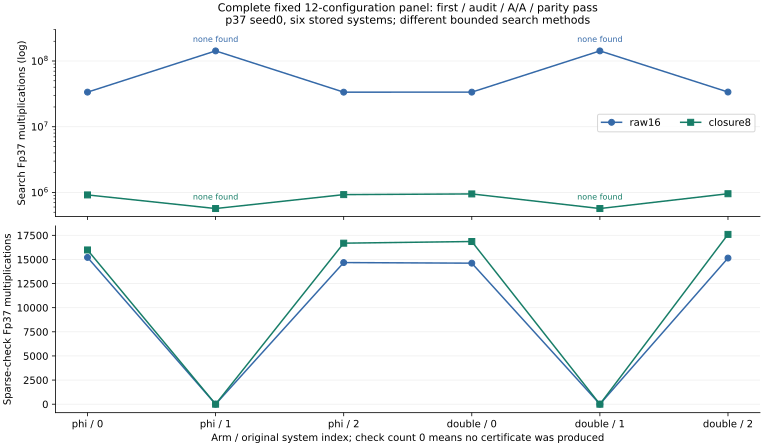

# Complete fixed raw-degree and degree-closure comparison

The original registered diagnostic is **complete**, terminal exit 0 at
**2026-10-25T07:20:28Z**: twelve configurations, 24 first/A/A producers,
twelve first audits, twelve parities, final source/input/execution seals
and the native reducer all pass. The producer receives equation-only
inputs; reference roots, physical outcomes and old costs are auditor-only.
Source/input freeze `c30a3dc6068b9907681e46634df14c52a8a40f1e` precedes
the 04:08:23 UTC managed launch. No collector, oracle or target solve was
repeated. All three fixed systems from each arm are retained.

## Every registered configuration

All rows below are `verified-first-aa` in the native final summary.
Multiplications are recorded Fp37 arithmetic, with inversion
exponentiation products included. Sparse-check inversions are zero.

| Arm / original index | Method | Power found | Last working degree | Actual original-product degree | Search multiplications | Sparse-check multiplications |
|---|---|---:|---:|---:|---:|---:|
| phi / 0 | raw16 | 2 | 12 | 12 | 33,609,631 | 15,211 |
| phi / 0 | closure8 | 2 | 7 | 12 | 916,980 | 15,983 |
| phi / 1 | raw16 | none | 16 | — | 142,494,025 | 0 |
| phi / 1 | closure8 | none | 8 | — | 569,173 | 0 |
| phi / 2 | raw16 | 1 | 12 | 12 | 33,569,618 | 14,675 |
| phi / 2 | closure8 | 1 | 7 | 12 | 926,804 | 16,686 |
| doubling / 0 | raw16 | 1 | 12 | 12 | 33,603,044 | 14,614 |
| doubling / 0 | closure8 | 1 | 7 | 12 | 949,579 | 16,857 |
| doubling / 1 | raw16 | none | 16 | — | 142,494,025 | 0 |
| doubling / 1 | closure8 | none | 8 | — | 569,173 | 0 |
| doubling / 2 | raw16 | 1 | 12 | 12 | 33,716,337 | 15,142 |
| doubling / 2 | closure8 | 1 | 7 | 12 | 956,093 | 17,595 |

The immutable native table retains additions, inversion calls, candidate,
input, reference, audit and parity hashes for every row. The six raw16
executions exactly reproduce their prior raw degrees 4..8, including
polynomial ranks and arithmetic counters. That prefix requirement applies
to raw16; the closure rows' false prefix flag is inapplicability, not a
failed gate.

## What is established

Systems 0 and 2 produce independently coefficient-checked certificates in
both maps and both methods. Closure finds them at working degree 7,
but their actual original-product degree remains 12. Its lower working
degree must not be reported as an original degree-7 certificate. Sparse
verification is slightly more costly for the closure certificates; all
that work remains in the table rather than being omitted.

System 1 in both arms returns no certificate for powers 1,2,3 within the
registered bounds. Raw16 explores the original Macaulay bound through 16.
Closure8 has working cap 8 and original-product cap 16, and can refuse
products beyond that cap. They are different bounded search procedures;
closure's lack of a certificate does not exclude every representation
with original-product degree 16. No bounded failure proves nonmembership
at every degree or power. A common-root/q-nonzero witness and a separate
higher-power control are possible discriminators, not results of this run.

The construction-count reduction occurs for generic doubling as well as
phi. This diagnostic does not isolate a twist-specific construction
advantage. The original-index controls are fixed separately in each arm;
raw16 and closure8 consume identical equations within each such pair,
whereas the phi and doubling images produce different residual systems.

This is one p37 seed0 fixture. Its six systems are not independent secret
samples and are not the seven-prime recovery panel. The prior raw8 result
is retained and is correctly limited to its smaller bound. The atlas match
already distinguishes Macaulay degree from degree-fall closure; no novelty,
global saturation or asymptotic conclusion is asserted.

## Relation yield, rank and complete cost

No new relation is collected and no matrix or DLP is solved here. A
successful q-power certificate supports rejection of a system in the
existing distinct-factor family under the documented generic theorem;
it is not a new independent relation or a rank increment. Native checks
cover the retained roots of the successful instances. The generic
conditional rejection proof is checked separately; the concrete phi-0
integer-lift proof has two retained memory failures and a distinct v3
attempt, whose outcome is not inferred from this diagnostic.

The original F4 reference for phi system 0 has 125,327 row-reduction
multiplications for finding all roots. Even closure's 916,980 search
products exceed this partial count. These are different tasks and neither
count prices an actual fallback/filter, root extraction or the complete
pipeline. A claim that certificate search speeds relation collection
therefore remains unestablished.

All complete-cost fields are null. Polynomial construction, matrix
bookkeeping, native hashing/trees/allocator, memory, I/O, calibration,
strongest matched IC/rho and external construction controls remain open.
The migrated shared host supplies diagnostic clocks only. No admitted
timing, fastest-tool, end-to-end gain or rho comparison follows from the
counted subroutines.

The separate [complete finite-residual audit](../fp_residual_audit/REPORT.md)
checks all 42 original arms in two processes. Its 300 phi/150 doubling
eligible systems preserve exact physical sets and ranks, but no filter is
deployed. That census is not combined with this diagnostic to invent a
measured full-pipeline result. Its multiset and q-witness follow-ups remain
separate, prospective work.

## Controls, execution and retained failures

- Native v2 gate: five tests pass, including the prelaunch correction of
  search-cap versus actual original-product degree. Native v1 and its
  four-test source are retained.
- The two launcher controls refuse nested outer reservations (64) and
  an existing phase command (65), without producing a science candidate.
  The old queued v1 orchestration control was quiesced before admission.
- One worker and the common reservation, 8 GiB, 1,200-second outer and
  1,180-second cooperative producer limits per phase. Queue wait is
  separately recorded. No failed execution is silently retried.
- The complete first/A/A table and all sparse audit/parity checks pass.
  Original input, source and frozen-execution seals pass at completion.
- The original overflowing layout, corrected inspected layout, source
  snapshots and partial historical progress snapshot remain unchanged.

## Requirements and reproduction

| Requirement | Status |
|---|---|
| Fixed twelve-configuration degree/closure comparison | Complete, all first/audit/A/A/parity and terminal seals pass |
| Certificate sufficiency in successful finite instances | Independent sparse expansion and retained-root checks pass |
| No certificate at arbitrary degree/power for failures | Not established |
| New unique relation yield, matrix rank or target recovery | Not measured by this diagnostic |
| Actual full-cost benefit attributable to the twist | Not established; all complete-price fields null |
| Original 189+21 comparison | Complete and not repeated; no consistent twist-specific full cold gain |
| Full 85-configuration recovery and 42-arm certificate panels | Their managed owners remain active under original workloads |

Use [PROTOCOL.md](PROTOCOL.md), [FREEZE.json](FREEZE.json), the native
sources, `run-panel.sh`, `run-phase.sh` and `workload-v1.json/tsv`.
Workload SHA-256:
`254581dfebfcb992e8ce0c6b7896cbd7cb402259b0a5b72e34fd8c711cc0c88a`.
Frozen runner SHA-256:
`d6e4f2f6d562f0a67bd5735123d63a6d744c9e685939f4c73d9c427ad0c7a92b`.
The native final summary and compact terminal/phase receipts remain loose
under `../results/degree-closure-probe-v1/final/`. The versioned archive
retains the full raw study, including failed controls/layouts, without
repacking any prior zero-fiber archive. Extract under the parent collector
as described in README.md. The prior complete reference corpus remains
a prerequisite.

The editable plot source only lays out literal native values. Every actual
PDF page is inspected before publication, with exact unlisted benchmark
copies. The prelaunch control graph/PDF are retained as historical artifacts.
Canonical IC/rho figures, leaderboard and benchmark index are unchanged
because complete-price, reference and VALIDATION gates remain unmet.
