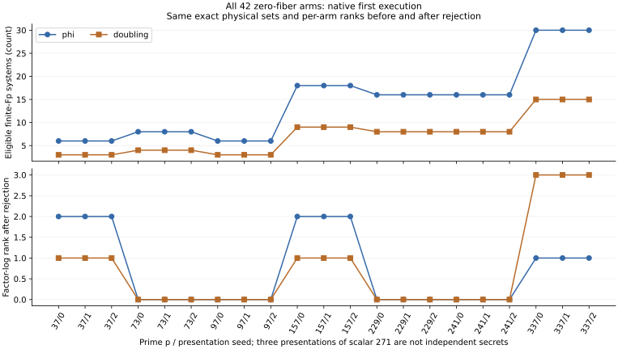
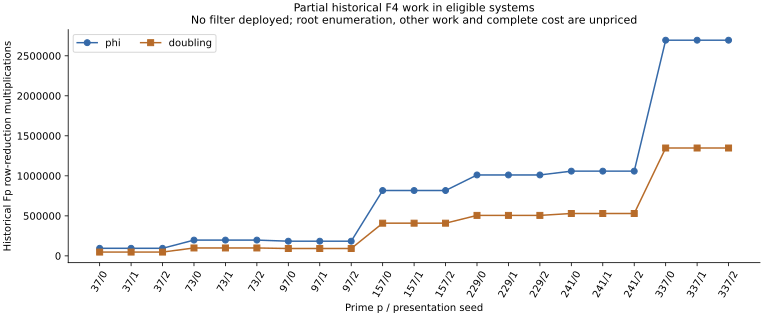

# Finite residual pruning in the complete mixed-base zero fiber

2026-10-25. Native first and separate A/A executions pass all 42 frozen
case-arms each. Complete output-tree parity, final source/execution seals
and the managed terminal receipt all pass, exit zero. No filter is deployed.

## Observed census

Seven primes p=37,73,97,157,229,241,337; three presentations per prime;
phi and generic doubling. The three presentations have public scalar 271
and are not independent secret samples. The protocol was frozen in
`be9af2af161025a4cd1b7ccfda9339e0a15f07a7` before production.

| Native first, case-local totals | Phi | Doubling |
|---|---:|---:|
| Canonical S4 systems inspected | 33,696 | 33,696 |
| Eligible finite prime-field residuals | 300 | 150 |
| Retained non-prime-field residuals | 33,396 | 33,546 |
| Infinity residuals | 0 | 0 |
| Saved algebraic roots in eligible systems | 65,532 | 32,766 |
| Accepted representatives in eligible systems | 0 | 0 |
| Unique signed physical tuples before / after | 504 / 504 | 504 / 504 |
| Recorded total F4 row multiplications | 4,112,120,748 | 4,110,616,998 |
| Recorded F4 row multiplications in eligible systems | 18,166,512 | 9,083,256 |

The eligible-system count is twice as large for phi in this census. This
is a count of a counterfactual skip opportunity, not a twofold speedup.
The roots counted here are distinct saved elementary-symmetric triples,
not accepted physical relations. Every eligible root satisfies all four
recorded equations, all four explicit component conditions, zero defect,
and has fewer than three distinct prime-field cubic roots. No root or
accepted-relation counterexample was found in the first complete execution.

Each arm's exact physical set, projective augmented rows, zero-row count,
independent RREF rank and any full-rank factor-log solution is preserved.
This does not say phi and doubling have identical ranks. The original
case-local ranks remain p37 **2/2 versus 1/2**, p157 **2/8 versus 1/8**,
p337 **1/14 versus 3/14**; other tested primes rank zero. The complete
phase-1 report records 15 case-local projective rows per arm and no zero
rows; this audit independently reproduces each case's actual row vectors.
Transported copies do not increase folded rank.

## Predicate, proof and boundary

Reject only a **finite** residual with x in Fp, expressed in the actual
four-coordinate field basis. Retain infinity. The current physical family
requires three distinct remaining ordinary abscissae, a fourth distinct
peeled ordinary abscissa and one disjoint image. Repeated factors or signed
multisets are a different relation family; this predicate must not be
silently transferred to a multiset collector.

The existing component theorem uses the quartic model y²=x³+B with B of
degree four over Fp and odd characteristic. Coefficient independence
forces C0=C1=C2=C3=0 for an S4 equation with all four abscissae in Fp.
For the quartic elementary coordinates a,b,c,d, set

    S = 64*d - (4*b-a^2)^2,
    Q(T) = 8*T^2 - 4*a*T + 4*b-a^2.

The previously checked identity `64*S^3 = sum(A_i*C_i)` forces S=0.
The checked square bridge `512*f(T)-8*Q(T)^2=C3*T+8*S` then forces
every quartic root to be a root of a quadratic with nonzero leading
coefficient. Three distinct ordinary roots are impossible, even if the
fourth residual abscissa repeats one of them. For S4 necessity with that
possible repetition, pair the four signed points into different-abscissa
pairs; their finite opposite sums supply the common S3-resultant root.
Infinity has a separate CM-triangle branch and is retained.

This reuses the existing exact certificate, independent IDC
`IDC1h65c11f01d0b1e67a` and ten-theorem Lean 4.34.1 gate. The proof map is
`SquareIdeal.component_square_certificate`,
`coefficients_force_defect_zero`,
`components_exclude_three_distinct_roots` and the seven unchanged
`SquareRootBridge` declarations. No new universal Lean theorem is asserted
by this finite audit. Full field-embedding and curve/group bridges remain
unformalized; the new native audit checks the actual finite instances.
See the [prior proof report](../../joint_image_elimination/reports/run-20261024T0445Z-square/REPORT.md).
Primary necessity references there are
[Gorla–Massierer, Definition 2.4 and Theorem 2.5](https://arxiv.org/html/1405.1059)
and [Semaev](https://eprint.iacr.org/2004/031).

## Independent native checks

The fresh Rust implementation recomputes the quartic field and every
signed pair residual from public points. It checks actual equality with
the saved residual and the concrete independence of 1,B,B²,B³. The 24
actions are built with scalar multiplication from public eigenvalues;
original orbit columns, point signs and image coefficients are rebuilt.
Every physical five-point relation is checked as an actual zero sum.
Kept representatives are transported, exact sets compared, augmented rows
normalized and RREF solved independently. Full-rank solutions are point
checked. The previous producer, equation deriver and RREF are not called.

The frozen catalog binds all 42 complete records, original public inputs
and passing previous audits by SHA-256. Missing records, hash/schema
failures or inconsistent rows refuse execution. Any lost accepted tuple
or component/root violation is retained with a witness and nonzero exit.
The existing record's complete field-root enumeration is reused; the new
program is not a fresh exhaustive root solver or independent human review.

Eight synthetic controls pass with zero failures: finite/infinite branch,
quartic field/inverses, group cancellation/sign orientation, cubic roots,
component evaluation, projective rank and inconsistent-row refusal. The
separate release build, formatting and source seals pass. Binary SHA-256:
`d0f56b52bddfe3ef9a0731c4fdaeb65daa9e9d311e71a60e851406840005137f`.
One managed owner, `twist-zero-fp-residual-audit-v1.service`, was accepted
at 06:31:41 UTC, PID 3809049; first science admission was 06:36:05 UTC.
First and A/A retain one 1,200-second/8 GiB phase each, with a shared
reservation and one science worker. No elapsed timing is admitted.

## What cost is known, and what to execute next

The row-work values come from old completed records. They exclude other
F4 work, polynomial construction, root extraction, hash/tree/allocator
CPU, memory and I/O, the proposed predicate and the full cold pipeline.
Counting many rejected roots does not price their enumeration. There is no
deployed filter or measured complete-cost gain in this round.

The next executable comparison is a separate public-only collector fork
which evaluates this predicate before F4/root enumeration, preserves
infinity and charges every predicate check. It must retain all 42 exact
physical sets and independent ranks, apply the identical rule to doubling,
retain losses/failures and compare complete cold collection and target
recovery against their actual controls. A rejected system may claim
physical completeness under the theorem; it must not falsely report that
all of its algebraic roots were enumerated or that none exist. Matched
strongest IC/rho, calibrated complete pricing and external solver controls
remain required before a general gain or fastest claim.

## Original request and reconciliation

| Requirement | Status |
|---|---|
| Original 189 cases plus 21 doubling controls | Complete; not repeated; no consistent twist-specific full cold advantage |
| Unique relations and factor-log rank for this 42-arm residual audit | Both full native processes, complete-tree parity and terminal seals pass |
| Actual public-only filtered collector | Not implemented in this round |
| Complete end-to-end cost attributable to the twist | Unresolved; partial historical counts only |
| Existing 85-configuration target, 42-arm certificate and 12-configuration degree/closure panels | Original managed owners and budgets preserved |
| Concrete q² instance proof | Two bounded Lean memory failures, retained in the separate instance report |

The approved migration receipt remains unchanged. Read-only EKS
reconciliation at 06:35 UTC finds 28 terminal jobs (18 complete, 10 failed,
zero nonterminal); no submission, role/profile or cluster change was made.
Diem remains expired at 50/52 under its original deadline. The saved
10,822-byte legacy waiter still requires generation_complete, exactly 52
records and no live generator; T-8 is cancelled and the waiter stays
quiesced. T-91 remains failed at attempt 4/4; no lease or executor reset.
No credentials or originating chat content enter these scientific records.

Raw source: `../runs/fp-residual-audit-v1/{first,aa}/` and gate v1.
Per-case records retain every classification/root witness and both exact
physical sets; the native summary retains all expected positions. The
[protocol](PROTOCOL.md), [source](native/src/main.rs), drivers and managed
[launch](RUNNING.md) give the reproduction path and original limits.
All full-price and validation gates remain open. Canonical IC/rho plots,
leaderboard and benchmark index receive no new row; report copies are
unlisted. The new local figures are descriptive. No novelty, asymptotic,
breakthrough, deployed-curve or full-group-formalization claim is made.
