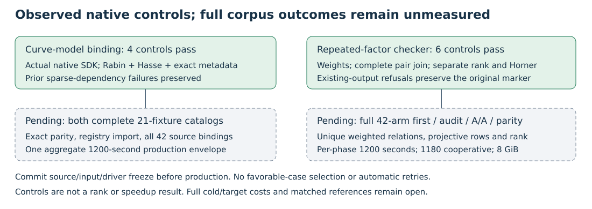

# Native controls before the expanded relation experiment

The new full-corpus experiments have not run at this checkpoint. The
original 189+21, distinct-factor 42-arm, finite-residual 42-arm and fixed
degree/closure studies remain complete and are not repeated. Both larger
original recovery/certificate owners retain their frozen workloads.

## Observed build and control outcomes

| Independent component gate | Actual outcome | Scope |
|---|---|---|
| Native curve-model binding, gate v3 | 4 tests pass, terminal 0; format/build/source seals pass | Rabin degree-four field check, unique Hasse multiple, canonical metadata and generator/field identity changes |
| Repeated-factor relation checker, gate v1 | 6 tests pass, terminal 0; format/build/source seals pass | Signed multiplicities/cancellation, weighted columns, two rank methods, repeated cubic factors, complete pair join versus four-slot direct enumeration, q/Horner evaluations |
| Existing-output controls | Deliberate native refusal 101, driver refusal 1; marker preserved; no candidate or run metadata | The new decoder and driver refuse an existing output directory |

These are different suites, not comparable performance samples. The
diagram records their verification roles rather than plotting a ratio of
test counts. An unused `case` argument produces one retained compiler
warning; it is not a failed gate or a mathematical result.

The first two binding build attempts terminate 101 before compilation:
tracked local dependencies are off disk in the sparse checkout. The exact
volcano-cli and isogeny_algos sources and five root-library metadata inputs
are materialized, without changing their bytes. The third attempt builds
against the actual repository identity SDK and passes. No missing SDK
capability, mathematical obstruction or successful catalog is inferred
from the dependency failures. Their commands, source hashes and errors
remain retained.

The binding SDK binary SHA-256 is
`b9b2261acde8e5cfae6ad4154c5450e3178ca98ecaadc9d688ef9e8c1ba72425`.
The repeated-factor runner SHA-256 is
`89b64fa3943e75ef9cf88019de088c04a312c00b896129944700e28541422fab`.
Each gate uses one build worker, the common reservation, 8 GiB address-space
and a 1,200-second aggregate build/test envelope after queue admission.
Build and shared-host clocks are diagnostic only; no measured speedup or
complete cryptanalytic price is produced.

## Full experiment retained as an obligation

The [relation protocol](PROTOCOL.md) fixes all 42 original phi/doubling
case-arms. Decode every saved root with repeated ordinary factors and
signed cancellation; independently enumerate the complete four-ordinary-
slot/one-image public-point family; compare exact weighted sets, zero and
projective rows, two rank methods and any full-rank point solutions. The
old five-distinct subset must remain exactly equal to the old complete set.
Run all first/audit/A/A/parity phases and preserve failed/missing cases in
the native summary. No numerical corpus outcome is prewritten.

Relations seen at finite prime-field residuals can also occur elsewhere.
Record that set, the non-Fp-seen set, their overlap and the exact difference
that would be lost under pruning. The old distinct-family pruning rule is
not silently extended to repetitions. Evaluate all proposed q witnesses,
including unsuccessful ones, and recheck them by independent Horner
evaluation. A bounded failure still does not prove nonmembership.

The [binding protocol](../curve_registry_binding/PROTOCOL.md) fixes the
21 original public fixtures and uses the actual native extension-ID SDK.
It checks the full curve order via a unique Hasse multiple of a checked
prime-order generator rather than assuming the subgroup order. Both
complete catalog processes share one 1,200-second production envelope.
Registry import, all 42 source-to-fixture bindings and exact EC1/UID
metadata parity remain required before citing new slugs in current prose.
Frozen packet IDs and historical reports remain unchanged.

The source/input/driver freeze must be committed before either real corpus
execution. Full target-pipeline costs, strongest matched IC/rho/external
references and formal field/group/parser bridges stay open. The new checks
do not establish a public polynomial collector, a rank gain, an end-to-end
gain or a breakthrough.

## Evidence and reproduction

- Native sources and gate commands: `native/`, `run-native-gate.sh` and
  `../curve_registry_binding/native/` / `run-native-gate.sh`.
- Raw gates: `../runs/multiset-native-gate-v1/` and
  `../runs/curve-registry-native-gate-v{1,2,3}/`. Versioned control archive
  retains metadata/binaries and excludes disposable Cargo build caches.
- Output-refusal controls: `../runs/multiset-driver-controls-v1/`.
- Compact receipts: `../results/multiset-root-audit-v1/` and
  `../results/curve-registry-binding-v1/`.
- Exact original catalog: `../collision_certificate/workload-v1.json`,
  SHA-256 `17ecb4c302526bc58e592466071e1c2704eaaf43a0a0ca1efe563e1bd69b3c10`.
- Lead-atlas matches are retained under `retrieval/`. No complete novelty
  audit is claimed; the separate KB tool is unavailable in this runtime.

The report diagram/PDF describes controls and planned execution, with
every actual PDF page inspected. Canonical price/IC/rho figures, benchmark
index and leaderboard stay unchanged: there is no new admitted performance
result or completed full-price validation to promote.
