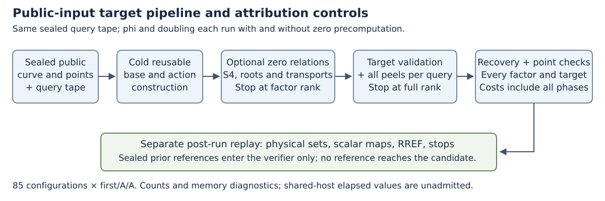

# Phase 2: native build and recovery controls

2026-10-24. This report covers the retained compilation attempts and the
completed first native gate. The 85-configuration comparison is a separate
round and has not started at this report checkpoint.

## Executed evidence

| Round | Observed result | Raw evidence under `../runs/` |
| --- | --- | --- |
| Native compile check v1 | Exit 101; `json!` expression syntax | `phase2-check-v1` |
| Native compile check v2 | Exit 101; ambiguous integer conversion | `phase2-check-v2` |
| Native compile check v3 | Exit 0 | `phase2-check-v3` |
| Bootstrap runner build | Exit 0 | `phase2-bootstrap-build-v1` |
| Baseline selection and fixture projection | Both exit 0 | `phase2-preregistration-v1` |
| Native gate v1 | 89 tests pass, no failures; compile/tests/runner exits 0; source seals stable | `phase2-native-gate-v1` |

The failed v1 source-copy verification and its exact reconstruction remain
separate. The successful v2 source snapshot, all failed compile logs and
bootstrap source seals are retained. No failure is reclassified as a solve,
and no old full census or 189-case panel is repeated.

## Actual positive controls

The p37 seed0 test executes all four zero/plain phi/doubling pipelines,
recovers the known-answer scalar 271, and checks every usable factor point
and the target by multiplication. Each first record passes a separate
physical-set and RREF replay against immutable prior complete sets. Two
additional zero-phi executions have exact deterministic A/A equality;
their distinct clock and memory telemetry remains recorded.

The zero-phi replay checks 81 zero systems, obtains factor rank 2/2, then
checks one target query with 72 finite systems and final rank 3/3. These
counts describe this retained positive control. They do not establish an
advantage over the corresponding plain pipeline or over all 21 cases.

Gate source: `f93e0cff07`. Runner SHA-256:
`daeb82aec36b876927d98bd48051fc4bf9b28d64c3e5a18b6c5f8e02c04dad37`.
Per-file compiled-source seals are the authoritative source binding.

## Validator correction and next gate

Post-gate review finds that directly deserializing an array into a set can
silently collapse duplicate physical tuples. The auditor now rejects that
input and explicitly corrupts a nonempty target tuple list to test rejection.
The first gate's successful records are preserved without changes. A fresh
v2 native gate is queued for the tightened verifier. Its terminal result
must be checked before launching the panel.

## Remaining requirements

The independent baseline selector is frozen from exact integer medians in
the existing admitted parent family; 20 best-parent roles reuse a registered
plain control and one adds `union-l2`. The proposed panel retains 85 distinct
configurations and 255 executions. Full unique yield, rank and end-to-end
comparisons for this new pipeline are not yet measured. The shared host
does not admit elapsed-time claims; scoped counters are not complete GAE
prices. Strongest IC/rho references, formal bridges and scaling remain open.

## Follow-up gate and fixed workload, 2026-10-25

The tightened verifier passes the fresh `phase2-native-gate-v2`: 89 tests,
zero failures, all three phases exit zero and compiled-source seals match.
The standalone Rust workload/reducer builds successfully. Its native
preparation verifies all original public/reference bindings and freezes
85 configurations and 255 candidate executions in commit `af66996a19`,
before the full panel starts. Earlier p37 positive controls are separate
from registered full-panel executions in that freeze.

The native metadata tool reads the retained p37 seed0 gate records without
repeating the solves:

| Configuration | Zero factor rank | Zero F4 systems | Target F4 systems | Total F4 systems | Target queries | Final rank |
| --- | --- | --- | --- | --- | --- | --- |
| Plain phi | 0/2 | 0 | 72 | 72 | 1 | 3/3 |
| Plain doubling | 0/2 | 0 | 72 | 72 | 1 | 3/3 |
| Zero plus phi | 2/2 | 81 | 72 | 153 | 1 | 3/3 |
| Zero plus doubling | 1/2 | 216 | 72 | 288 | 1 | 3/3 |

Every configuration recovers 271 and verifies all factor and target points.
Phi needs fewer zero systems than doubling on this instance. Neither
precomputation reduces its online query count or target F4 systems; each
adds work relative to its matched plain control. These are finite system
counts from a positive control, not an admitted elapsed or complete GAE
comparison. The full panel retains every original case and loss.

`phase2-driver-controls-v2` verifies both protections: nested outer busy
exits 64 before output creation; a pre-existing first-phase command exits
65 without changing its marker or starting a candidate. All exact executed
sources remain. The managed `twist-zero-pipeline-panel-v1.service` now owns
the full panel. Its terminal results and new archive are separate from
this build/control report.

The first PDF inspection finds narrow diagram text extending past boxes.
Its PDF, diagram and sources remain in `phase2-controls-layout-v1`; v2 fixes
the boxes and passes visual inspection. The final follow-up report adds
this control table and a 150 dpi PNG from the same vector source. Layout
changes do not alter any native record or statistic.
