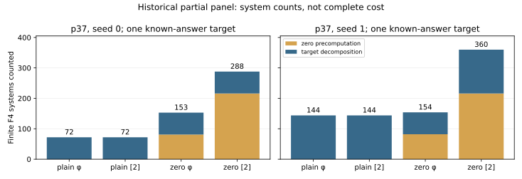

# Twist index calculus: checked accounting

The native accounting tool re-read the already committed 29-exit snapshot. Nine configurations in that historical snapshot have first-run audit and two deterministic A/A checks. The comparison below uses the two complete four-arm groups at p37, seeds 0 and 1. The remaining p37 seed-2 zero-phi configuration is retained in the JSON, without inventing its missing controls. Later panel completions are excluded from this historical analysis.

At seed 1, zero-phi reaches full factor rank before the target and uses one target query where plain phi uses two. Its recorded zero plus target F4 system count is 154 versus 144 for plain phi. At seed 0, all four arms already recover after one target query. This separates an observed online rank effect from the preprocessing charge. Neither observation determines complete end-to-end cost.

## Seed 1

| Arm | Zero F4 | Target F4 | Total F4 | Queries | Zero rank | Final rank |
|---|---:|---:|---:|---:|---:|---:|
| plain φ | 0 | 144 | 144 | 2 | 0 | 3/3 |
| plain [2] | 0 | 144 | 144 | 2 | 0 | 3/3 |
| zero φ | 82 | 72 | 154 | 1 | 2 | 3/3 |
| zero [2] | 216 | 144 | 360 | 2 | 1 | 3/3 |

## Yield and counted arithmetic, seed 1

| Arm | Zero signed | Target signed | Projective rows | F4 row muls | Online Fp muls | Cold Fp muls |
|---|---:|---:|---:|---:|---:|---:|
| plain φ | 0 | 4 | 4 | 17,026,817 | 2,776,060 | 4,954,250 |
| plain [2] | 0 | 3 | 3 | 16,687,744 | 2,727,297 | 4,055,275 |
| zero φ | 48 | 2 | 4 | 17,510,778 | 2,187,743 | 12,224,047 |
| zero [2] | 24 | 3 | 4 | 41,068,849 | 2,727,297 | 11,507,181 |

All complete end-to-end prices and admitted speedup fields remain null. Full panel, final seals, complete primitive prices and strongest matched IC/rho remain open. Raw clocks are diagnostic only.

Three native tests and the actual partial-as-complete rejection are implementation controls; see the raw command/exit receipts. No new solve or new live snapshot was executed.

[Native accounting](../results/phase2-accounting-v1/accounting.json); [source snapshot](../results/phase2-live-progress-v1/summary.json).

Canonical IC/rho charts and benchmark index stay unchanged because the complete-price and VALIDATION gates are unresolved.

Accounting JSON SHA-256: `02ccf1fbffc42204d76eb59414067547073aa3275293b05fb7a753804eac8afa`.
