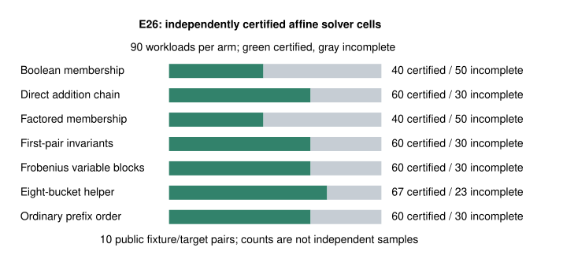
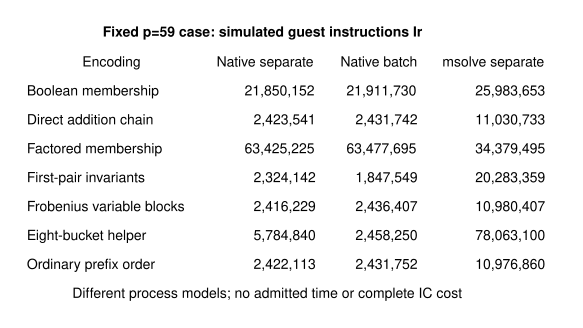

# E26: equivalent encodings and matched ordinary controls

2026-10-25; bounded public toy fixtures; Intel Xeon Platinum 8573C;
managed Linux x86_64; isolation L0. No admitted wall time.

The native construction covers all 90 preregistered workloads: ten ordinary
curves, B=8,12,16 abscissae, arities 2,3,4 and original target label 0.
All four candidates and the ordinary controls are retained. The requested
solver population is 631 cells including one A/A control. This is a partial
E26 pilot, not complete IC costing or a speedup claim.

## Verified construction and information checks

Independent PARI replay accepts 18970
retained signed-witness checks and rejects
18623 wrong-sign controls. The Rust gate
checks the script and output hashes, completion marker and clean errors.
Counts repeat point tuples across overlapping base sizes. There are
10 distinct fixture/target pairs.

All 90 matched-order checks recover the ordinary polynomial coefficients
exactly after setting anti-rational variables to zero. This is an input-level
identity check for the frozen family, not a universal statement about every
twist encoding. The invariant diagonal and identity-prefix exceptions remain
in the construction and full relation census.

The same-input A/A polynomial check passes; equal independently certified
row-multiplication counts: **true**.
Native step-log counter coverage failures: **0**.
Any failed or missing certificate remains incomplete.

## Complete and incomplete solver cells

| Arm | Requested | Certified | Incomplete | msolve certified branches |
| --- | --- | --- | --- | --- |
| Boolean membership | 90 | 40 | 50 | 40 |
| A/A control | 1 | 1 | 0 | 1 |
| Direct addition chain | 90 | 60 | 30 | 60 |
| Factored membership | 90 | 40 | 50 | 40 |
| First-pair invariants | 90 | 60 | 30 | 120 |
| Frobenius variable blocks | 90 | 60 | 30 | 60 |
| Eight-bucket helper | 90 | 67 | 23 | 536 |
| Ordinary prefix order | 90 | 60 | 30 | 60 |

Native F4 uses grevlex, degree bound 32, GM=1 and a shared 30-second budget
per candidate cell, including every helper/diagonal branch. Stock msolve q0
and Singular share a separate 30-second cell budget. The native and external
phases each have a 1,800-second global cap, with checkpoints. Global-cap
omissions remain not attempted. Every process has one worker and a 4 GiB
address-space cap. Raw failure outputs and exact inputs are retained.

Singular computes a reference basis and checks both ideal containments,
equality of leading ideals and vdim against the complete native affine
assignment census. These are complete-basis checks. vdim is the quotient
vector-space dimension, not Krull dimension. Parsed stock msolve bases have
their own independent certificate; an msolve failure does not erase a valid
native certificate. The small positive/truncated-basis control is retained.

## Fixed first workload: what the recorded counts measure

The p=59, B=8, arity-2 example was fixed before inspecting outcomes.
Counts below are multiplications in native row reduction only. A smaller
number is not a measured full-solver or IC speedup.
Incomplete counter sums are partial records, not zero-cost successes.

| Encoding | Recorded row multiplications | Basis status |
| --- | --- | --- |
| Direct addition chain | 7920 | certified |
| Ordinary prefix order | 7920 | certified |
| Frobenius variable blocks | 7920 | certified |
| Factored membership | 473345 | certified |
| Boolean membership | 447400 | certified |
| Eight-bucket helper | 458 | certified |
| First-pair invariants | 2594 | certified |

Construction, symbolic preprocessing, normalization, root extraction,
process startup, signs, deduplication, exception enumeration, transfer,
verification and complete target recovery are not priced by this counter.
All eight helper solves are included in its row-multiplication sum, while
their remaining overhead is missing. No admitted wall time is reported.
The ordinary comparison is the preregistered hindsight minimum among four
fixed controls; it is not an executable selector or an IC pipeline baseline.

## Whole-worker instruction diagnostics

Callgrind records simulated guest instructions Ir, not cycles, wall time,
field operations or GAE. The first probe starts a separate process for each
helper/diagonal branch. All 31 native and stock-msolve worker outputs match
the previously certified bases (and native row counters). The second probe
runs every native candidate through the same batch interface, one process
per candidate; all eight process outputs and every branch match. Independent
audits reopen the raw Ir records and recompute their aggregates.

| Encoding | Native separate Ir | Native batch Ir | msolve separate Ir |
| --- | --- | --- | --- |
| Boolean membership | 21850152 | 21911730 | 25983653 |
| Direct addition chain | 2423541 | 2431742 | 11030733 |
| Factored membership | 63425225 | 63477695 | 34379495 |
| First-pair invariants | 2324142 | 1847549 | 20283359 |
| Frobenius variable blocks | 2416229 | 2436407 | 10980407 |
| Eight-bucket helper | 5784840 | 2458250 | 78063100 |
| Ordinary prefix order | 2422113 | 2431752 | 10976860 |

Separate-worker A/A relative spread is 0.0015427351256755144;
batch-worker A/A relative spread is 0.00006250858464937208.
Both meet the frozen 5-percent check. These are same-input repeats, not
confidence intervals or an independent-host replication.

The helper's 458 row multiplications omit enough other work to change its
ranking: separate helper workers use 5,784,840 Ir versus the direct worker's
2,423,541. Batching the helper branches records 2,458,250 Ir versus the
matched direct batch's 2,431,742. The pair-invariant batch records 1,847,549
Ir on this fixed case; its stock-msolve separate-worker total is 20,283,359
Ir versus direct's 11,030,733. Process model and solver therefore matter.
These are observations of this prototype, not an inherent ranking or a
twist-specific advantage. No fastest-implementation claim is made.

The worker interval includes startup, input parsing, symbolic preprocessing,
F4 and output serialization. It excludes encoder construction, parent
orchestration, OS/kernel work, certification, root/sign lifting, duplicate
removal, linear algebra over relations and target recovery. The batch
follow-up was motivated by the first probe's training result; it is not heldout.
There is no batched msolve measurement. Complete-cost and calibrated IC
comparisons remain open.

## Tuple multiplicity, coefficient rows and rank

| Frozen workload | Tuple witnesses | Distinct rows | Rank mod source order |
| --- | --- | --- | --- |
| p=59, B=8, m=2 | 1 | 1 | 1 |
| p=211, B=8, m=3 | 17 | 6 | 5 |
| p=251, B=16, m=4 | 1847 | 162 | 16 |

The native auditor deduplicates signed coefficient vectors and computes rank
over the prime source subgroup order, rather than the curve coordinate field.
A separate PARI input replays all 90 ranks. Full-task ranks include exceptional
relations; they are not used as denominators for affine-solver cost. Exactly
one retained deterministic sign witness per canonical tuple is used, not every
possible sign assignment. The first-pair permutation is folded consistently.

## Scope, sources and remaining work

This wave implements and runs bounded E26 encodings. The genus-two transfer
result remains the prior-art BHLS construction with 24 verified toy targets;
no new transfer-speed result is claimed. Earlier extension/rational helper
row equalities remain valid. The 270-cell E30 pilot is a separate experiment,
and its full solver-cost comparison is still open.

E26 remains partial: broader training/heldout cases, production root
extraction, matrix nonzeros, complete counters and full costs are missing. E27 complete cold
accounting/calibration and E28 final selection are unrun; these worker probes
do not replace either requirement. Labels 32--63 remain
unopened. No novelty, fastest-tool, NIST DLP, independent-host, calibrated
IC speedup or leaderboard promotion follows. All cards remain blocked and
unfunded; no paid host or lease was created.

[Primary assessment](../../execution-v2/runs/block-panel-20261025-v2/ASSESSMENT.json),
[independent audit](../../execution-v2/block-audit-20261025-v1/AUDIT.json),
[batch instruction audit](../../execution-v2/block-audit-20261025-v2/AUDIT.json),
[separate-worker probe](../../execution-v2/runs/block-worker-cost-20261025-v1/COST.json),
[batch-worker probe](../../execution-v2/runs/block-batch-cost-20261025-v1/COST.json),
[protocol](../../execution-v2/BLOCK_PROTOCOL_V1.md),
[matched-control amendment](../../execution-v2/BLOCK_AMENDMENT_V2.md),
[audit protocol](../../execution-v2/BLOCK_AUDIT_PROTOCOL_V1.md),
[worker protocol](../../execution-v2/BLOCK_WORKER_COST_PROTOCOL_V1.md),
[batch protocol](../../execution-v2/BLOCK_BATCH_COST_PROTOCOL_V1.md),
[raw artifact manifest](../../execution-v2/block-20261025/RAW_ARTIFACTS.json),
[validation logs](../../execution-v2/block-checks-20261025/).

The new raw bundle contains 12707 archived files and
39 separately tracked metadata records. Its
9310540-byte immutable object is published in the
user-confirmed Setec bucket. Fresh download, remote verification and every
member hash pass; extraction/repacking reproduces the exact archive digest.
[Publication receipt](../../execution-v2/block-publication-20261025-setec-v1/RECEIPT.json)
and [downloaded-member check](../../execution-v2/block-publication-20261025-setec-v1/archive-members/ARCHIVE_CHECK.json).
The native index entry accompanies these records. The separate
[delivery receipt](../../execution-v2/block-checks-20261025/DELIVERY.json)
tracks the pushed head and CI without changing the scientific measurements.
The earlier archive and index entry are unchanged.

Exact source, native/tool binary hashes, fixture and input hashes, commands,
caps and raw outputs are retained with the records. UTC intervals are retained
where captured. The batch probe's launch timestamps were not captured; its
post-run receipt records that gap and the saved actual child exit explicitly.
GitHub access initially returned 403/404. A later CLI fetch and PR read succeed
and resolve the existing PR to isogeny-labs/crypto; the connector's old path
still returns 404. Delivery and its exact head are tracked separately in
[the access problem](../../../../problems/twist-github-repository-access.md).
The twelve historical oversized Git blobs remain a separate merge hold.
The IC leaderboard, progress timeline and scientific geometry figures remain
unchanged because this wave establishes no complete-cost result. Benchmark
copies are indexed as unadmitted diagnostics without adding a validated row.

## Requirement status

| Requirement | Status | Remaining acceptance gap |
| --- | --- | --- |
| Genus-two route | Partial; earlier 24 toy transfers unchanged | Full transfer and destination-solving costs; polarized graph identification |
| Extension helpers | Tested families retain matched rows | A new restriction or cheaper solver computing the same projected task |
| E26 encodings | Bounded pilot verified; full experiment partial | Broader training/heldout, root extraction, nonzeros and complete costs |
| E30 finite incidence | 270 correctness cells verified earlier | Separate full solver-cost comparison remains unrun |
| E27 complete cold cost | Unrun; worker probes are separate diagnostics | Original 24-arm instrumentation and all 1,920 attempts, calibrated matched rho |
| E28 heldout selector | Unrun; labels 32–63 unopened | Freeze selector only after complete training and E27 counters |
| Delivery | Tracked by separate commit/push receipt | Current-head CI/review; historical size hold remains |

[Next discriminating experiments](../../execution-v2/block-20261025/NEXT_EXPERIMENTS.md)
retain the original blocked cards and distinguish proposed runs from this
completed bounded wave. No subsequent job is implied to be running.
