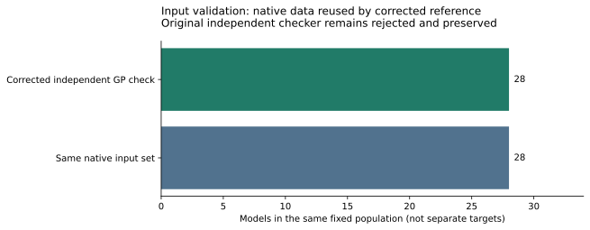

# Fixed inputs and strict reference correction

The final independent input reference verifies the same 28 models as the native producer: ten original prime-order models, twelve larger held-out models and six distinct sizing models. Whole orders, subgroup generators, nonsquare twist factors and selected CM orientations are checked. No held-out target or cost outcome selected these inputs.

The initial independent GP script used analytic `ellj` on an elliptic-curve object. It exited0 and printed its final marker despite errors. Strict admission rejected it. The source-linked successor changes exactly nine accesses to `ee.j`, reuses unchanged native data and passes a fresh independent GP process. Both executions remain.

Across the original and successor there are3 unique top-level executions and4 compute processes: native producer with resident GP, rejected standalone GP, corrected standalone GP. The native record reused in the successor export is not another execution or target population. Both metadata-corrected input exports pass full canonical protocol/file binding.

The generation recipe is fixed in [PROTOCOL.md](../../execution-v15/PROTOCOL.md). CM models use the known discriminant-67 construction; no novel family is claimed. General controls use the filed public coefficient/order rule. All56 E/T model identities are generated natively; new registry entries preserve earlier records. The final native registry check verifies103 accumulated model entries, including the new set. No cross-repository EC1 representation identity is asserted.

The original rejected certificate and its corrected lineage are in [ADMISSION.json](../../execution-v15/ADMISSION.json) and [reference-v2](../../execution-v15/reference-v2/ADMISSION.json). Source and exact hashes remain under the same evidence tree.

\newpage

Raw evidence: [manifest](../../execution-v15/.artifacts.json), [all15 member hashes and fresh repack check](../../execution-v15/RAW_VERIFICATION.json), [corrected export](../../execution-v15/reference-v2/experiment.export.v2.json).

Reproduction and raw-object manifests are linked from the evidence directory.
The user-confirmed store is `setec-astronomy-artifacts`, region us-east-2.
No NIST, asymptotic, novelty or calibrated-GAE result is established.
