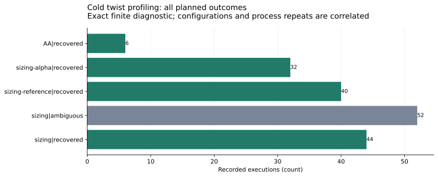
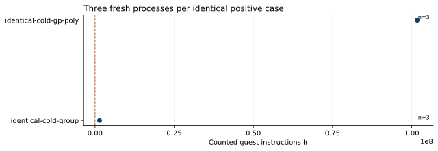

# Cold instruction instrument and resource pilot

**Status:** independently replayed finite software-count diagnostic; benchmark admission remains incomplete.

The fixed plan contains 174 profiles and 174 attempted executions. It uses six disjoint sizing curves plus the public development controls. No held-out DLP outcome selected this pilot.

| Recorded cohort and outcome | Executions |
|:--|--:|
| AA / recovered | 6 |
| sizing-alpha / recovered | 32 |
| sizing-reference / recovered | 40 |
| sizing / ambiguous | 52 |
| sizing / recovered | 44 |

All 174 raw native/backend totals pass an independent parser. Independent GP checks89 distinct mathematical payloads,41 complete signed witness sets and four generic maps. Six known-answer controls recover2. Native A/A Ir is identical; GP A/A spans101754271–101754276. These are instrument draws, not population variance.

The pilot used523 resource seconds in total. Larger GP-root cases used up to24.3 seconds; group/reference cases used at most1.3 seconds. These clocks only provisioned later limits. Unequal-query pilot arms are not ranked as a performance experiment.

The unit is single-event guest instructions Ir, including actual resident-GP instructions in each exclusive phase. Cold setup, queries, complete decomposition, signs/deduplication, matrix work and source-point verification are charged per target. Input/program loading and result/trace serialization are excluded. No clock, cycle or primitive/GAE conversion is used.

Conditional affine Lean lemmas retain their stated hypotheses. Concrete arithmetic, rank/kernel spans and map fidelity are checked externally; a fully formal concrete bridge is open. Literature and access gaps are in the frozen protocol.

\newpage

Sources: [frozen protocol](../../execution-v16/PROTOCOL.md), [native data manifest](../../execution-v16/analysis-v1/.artifacts.json), [source/byte pins](../../execution-v16/FROZEN.json). [Independent GP admission](../../execution-v16/audit-v1/ADMISSION.json).

Reproduction and raw-object manifests are linked from the evidence directory.
The user-confirmed store is `setec-astronomy-artifacts`, region us-east-2.
No NIST, asymptotic, novelty or calibrated-GAE result is established.
