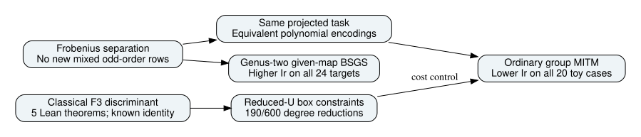

# Twist routes: continued bounded experiments, 2026-10-26

The stronger ordinary control changes the interpretation of the polynomial savings. Group meet-in-the-middle returns exactly the same signed relations and uses fewer simulated guest instructions Ir in all twenty tested configurations. Its median cost is 0.11239246188758457 times the direct F4 worker. All optimized F4 variants remain above this ordinary control. These are toy finite-decomposition results, not a NIST attack or calibrated whole-IC speedup.

The same generic BSGS after a given genus-two transfer costs 59.34139101214629–289.80547820363523 times source BSGS on twenty-four public targets. That closes this prototype comparison as a loss. Map discovery, optimized balanced base-field arithmetic and destination IC remain separate open work.

A classical F3 discriminant identity proves square lifting into the target field when target y is nonzero. Five Lean theorems and a fresh axiom auditor pass. Certificate **IDC1hfab3acdc297476e5** supplements the exact proof. The six-hundred-box independent finite audit finds 57 full-mask and 190 reduced-U maximum-degree reductions; the original 270 full-mask count remains zero. With the same supplied U, an ordinary encoding has identical reduced equations. Degree is a proxy; actual cost completions and all caps are recorded in the separate report.

## Run reports and acceptance

| Run report | Run id |
| --- | --- |
| [Broader solver-worker instruction sweep](sweep/RESULTS.md) | sweep-20261026-v1 |
| [Cold finite-decomposition worker](decomposition/RESULTS.md) | decomposition-20261026-v1 |
| [Given-map genus-two transfer cost](transfer/RESULTS.md) | transfer-cost-20261026-v1 |
| [Expanded finite boxes and classical F3 lifting](frontier/RESULTS.md) | frontier-20261026-v1 |
| [Stronger ordinary control and exact sign propagation](controls/RESULTS.md) | control-20261026-v1 |
| [Cold anchored-box solver-cost comparison](incidence-cost/RESULTS.md) | incidence-cost-20261026-v1 |
| [Opt-in exact linear-root policy](linear-roots/RESULTS.md) | linear-root-20261026-v1 |

| Finite task | Requested | Accepted |
| --- | --- | --- |
| Exact signed-row controls | 200 | 200 |
| Box cost workers | 560 | 414 |

Each report carries recorded counts, sources, commands, limits, failures, accounting interval, editable graphs and an inspected PDF. The first control aggregate audit counted a duplicated plan comparison twice; it is retained and superseded by the corrected v2 audit, without changing runs or raw instruction values. The frontier launch omitted separate timestamps/argv receipt; the limitation is recorded rather than reconstructed from file dates.

## Scope still open

The original full E26 costs include arity four and broader selection; E27 still requires original 24-arm/1,920-attempt complete accounting, calibration, relation algebra, cold recovery and matched rho. E28 final labels 32–63 remain unopened. E30 still owes all six-hundred cost cases, arity-three comparisons and stronger full-root external references. Polarized gluing identification, higher-prime quotient maps, balanced base-field Jacobian arithmetic, concrete formal group/map bridges and independent-host replay remain open. Bounded local diagnostics do not discharge those criteria; all sixteen full-campaign cards stay blocked and unfunded.

No background computation is implied after this recorded wave finishes. Exhausting a named finite grid is not exhausting possible mathematics. The opt-in linear-root follow-up also passes all 200 exact signed-row checks. Its per-method median ratios stay near one, and every polynomial arm remains more expensive than group MITM. The next discriminating implementation targets are an external full-root comparison, nonlinear root extraction without full-field scans, balanced Fp Jacobian costs and the complete IC/rho accounting interval.

## Artifact and graph review

All new raw evidence is one deterministic archive in the user-confirmed **setec-astronomy-artifacts** bucket, with fresh download and every member hash verified. See [publication/reproduction](../../execution-v3/continue-20261026/README.md). Earlier archives are unchanged by this wave. The separately incoming repository artifact-storage commit is preserved in the branch history.

Performance copies are indexed under benchmarks as **unadmitted diagnostics**. Canonical IC leaderboard/scoreboard, progress timeline and existing curve/cover graphs were checked: no new validated pipeline row, curve map or admitted record changes their data, so they remain unchanged. Existing frozen result reports remain historical evidence. No validation-gated claim is promoted.
