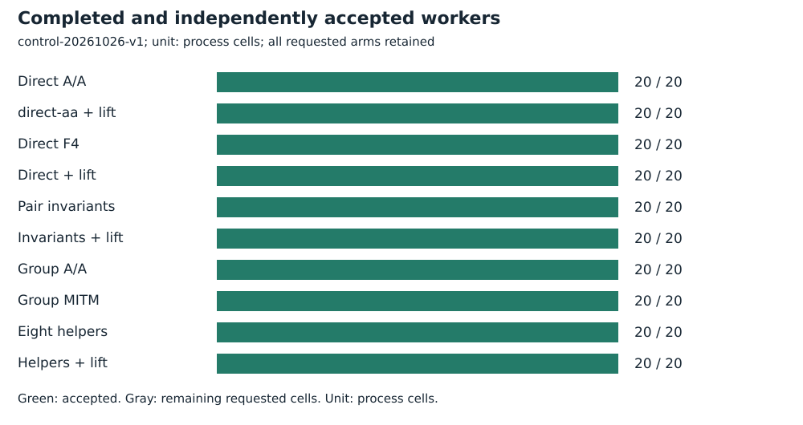
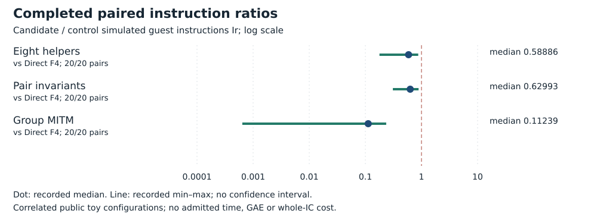
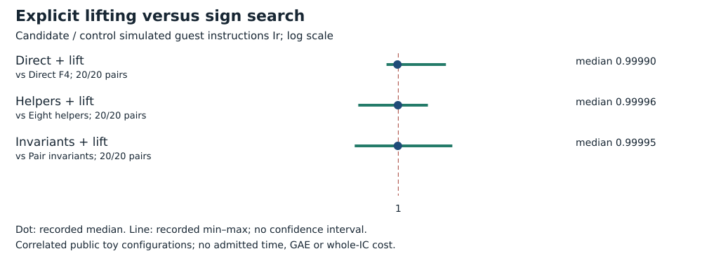

# Stronger ordinary control and exact sign propagation

Run **control-20261026-v1**, 2026-10-26. Intel Xeon Platinum 8573C, managed Linux x86_64, L0. Public synthetic/known-answer fixtures only. No admitted wall time.

## Frozen task and accounting

Same ten curves, B=8, arities 2 and 3, target label 0. Twenty configurations; ten arms each, two hundred requested processes. Three A/A pairs cover direct search, direct propagation and group MITM.

The cold worker charges actual construction, native F4/roots or ordinary point lookup/MITM, lifting, exceptions, verification, deduplication and serialization. Limits: 15,000 ms cooperative, 18-second hard timeout plus one-second grace, 4 GiB, 32 MiB/file; 3,800 seconds/1 GiB globally. No wall time or full IC.

[Protocol](../../../execution-v3/CONTROL_PROTOCOL_V1.md) · [source, command and transport receipt](../../../execution-v3/runs/control-20261026-v1.transport.json) · [independent native audit](../../../execution-v3/control-audit-20261026-v2/AUDIT.json) · [raw records](../../../execution-v3/runs/control-20261026-v1/RECORDS.json).

The receipt records the source revision, pinned binary hashes and exact command where captured. All workers run on already observed training targets; final E28 labels 32–63 remain unopened.

## Recorded observations

All 200 outputs match the entire frozen ordered [x,y,sign_mask] list. PARI checks 980 positive sums and 980 wrong-sign controls. Group MITM uses fewer Ir than direct F4 in all twenty configurations, median ratio 0.11239246188758457. Every optimized F4 arm remains more expensive than group MITM on every matched configuration. Classical propagation preserves exact rows, but its per-method effects stay below one percent here.

| Arm | Requested | Accepted |
| --- | --- | --- |
| Direct A/A | 20 | 20 |
| direct-aa + lift | 20 | 20 |
| Direct F4 | 20 | 20 |
| Direct + lift | 20 | 20 |
| Pair invariants | 20 | 20 |
| Invariants + lift | 20 | 20 |
| Group A/A | 20 | 20 |
| Group MITM | 20 | 20 |
| Eight helpers | 20 | 20 |
| Helpers + lift | 20 | 20 |



| Candidate / control | Pairs | Fewer Ir | Median ratio |
| --- | --- | --- | --- |
| Eight helpers / Direct F4 | 20/20 | 20 | 0.58886 |
| Pair invariants / Direct F4 | 20/20 | 20 | 0.62993 |
| Group MITM / Direct F4 | 20/20 | 20 | 0.11239 |
| Direct + lift / Direct F4 | 20/20 | 12 | 0.99990 |
| Helpers + lift / Direct F4 | 20/20 | 20 | 0.59058 |
| Invariants + lift / Direct F4 | 20/20 | 20 | 0.62997 |
| Direct + lift / Group MITM | 20/20 | 0 | 158.89 |
| Helpers + lift / Eight helpers | 20/20 | 10 | 0.99996 |
| Helpers + lift / Group MITM | 20/20 | 0 | 29.939 |
| Invariants + lift / Pair invariants | 20/20 | 12 | 0.99995 |
| Invariants + lift / Group MITM | 20/20 | 0 | 52.568 |





## Validation, limits and raw preservation

The first aggregate audit double-counted a duplicate comparison listed twice in the frozen plan. Raw runs and all correctness gates were unchanged. That v1 audit is retained and superseded by v2, which counts each unique candidate/control pair once; CONTROL_AUDIT_AMENDMENT_V2.md records the correction. Reports use v2 only.

Independent PARI positive and negative checks each: **980**. The native gate reopens script, stdout, stderr and actual-exit hashes; only the documented maximum-stack warning is allowed.

Measured instructions are simulated guest instructions Ir, not CPU cycles, seconds, field operations or GAE. Ratios are native-audited candidate/control values. Counts repeat correlated configurations; A/A repeats check only the frozen five-percent within-input gate. No confidence interval or independent-host replication is claimed. Missing pairs stay missing. No matched rho or validation-gated benchmark row is added.

Raw bytes, failed/capped cells and loose replay metadata are preserved by [the deterministic archive manifest](../../../execution-v3/continue-20261026/RAW_ARTIFACTS.json). The user-selected remote is **s3://setec-astronomy-artifacts/store**, logical name is recorded in the manifest.

Archive SHA-256:

```text
f0b73ee2cd1ab71cec520098a6c4e4868a0a0846daaf64c207be6fcf0839be7a
```

 [Extraction/member check instructions](../../../execution-v3/continue-20261026/README.md).

Editable SVGs and [recorded plot data](PLOT_DATA.json) accompany this report. No result is extrapolated to NIST-size DLPs, full index calculus or novelty.
