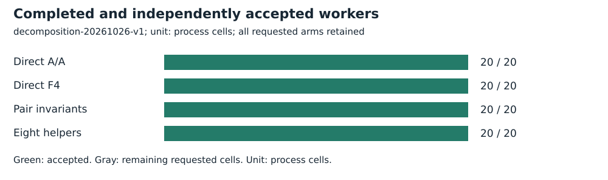
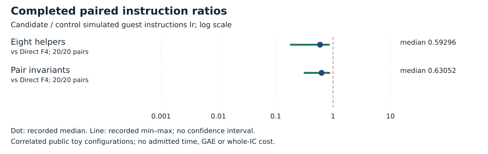

# Cold finite-decomposition worker

Run **decomposition-20261026-v1**, 2026-10-26. Intel Xeon Platinum 8573C, managed Linux x86_64, L0. Public synthetic/known-answer fixtures only. No admitted wall time.

## Frozen task and accounting

All ten original curves, B=8, arities 2 and 3, target label 0. Twenty configurations, ten target pairs and eighty requested processes including direct A/A.

Charge startup, public base/equation construction, generic native F4/substitution, exhaustive Fp roots, sign search, invariant/exception handling, deduplication, source verification and serialization. Exclude parent, kernel, independent replay, relation-matrix algebra and full DLP. Limits: 15,000 ms cooperative, 18-second hard timeout plus one-second grace, 4 GiB, 32 MiB/file; 1,800 seconds/1 GiB globally.

[Protocol](../../../execution-v3/DECOMPOSITION_PROTOCOL_V1.md) · [source, command and transport receipt](../../../execution-v3/runs/decomposition-20261026-v1.transport.json) · [independent native audit](../../../execution-v3/decomposition-audit-20261026-v1/AUDIT.json) · [raw records](../../../execution-v3/runs/decomposition-20261026-v1/RECORDS.json).

The receipt records the source revision, pinned binary hashes and exact command where captured. All workers run on already observed training targets; final E28 labels 32–63 remain unopened.

## Recorded observations

All eighty cells return the complete frozen projected tuple set. PARI independently checks 392 signed sums and 392 wrong-sign controls. Both candidates use fewer Ir than the product-polynomial F4 worker in all twenty matched configurations. This baseline is subsequently superseded as an ordinary control by direct group MITM; these remain scoped comparisons within the polynomial solver.

| Arm | Requested | Accepted |
| --- | --- | --- |
| Direct A/A | 20 | 20 |
| Direct F4 | 20 | 20 |
| Pair invariants | 20 | 20 |
| Eight helpers | 20 | 20 |



| Candidate / control | Pairs | Fewer Ir | Median ratio |
| --- | --- | --- | --- |
| Eight helpers / Direct F4 | 20/20 | 20 | 0.59296 |
| Pair invariants / Direct F4 | 20/20 | 20 | 0.63052 |



## Validation, limits and raw preservation

No newly measured external full-root reference, calibrated IC accounting or matched rho is supplied. Do not subtract this interval from the earlier basis-only interval: they are distinct measurements.

Independent PARI positive and negative checks each: **392**. The native gate reopens script, stdout, stderr and actual-exit hashes; only the documented maximum-stack warning is allowed.

Measured instructions are simulated guest instructions Ir, not CPU cycles, seconds, field operations or GAE. Ratios are native-audited candidate/control values. Counts repeat correlated configurations; A/A repeats check only the frozen five-percent within-input gate. No confidence interval or independent-host replication is claimed. Missing pairs stay missing. No matched rho or validation-gated benchmark row is added.

Raw bytes, failed/capped cells and loose replay metadata are preserved by [the deterministic archive manifest](../../../execution-v3/continue-20261026/RAW_ARTIFACTS.json). The user-selected remote is **s3://setec-astronomy-artifacts/store**, logical name is recorded in the manifest.

Archive SHA-256:

```text
f0b73ee2cd1ab71cec520098a6c4e4868a0a0846daaf64c207be6fcf0839be7a
```

 [Extraction/member check instructions](../../../execution-v3/continue-20261026/README.md).

Editable SVGs and [recorded plot data](PLOT_DATA.json) accompany this report. No result is extrapolated to NIST-size DLPs, full index calculus or novelty.
