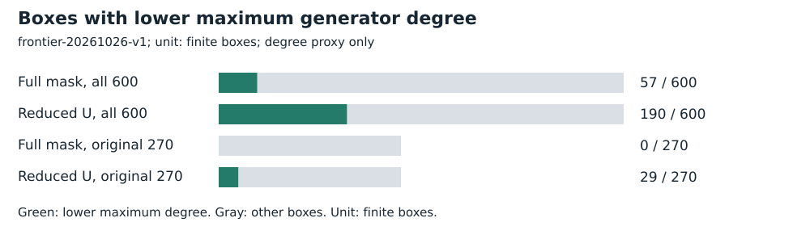

# Expanded finite boxes and classical F3 lifting

Run **frontier-20261026-v1**, 2026-10-26. Intel Xeon Platinum 8573C, managed Linux x86_64, L0. Public synthetic/known-answer fixtures only. No admitted wall time.

## Frozen task and accounting

All ten original curves and target label 0; H,K in {2,4,8,16}; every distinct lambda in {1,2,3,H}: six hundred finite boxes. All original 270 coefficient arrays are reproduced independently by Newton interpolation.

This run checks exact finite geometry and polynomial degrees, not solver cost. Native construction and independent square-table/Euler/Euclid/translation audit are separate from strict PARI. The subsequent eighty-configuration cost diagnostic does not complete all six hundred cost cases.

[Protocol](../../../execution-v3/INCIDENCE_FRONTIER_PROTOCOL_V1.md) · [source, command and transport receipt](../../../execution-v3/frontier-20261026/TRANSPORT_LIMITS.json) · [independent native audit](../../../execution-v3/frontier-audit-20261026-v1/AUDIT.json) · [strict native/PARI admission](../../../execution-v3/frontier-audit-20261026-v1/ADMISSION.json).

The receipt records the source revision, pinned binary hashes and exact command where captured. All workers run on already observed training targets; final E28 labels 32–63 remain unopened.

## Recorded observations

The independently audited counts are 57 full-mask degree reductions and 190 reduced-U reductions among 600 boxes. In the original 270 boxes, the full-mask count remains zero, while reduced U gives 29. Strict PARI checks 566 explicit signed pairs and 28 arity-three mixed-prefix counterexamples, including curve membership and both F3 constraints.

| Grid | Boxes | Lower degree |
| --- | --- | --- |
| Full mask, all 600 | 600 | 57 |
| Reduced U, all 600 | 600 | 190 |
| Full mask, original 270 | 270 | 0 |
| Reduced U, original 270 | 270 | 29 |



## Validation, limits and raw preservation

The classical numerator-square identity supplies rational lifts when the anchored target y is nonzero. Five Lean theorems and a clean fresh native axiom audit pass; IDC1hfab3acdc297476e5 adds 32 issuer/64 extra checker probes and a false-plus-one rejection. The formal group-addition bridge is not completed. A generic ordinary encoding with the same supplied U has identical reduced equations. Degree reductions alone are not speedups. The original run omitted separate launch timestamps/argv/exit receipt; TRANSPORT_LIMITS.json records that gap honestly. Independent per-case/native/PARI gates passed; no launch timestamp is inferred from file mtime.

The geometry admission links the separately hashed strict PARI script, exit, clean-error gate and 566/28 markers.

This run records finite geometry and maximum generator degrees. It contains no instruction, timing or A/A cost measurement. The separate cost report prices eighty configurations; a degree reduction by itself supplies no measured speedup. All six hundred cases passed the independent finite checks. No confidence interval, independent-host replication or validation-gated benchmark result is claimed.

Raw bytes, failed/capped cells and loose replay metadata are preserved by [the deterministic archive manifest](../../../execution-v3/continue-20261026/RAW_ARTIFACTS.json). The user-selected remote is **s3://setec-astronomy-artifacts/store**, logical name is recorded in the manifest.

Archive SHA-256:

```text
f0b73ee2cd1ab71cec520098a6c4e4868a0a0846daaf64c207be6fcf0839be7a
```

 [Extraction/member check instructions](../../../execution-v3/continue-20261026/README.md).

Editable SVGs and [recorded plot data](PLOT_DATA.json) accompany this report. No result is extrapolated to NIST-size DLPs, full index calculus or novelty.

Classical summation-polynomial reference: [Semaev (2004)](https://eprint.iacr.org/2004/031). The identity and field lift are standard, with the exact formal scope stated above.
