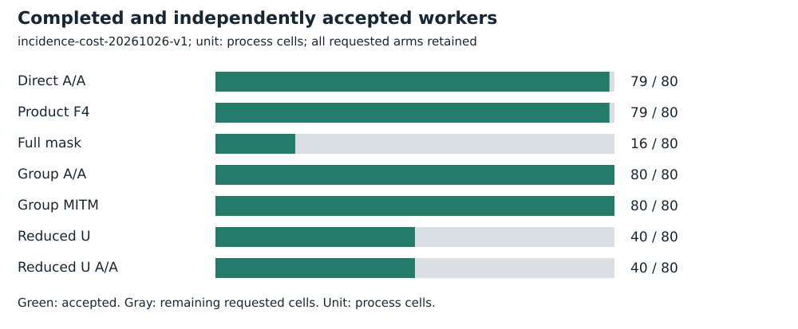
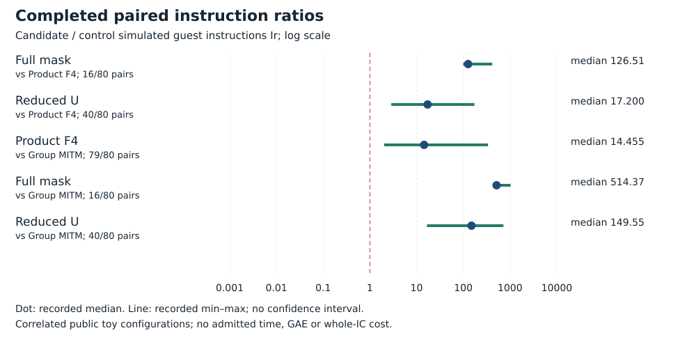

# Cold anchored-box solver-cost comparison

Run **incidence-cost-20261026-v1**, 2026-10-26. Intel Xeon Platinum 8573C, managed Linux x86_64, L0. Public synthetic/known-answer fixtures only. No admitted wall time.

## Frozen task and accounting

All ten original curves; H=K in {8,16}; every lambda in {1,2,3,H}; target label 0. Eighty configurations selected without filtering degrees or outcomes, seven arms each and 560 requested processes. The remaining 520 frontier cost cases and arity-three full costs remain open.

Charge actual public construction, product or mask or reduced-U equations, generic native F4/substitution/Fp roots, explicit lifts, verification, deduplication and serialization. Group MITM avoids unused polynomials. Grevlex/GM=1/degree bound 128, 2,500 ms shared cooperative, four-second hard timeout plus one-second grace, 4 GiB, 32 MiB/file; 2,100 seconds/1 GiB globally.

[Protocol](../../../execution-v3/INCIDENCE_COST_PROTOCOL_V1.md) · [source, command and transport receipt](../../../execution-v3/runs/incidence-cost-20261026-v1.transport.json) · [independent native audit](../../../execution-v3/incidence-cost-audit-20261026-v1/AUDIT.json) · [raw records](../../../execution-v3/runs/incidence-cost-20261026-v1/RECORDS.json).

The receipt records the source revision, pinned binary hashes and exact command where captured. All workers run on already observed training targets; final E28 labels 32–63 remain unopened.

## Recorded observations

All 560 processes were attempted; 414 pass the complete finite-answer and Ir gates. Direct product completes 79/80, full mask 16/80, reduced U 40/80 and group MITM 80/80, with their repeats counted separately. Every completed polynomial comparison loses to group MITM. Full mask versus product costs a median 126.51260352071196 times on 16 matched pairs; reduced U versus product costs 17.20034219519909 times on 40. PARI checks 1,085 positive sums and 1,085 wrong-sign controls. The independent audit requires exact pairs/signed y lists, every distinct finite root within its actual bounds, and the complete independent frontier root count including fiber multiplicity. This certifies finite answers rather than algebraic-closure bases.

| Arm | Requested | Accepted |
| --- | --- | --- |
| Direct A/A | 80 | 79 |
| Product F4 | 80 | 79 |
| Full mask | 80 | 16 |
| Group A/A | 80 | 80 |
| Group MITM | 80 | 80 |
| Reduced U | 80 | 40 |
| Reduced U A/A | 80 | 40 |



| Candidate / control | Pairs | Fewer Ir | Median ratio |
| --- | --- | --- | --- |
| Full mask / Product F4 | 16/80 | 0 | 126.51 |
| Reduced U / Product F4 | 40/80 | 0 | 17.200 |
| Product F4 / Group MITM | 79/80 | 0 | 14.455 |
| Full mask / Group MITM | 16/80 | 0 | 514.37 |
| Reduced U / Group MITM | 40/80 | 0 | 149.55 |



Failure reasons recorded by the independent auditor:

| Reason | Cells |
| --- | --- |
| cooperative-budget | 146 |

## Validation, limits and raw preservation

A lower displayed degree is not assigned a cost saving. Reduced U and group MITM keep their own A/A gates even where direct F4 fails; full mask uses the direct A/A gate. No external full-root reference, full IC, matched rho, general scaling or twist-specific advantage is established.

Independent PARI positive and negative checks each: **1085**. The native gate reopens script, stdout, stderr and actual-exit hashes; only the documented maximum-stack warning is allowed.

Measured instructions are simulated guest instructions Ir, not CPU cycles, seconds, field operations or GAE. Ratios are native-audited candidate/control values. Counts repeat correlated configurations; A/A repeats check only the frozen five-percent within-input gate. No confidence interval or independent-host replication is claimed. Missing pairs stay missing. No matched rho or validation-gated benchmark row is added.

Raw bytes, failed/capped cells and loose replay metadata are preserved by [the deterministic archive manifest](../../../execution-v3/continue-20261026/RAW_ARTIFACTS.json). The user-selected remote is **s3://setec-astronomy-artifacts/store**, logical name is recorded in the manifest.

Archive SHA-256:

```text
f0b73ee2cd1ab71cec520098a6c4e4868a0a0846daaf64c207be6fcf0839be7a
```

 [Extraction/member check instructions](../../../execution-v3/continue-20261026/README.md).

Editable SVGs and [recorded plot data](PLOT_DATA.json) accompany this report. No result is extrapolated to NIST-size DLPs, full index calculus or novelty.
