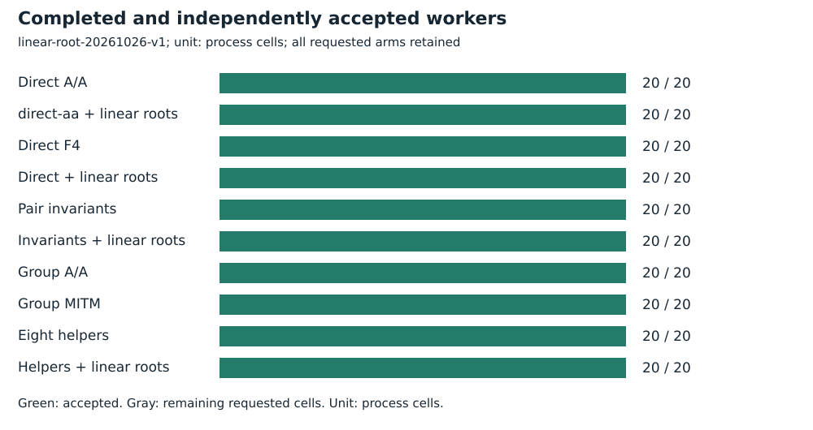
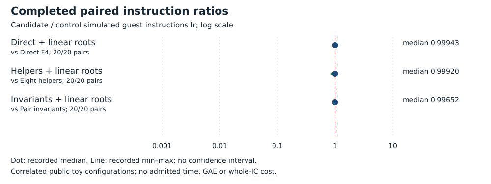
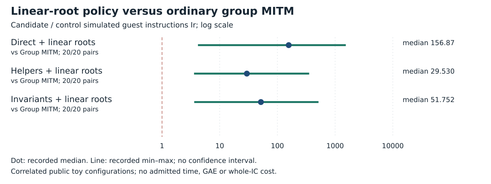

# Opt-in exact linear-root policy

Run **linear-root-20261026-v1**, 2026-10-26. Intel Xeon Platinum 8573C, managed Linux x86_64, L0. Public synthetic/known-answer fixtures only. No admitted wall time.

## Frozen task and accounting

All ten original curves, B=8, arities 2 and 3, target label 0. Twenty configurations and 200 requested processes: direct A/A, direct, helpers and invariants with each policy, plus group A/A and MITM.

The same cold finite-decomposition interval is charged for policy off and on, including actual construction, F4, roots, original minimum-mask sign search, infinity exceptions, verification, deduplication and serialization. Limits: 15,000 ms cooperative, 18-second hard timeout plus one-second grace, 4 GiB, 32 MiB/file; 3,800 seconds/1 GiB globally. F4_FP_LINEAR_ROOTS=1 prefers an analytically solved pure linear basis equation before the generic full-field root scan; default remains off.

[Protocol](../../../execution-v3/LINEAR_ROOT_PROTOCOL_V1.md) · [source, command and transport receipt](../../../execution-v3/runs/linear-root-20261026-v1.transport.json) · [independent native audit](../../../execution-v3/linear-root-audit-20261026-v1/AUDIT.json) · [raw records](../../../execution-v3/runs/linear-root-20261026-v1/RECORDS.json).

The receipt records the source revision, pinned binary hashes and exact command where captured. All workers run on already observed training targets; final E28 labels 32–63 remain unopened.

## Recorded observations

All 200 outputs match the entire frozen signed-row list. Independent PARI verifies 980 positive sums and 980 wrong-sign controls. Policy-on/off median ratios are direct 0.9994338578968132, helpers 0.9992032880251398 and invariants 0.996520508243923. Best helper cell ratio is 0.8421707962912168; regressions are retained. All three polynomial variants still exceed ordinary group MITM in every one of twenty matched cases. Two new unit tests cover exhaustive small-field linear coefficients, rejected non-pivots and recursive/inconsistent differential answers without mutating test-process environment.

| Arm | Requested | Accepted |
| --- | --- | --- |
| Direct A/A | 20 | 20 |
| direct-aa + linear roots | 20 | 20 |
| Direct F4 | 20 | 20 |
| Direct + linear roots | 20 | 20 |
| Pair invariants | 20 | 20 |
| Invariants + linear roots | 20 | 20 |
| Group A/A | 20 | 20 |
| Group MITM | 20 | 20 |
| Eight helpers | 20 | 20 |
| Helpers + linear roots | 20 | 20 |



| Candidate / control | Pairs | Fewer Ir | Median ratio |
| --- | --- | --- | --- |
| Eight helpers / Direct F4 | 20/20 | 20 | 0.59112 |
| Pair invariants / Direct F4 | 20/20 | 20 | 0.63021 |
| Group MITM / Direct F4 | 20/20 | 20 | 0.11377 |
| Direct + linear roots / Direct F4 | 20/20 | 16 | 0.99943 |
| Helpers + linear roots / Direct F4 | 20/20 | 20 | 0.58332 |
| Invariants + linear roots / Direct F4 | 20/20 | 20 | 0.62117 |
| Direct + linear roots / Group MITM | 20/20 | 0 | 156.87 |
| Helpers + linear roots / Eight helpers | 20/20 | 11 | 0.99920 |
| Helpers + linear roots / Group MITM | 20/20 | 0 | 29.530 |
| Invariants + linear roots / Pair invariants | 20/20 | 17 | 0.99652 |
| Invariants + linear roots / Group MITM | 20/20 | 0 | 51.752 |





## Validation, limits and raw preservation

This is a generic implementation optimization, not new twist geometry. A task/env assertion and independent audit verify the selected policy. Nonlinear root scans remain unchanged. No external full-root reference, complete IC cost, matched rho, scaling or fastest implementation result is supplied. The pre-feature library check is retained separately; final checks rerun after this shared solver change.

Independent PARI positive and negative checks each: **980**. The native gate reopens script, stdout, stderr and actual-exit hashes; only the documented maximum-stack warning is allowed.

Measured instructions are simulated guest instructions Ir, not CPU cycles, seconds, field operations or GAE. Ratios are native-audited candidate/control values. Counts repeat correlated configurations; A/A repeats check only the frozen five-percent within-input gate. No confidence interval or independent-host replication is claimed. Missing pairs stay missing. No matched rho or validation-gated benchmark row is added.

Raw bytes, failed/capped cells and loose replay metadata are preserved by [the deterministic archive manifest](../../../execution-v3/continue-20261026/RAW_ARTIFACTS.json). The user-selected remote is **s3://setec-astronomy-artifacts/store**, logical name is recorded in the manifest.

Archive SHA-256:

```text
f0b73ee2cd1ab71cec520098a6c4e4868a0a0846daaf64c207be6fcf0839be7a
```

 [Extraction/member check instructions](../../../execution-v3/continue-20261026/README.md).

Editable SVGs and [recorded plot data](PLOT_DATA.json) accompany this report. No result is extrapolated to NIST-size DLPs, full index calculus or novelty.
