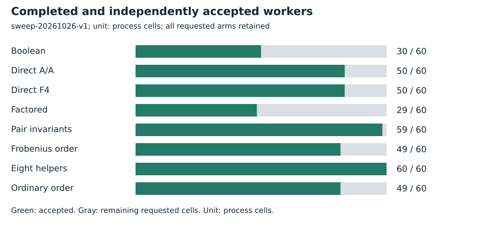
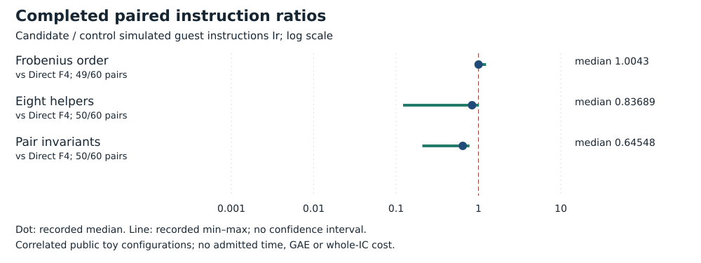

# Broader solver-worker instruction sweep

Run **sweep-20261026-v1**, 2026-10-26. Intel Xeon Platinum 8573C, managed Linux x86_64, L0. Public synthetic/known-answer fixtures only. No admitted wall time.

## Frozen task and accounting

All ten original curves; B=8,12,16; arities 2 and 3; public target label 0. Sixty correlated configurations and ten distinct fixture-target pairs. Eight worker arms per configuration, 480 requested processes.

Startup, parsing, symbolic/F4 work, all branches and serialization are charged. Construction, roots/signs, exceptions, certification, relation algebra and full recovery are excluded. Each worker has a 10,000 ms cooperative budget, 12-second hard timeout plus one-second grace, 4 GiB and 32 MiB/file. The batch cap is 7,200 seconds and 1 GiB.

[Protocol](../../../execution-v3/SWEEP_PROTOCOL_V1.md) · [source, command and transport receipt](../../../execution-v3/runs/sweep-20261026-v1.transport.json) · [independent native audit](../../../execution-v3/sweep-audit-20261026-v1/AUDIT.json) · [raw records](../../../execution-v3/runs/sweep-20261026-v1/RECORDS.json).

The receipt records the source revision, pinned binary hashes and exact command where captured. All workers run on already observed training targets; final E28 labels 32–63 remain unopened.

## Recorded observations

All 480 cells were attempted. Complete outputs and row counters are checked against the previously independent Singular complete-basis certificates. The candidate distributions below require completed direct A/A controls. Frobenius ordering is also compared with its matched ordinary ordering in the audit; its median ratio there is 1.0031164415185945. There is no twist-specific measured advantage from that ordering.

| Arm | Requested | Accepted |
| --- | --- | --- |
| Boolean | 60 | 30 |
| Direct A/A | 60 | 50 |
| Direct F4 | 60 | 50 |
| Factored | 60 | 29 |
| Pair invariants | 60 | 59 |
| Frobenius order | 60 | 49 |
| Eight helpers | 60 | 60 |
| Ordinary order | 60 | 49 |



| Candidate / control | Pairs | Fewer Ir | Median ratio |
| --- | --- | --- | --- |
| Frobenius order / Direct F4 | 49/60 | 3 | 1.0043 |
| Frobenius order / Ordinary order | 48/60 | 5 | 1.0031 |
| Frobenius order / Factored | 29/60 | 29 | 0.014524 |
| Frobenius order / Boolean | 30/60 | 30 | 0.025099 |
| Eight helpers / Direct F4 | 50/60 | 44 | 0.83689 |
| Eight helpers / Ordinary order | 49/60 | 43 | 0.83890 |
| Eight helpers / Factored | 29/60 | 29 | 0.013248 |
| Eight helpers / Boolean | 30/60 | 30 | 0.020946 |
| Pair invariants / Direct F4 | 50/60 | 50 | 0.64548 |
| Pair invariants / Ordinary order | 49/60 | 49 | 0.64628 |
| Pair invariants / Factored | 29/60 | 29 | 0.0098199 |
| Pair invariants / Boolean | 30/60 | 30 | 0.016164 |



## Validation, limits and raw preservation

The 104 incomplete cells are retained, including cooperative/hard-budget and incomplete-output attempts. Their raw exit, signal, solver status and logs remain in RECORDS.json and the archive. Missing pairs are not zero-cost successes. The 50 completed direct comparisons are correlated settings of ten target pairs, not fifty independent targets.

This basis-worker interval matches complete branch outputs and counters to the earlier independent Singular complete-basis certificates. It has no new full-root or PARI witness replay.

Measured instructions are simulated guest instructions Ir, not CPU cycles, seconds, field operations or GAE. Ratios are native-audited candidate/control values. Counts repeat correlated configurations; A/A repeats check only the frozen five-percent within-input gate. No confidence interval or independent-host replication is claimed. Missing pairs stay missing. No matched rho or validation-gated benchmark row is added.

Raw bytes, failed/capped cells and loose replay metadata are preserved by [the deterministic archive manifest](../../../execution-v3/continue-20261026/RAW_ARTIFACTS.json). The user-selected remote is **s3://setec-astronomy-artifacts/store**, logical name is recorded in the manifest.

Archive SHA-256:

```text
f0b73ee2cd1ab71cec520098a6c4e4868a0a0846daaf64c207be6fcf0839be7a
```

 [Extraction/member check instructions](../../../execution-v3/continue-20261026/README.md).

Editable SVGs and [recorded plot data](PLOT_DATA.json) accompany this report. No result is extrapolated to NIST-size DLPs, full index calculus or novelty.
