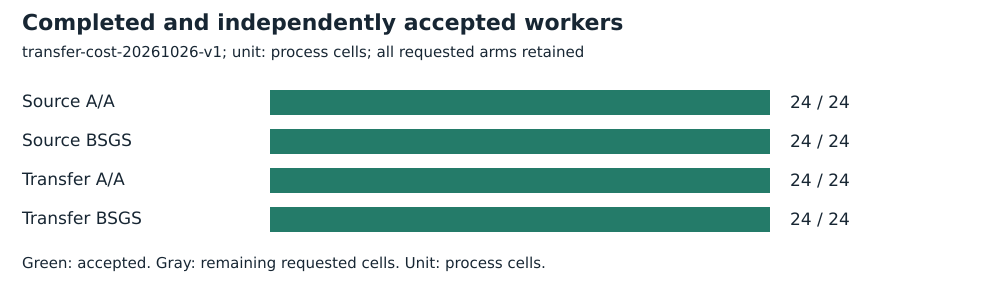
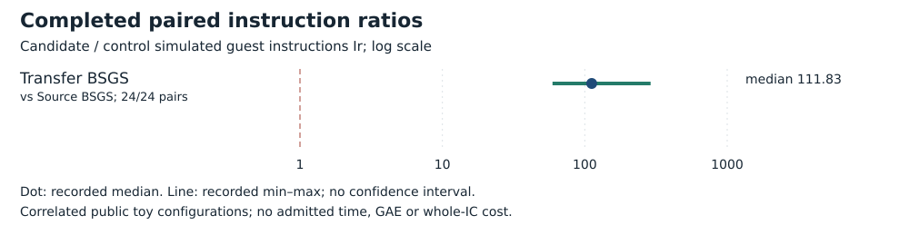

# Given-map genus-two transfer cost

Run **transfer-cost-20261026-v1**, 2026-10-26. Intel Xeon Platinum 8573C, managed Linux x86_64, L0. Public synthetic/known-answer fixtures only. No admitted wall time.

## Frozen task and accounting

The existing 24 public toy targets: eight each on icv1-fp8-tm21-71e3bcb7, icv1-fp10-tm21-b87c79a9 and icv1-fp14-t33-d98086ae, subgroup orders 233,773,10079. Four arms per target: source/transfer BSGS and their A/A repeats; 96 requested processes.

Both groups use the same ceil-sqrt(n) BSGS. Transfer includes reference chart setup, pulling both G and Q, subgroup checks, Jacobian BSGS, norm/inverse-three recovery and source verification. Map/parameter discovery, polarization identification and destination IC are excluded. Limits: 60 seconds/process, 4 GiB, 32 MiB/file; 2,400 seconds/1 GiB globally.

[Protocol](../../../execution-v3/TRANSFER_COST_PROTOCOL_V1.md) · [source, command and transport receipt](../../../execution-v3/runs/transfer-cost-20261026-v1.transport.json) · [independent native audit](../../../execution-v3/transfer-cost-audit-20261026-v1/AUDIT.json) · [raw records](../../../execution-v3/runs/transfer-cost-20261026-v1/RECORDS.json).

The receipt records the source revision, pinned binary hashes and exact command where captured. All workers run on already observed training targets; final E28 labels 32–63 remain unopened.

## Recorded observations

All 96 known-answer recoveries and 96 positive/96 wrong-answer PARI controls pass. Transfer uses more Ir in every one of the 24 paired targets: the recorded range is 59.34139101214629 to 289.80547820363523 times source BSGS, median 111.8263555137982. This is a measured loss for the given-map generic-BSGS prototype.

| Arm | Requested | Accepted |
| --- | --- | --- |
| Source A/A | 24 | 24 |
| Source BSGS | 24 | 24 |
| Transfer A/A | 24 | 24 |
| Transfer BSGS | 24 | 24 |



| Candidate / control | Pairs | Fewer Ir | Median ratio |
| --- | --- | --- | --- |
| Transfer BSGS / Source BSGS | 24/24 | 0 | 111.83 |



## Validation, limits and raw preservation

The reference uses Fp6 chart arithmetic, often in an Fp3 subfield, rather than optimized balanced Fp Jacobian arithmetic. This experiment does not rule out another destination algorithm, optimized arithmetic or another cover, and is not the strongest matched-rho comparison.

Independent PARI positive and negative checks each: **96**. The native gate reopens script, stdout, stderr and actual-exit hashes; only the documented maximum-stack warning is allowed.

Measured instructions are simulated guest instructions Ir, not CPU cycles, seconds, field operations or GAE. Ratios are native-audited candidate/control values. Counts repeat correlated configurations; A/A repeats check only the frozen five-percent within-input gate. No confidence interval or independent-host replication is claimed. Missing pairs stay missing. No matched rho or validation-gated benchmark row is added.

Raw bytes, failed/capped cells and loose replay metadata are preserved by [the deterministic archive manifest](../../../execution-v3/continue-20261026/RAW_ARTIFACTS.json). The user-selected remote is **s3://setec-astronomy-artifacts/store**, logical name is recorded in the manifest.

Archive SHA-256:

```text
f0b73ee2cd1ab71cec520098a6c4e4868a0a0846daaf64c207be6fcf0839be7a
```

 [Extraction/member check instructions](../../../execution-v3/continue-20261026/README.md).

Editable SVGs and [recorded plot data](PLOT_DATA.json) accompany this report. No result is extrapolated to NIST-size DLPs, full index calculus or novelty.
