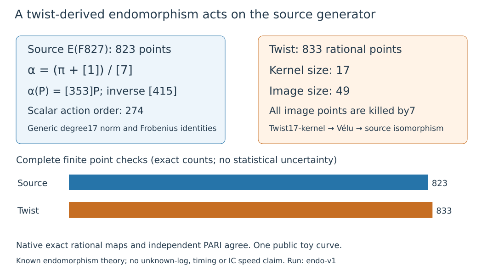

# Twist torsion yields a degree-17 source endomorphism

The same public p827 fixture now has an explicit endomorphism of the source
curve, built from twist torsion:

$$
\alpha=(\pi+[1])/[7],\qquad
(1-\alpha)\alpha=\alpha(1-\alpha)=[17],\qquad
\alpha^2-\alpha+[17]=0.
$$

These are **generic rational-function identities**, checked in native Rust and
independently in PARI. The Frobenius identity is checked as
[7]α=π+[1], including x^827 and y·f(x)^413; division notation above denotes
this certified endomorphism. It is not scalar inversion only on a finite group.
This supplies a further explicit twist-derived connection to the source
generator arithmetic. Standard isogeny/endomorphism theory is prior art;
no novel index-calculus speedup or NIST result is established.

On E:y²=x³+x+15 over F827, group order823, G=(2,5), Q=37G, the map acts as
$\alpha(P)=[353]P$ for every rational P. Hence α(Q)=k·α(G) whenever Q=kG.
The generator image is(189,620), the target image is(451,814), and scalar415
inverts this action modulo823. All823 points, including infinity, are checked;
all822 wrong-scalar354 controls are rejected. No unknown logarithm is recovered
by evaluating a known scalar action.

The d2 twist is Y²=X³+4X+120, order833=C7×C119. Starting from the already
verified maximal-order point H=(2,386), the fixed[7]H=(345,743) has order17.
Its anti-Frobenius embedding supplies the eight paired x-roots of the kernel.
Normalized Vélu gives the intermediate curve y²=x³+31x+77. The fixed coordinate
isomorphism (x,y)↦(49x,343y) returns to the source and gives α. The sign and
scale were specified before the output; no alternative kernel was selected.

On all833 embedded twist-rational points, α has kernel17 and image49 killed
by7. This is consistent with [7]α=π+[1] and the original odd-component
Frobenius separation. It does not transport the order823 DLP into the rational
twist group. The scalar353 has multiplicative order274 modulo823, independently
verified. Evaluating or folding such orbits requires charged work; an orbit
length alone establishes no computational gain. The morphism has degree17.

The native producer constructs rational functions (X(x),yS(x)), the conjugate
id−α and independent generic[7]/[17] maps. It checks both degree17 norm
compositions and the Frobenius identity exactly, then the complete finite
source/twist sets. GP independently builds `ellisogeny`, reconstructs generic
group arithmetic, checks the same identities, and evaluates the conjugated
map (X,Y)↦(2R(X/2),Y·S(X/2)) on the rational twist. Native and GP agree; strict
admission allows only the exact declared GP stack-size warning. No scientific
stage fails or reaches its cap. Two actual complete-panel executions pass;
their unified protocol/export/file binding has zero findings.

Source c12290db2fd94b4a929b2e0586ff8973dd8079a1; protocol
1bfb4a24bf342ec370dfaa59b861449fd7b59c422effd85def05139f47df5523.
Source/binaries/spec were frozen, committed and checkpointed before data.
Bounds300s each,4GiB,CPU0,one thread,L0 managed Xeon Platinum8573C/KVM.
The documented EKS access/image fallback applies. Operational timestamps are
unadmitted; no paid resource or IAM change. The v8 arithmetic/map prefix is a
byte-preserved versioned snapshot; older frozen source and data stay unchanged.

Three conditional Lean declarations pass fresh native axiom audit:

- `TwistEndomorphism.norm_polynomial` assumes a commutative ring, a+b=1 and ba=17.
- `frobenius_polynomial` derives the trace5/norm827 polynomial from a²−a+17=0.
- `inverse_scalar` proves415·353 acts as identity on an823-torsion additive group.

Foundations are propext and Quot.sound, with no sorry/custom axiom/trusted
native evaluation. Concrete curve groups, rational maps and the endomorphism
ring bridge are **not formalized**. The discriminant−67 is that of the checked
quadratic polynomial; no separate class-polynomial or complete volcano census
was run in this experiment.

Literature reviewed before implementation: Sutherland, MIT18.783 Fall2025
Lecture5 Theorems5.11/5.15 and Lecture13 Theorems13.6/13.8/proof; the repository
isogeny-loop report and atlas GLV/GLS/isogeny-loop lead. These sources
separate known-scalar arithmetic from unknown-log solving. A public small
fixture with this structure is not evidence that NIST P-curves have it.

[Reproduction, exact models, ordered route and raw verification](../../execution-v10/README.md)
retain the generator-bound EC1 UIDs, map artifact hashes, complete scripts,
receipts and deterministic Setec archive. No benchmark/leaderboard row moves.
Existing performance graphs stay unchanged; this exact connection figure is
new. The remaining experiments must price map discovery/evaluation and useful
relation solving on identical tasks. Original full campaigns, calibrated
IC/rho comparison and independent-host replay remain open.
