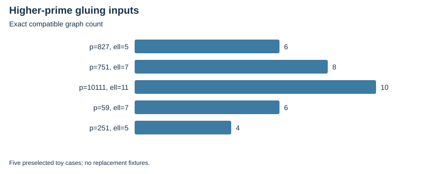

# Higher-prime torsion inputs verified

E20; 2026-10-23; local bounded evidence, L0.

The necessary module filter covers 75 main rows at ell=5,7,11,13,17, with 15 ell=3 regression rows. It is not a geometric quotient test.

Five selected toy cases now have actual torsion bases, primitive Weil pairings, Frobenius actions and every compatible Galois-stable graph, checked in independent Rust and PARI arithmetic. The first constructor branch skipped the pairing test; its five failures are retained, and the corrected same-seed bounded replay passes.

| Source | ell | Extension degree | Points per curve | Compatible graphs |
| --- | --- | --- | --- | --- |
| p=827 | 5 | 8 | 25 | 6 |
| p=751 | 7 | 12 | 49 | 8 |
| p=10111 | 11 | 10 | 121 | 10 |
| p=59 | 7 | 6 | 49 | 6 |
| p=251 | 5 | 4 | 25 | 4 |

No ell>=5 quotient, polarized genus-two model or induced maps are constructed. No actual higher-prime NIST construction is claimed.

Verified locally; complete raw publication awaits artifact-store access. No calibrated speedup, novelty, independent-host replay or NIST DLP is established.

Native assessment: ../../execution-v2/assessment-20261023-v3/ASSESSMENT.json. Raw members: runs/module-20261023-v1, runs/higher-*-v1 and -v2, input and replay directories. Source/input/binary hashes and exact argv: E20-receipts.json and ../../execution-v2/receipts/.

All phase receipts, including errors and timeouts: [E20-receipts.json](E20-receipts.json). The complete execution ledger and original protocols retain actual limits and missing measurements.
