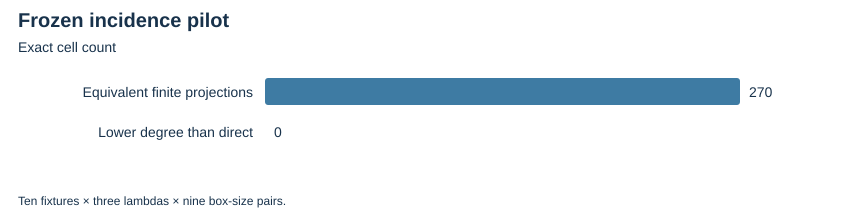

# Two-box incidence pilot: no degree reduction in this grid

E30; 2026-10-23; local bounded evidence, L0.

A new pilot uses all ten original ordinary fixtures, lambda=1,2,3 and coordinate-box widths h,k=2,4,8. It interpolates a Boolean curve/twist-lifting mask, records actual extension witnesses and compares an ordinary mask for the exact same projected base.

All 270 complete finite grids pass native checks and independent PARI replay. Zero cells lower the maximum generator degree relative to direct membership. Every projected set has an ordinary mask using no twist membership after the base has been constructed. No box offsets or replacement fixtures are searched.

| Recorded inventory | Count |
| --- | --- |
| Frozen cells | 270 |
| Native/CAS-equivalent projected sets | 270 |
| Twist degree below direct membership | 0 |
| Ordinary degree below twist degree | 0 |

Complete Gröbner bases, decomposition/lifting costs and comparisons with generic ordinary incidence encodings remain unimplemented. This elementary interpolation construction carries no novelty claim.

Verified locally; complete raw publication awaits artifact-store access. No calibrated speedup, novelty, independent-host replay or NIST DLP is established.

Native assessment: ../../execution-v2/assessment-20261023-v3/ASSESSMENT.json. Raw members: runs/incidence-20261023-v1 and its accepted independent replay. Source/input/binary hashes and exact argv: E30-receipts.json and ../../execution-v2/receipts/.

All phase receipts, including errors and timeouts: [E30-receipts.json](E30-receipts.json). The complete execution ledger and original protocols retain actual limits and missing measurements.
