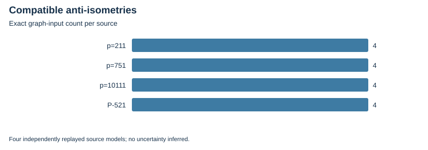
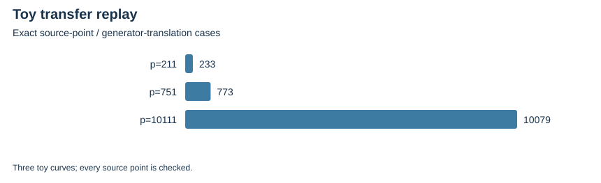
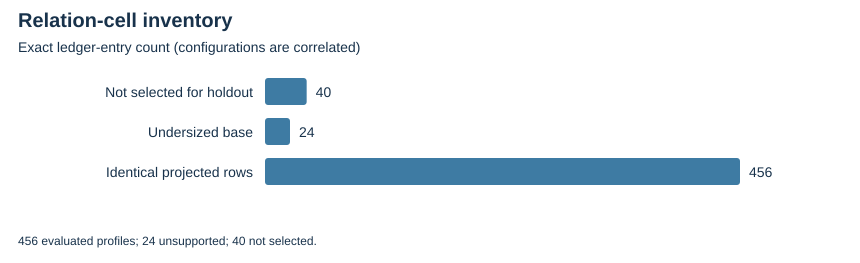
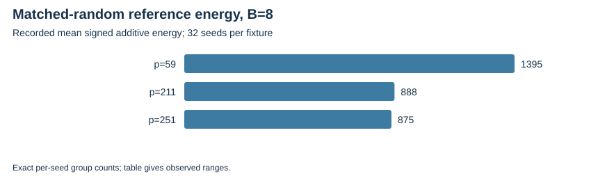
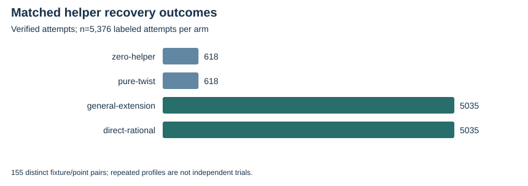
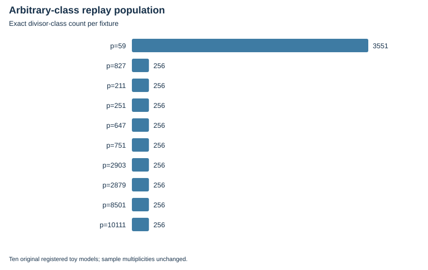
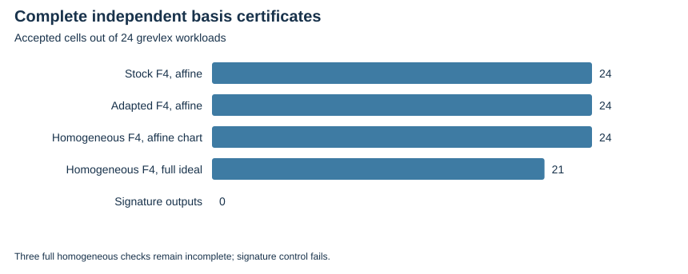
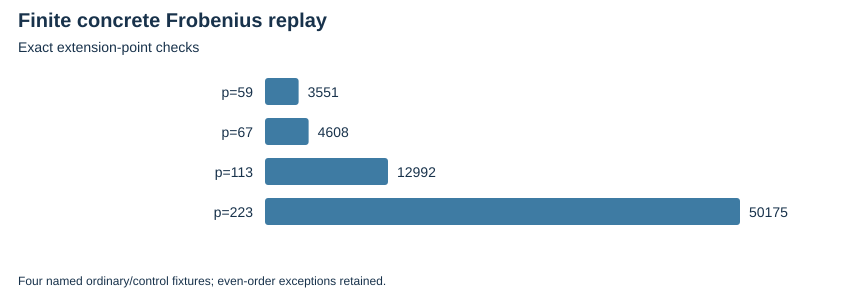

# Twist follow-up results, 2026-10-23

No calibrated IC speedup, novelty or NIST DLP is established. Explicit geometry and arithmetic are verified locally; the full raw bundle is pending artifact-store credentials.

| Experiment | Status | Remaining requirement |
| --- | --- | --- |
| E18 | partial | Actual torsion inputs do not identify an indecomposable polarized quotient or supply a faster destination solver. Canonical extension identity registration and full formal bridges remain open. |
| E19 | partial | Polarized identification with each E18 graph, full second-map divisor transfer, balanced base-field arithmetic, formal chart/group bridges and all costs remain open. The construction is prior art, not a novelty claim. |
| E20 | partial | No ell>=5 quotient, polarized genus-two model or induced maps are constructed. No actual higher-prime NIST construction is claimed. |
| E21 | partial | The auxiliary polynomial-system solver and complete cold construction/decomposition costs are missing. Final E28 labels 32–63 remain unopened. |
| E22 | partial | Full independent row-span/yield controls, shuffled and interval-like controls, frozen structural selection and complete collector costs remain open. |
| E23 | partial | Complete helper construction/index/projection/elimination costs and a calibrated one-target comparison remain missing. Equal projected rows alone do not prove every extension representation has equal computational cost. |
| E24 | partial | Balanced two-infinity base-field arithmetic, full formal field/chart bridges, independent-host replay and complete cost measurements remain open. |
| E25 | partial | No timing or speed comparison is admitted. Magma/FGb/OpenF4 and an applicable successful signature reference remain missing. The historical gate key “dimension” records Singular vdim (quotient vector-space dimension), not Krull dimension. |
| E29 | partial | The exact twist point-group embedding, concrete odd-subgroup/projector identification, integer-to-prime-field row module and Rust serialization bridges remain open. The full E29 theorem is not claimed complete. |
| E26 | not-attempted | No four-candidate block-elimination implementation or runs. |
| E27 | not-attempted | Complete construction, solver, elimination and verification cost accounting and calibration missing. |
| E28 | not-attempted | Final labels 32–63 withheld pending complete-cost selection; no final holdout executed. |
| E30 | partial | Finite encoding pilot verified; full solver and cost comparison open. |

- [E18: Actual 3-torsion and compatible graph inputs](E18.md) · [PDF](E18.pdf)
- [E19: Explicit degree-three covers and toy subgroup transfer](E19.md) · [PDF](E19.pdf)
- [E20: Higher-prime torsion inputs verified](E20.md) · [PDF](E20.pdf)
- [E21: Coupled-component bases retain the same projected rows](E21.md) · [PDF](E21.pdf)
- [E22: Projected additive-energy diagnostics](E22.md) · [PDF](E22.pdf)
- [E23: Extension helpers match their rational projections](E23.md) · [PDF](E23.pdf)
- [E24: Independent arbitrary-divisor arithmetic replay](E24.md) · [PDF](E24.pdf)
- [E25: Correct-field F4 checks and failed signature controls](E25.md) · [PDF](E25.pdf)
- [E29: Concrete Frobenius replay and a partial Lean bridge](E29.md) · [PDF](E29.pdf)
- [E30: Two-box incidence pilot: no degree reduction in this grid](E30.md) · [PDF](E30.pdf)

[Combined inspected PDF](RESULTS.pdf). Native calculations: [assessment](../../execution-v2/assessment-20261023-v3/ASSESSMENT.json). Universal supporting certificates: [inventory](../../execution-v2/identities-20261023-v1/SUMMARY.json). Read [execution and extraction status](../../execution-v2/README.md) before replay. All plots read recorded native values; JavaScript renders documents only.

Full root library: 4,492 passed and 119 existing ignored. No leaderboard/benchmark promotion or curve-catalog registration. Existing scoreboard, timeline, catalog and historical study figures remain unchanged because this wave admits no performance result or complete typed transfer route. E26–E28 remain open; final target labels 32–63 remain unopened.

Universal supporting identities (32 issuer plus 64 extra checker points over 2^61−1):

- cleared long-to-short Weierstrass coordinate identity: `IDC1h7769f46ded30a517`.
- cleared 2-point Lagrange partition of unity: `IDC1ha123de2704e5560c`.
- cleared 4-point Lagrange partition of unity: `IDC1h5179f719177f24eb`.
- cleared 8-point Lagrange partition of unity: `IDC1h2e1943ad8bc423a1`.

These evaluated certificates cover the stated generic steps; they do not replace the exact finite-field cover checks or close their formal bridges.

\newpage

# Actual 3-torsion and compatible graph inputs

E18; 2026-10-23; local bounded evidence, L0.

Four sources now have explicit full 3-torsion over a specified degree-four extension. Rust verifies pairings, both Frobenius matrices, all anti-isometries and graph points; independent PARI replay is accepted for each source.

The corrected GP emitter leaves the native certificate rows unchanged. Earlier malformed GP attempts remain preserved. Public P-521 work is parameter/torsion verification only.

| Source | Extension degree | Anti-isometries | Nonzero torsion points | Bilinearity checks |
| --- | --- | --- | --- | --- |
| p=211 | 4 | 4 | 8 | 81 |
| p=751 | 4 | 4 | 8 | 81 |
| p=10111 | 4 | 4 | 8 | 81 |
| P-521 | 4 | 4 | 8 | 81 |

Actual torsion inputs do not identify an indecomposable polarized quotient or supply a faster destination solver. Canonical extension identity registration and full formal bridges remain open.

Verified locally; complete raw publication awaits artifact-store access. No calibrated speedup, novelty, independent-host replay or NIST DLP is established.

Native assessment: ../../execution-v2/assessment-20261023-v3/ASSESSMENT.json. Raw members: runs/torsion-*-20261023-v1 and -v2, all GP attempts and adjudications. Source/input/binary hashes and exact argv: E18-receipts.json and ../../execution-v2/receipts/.

All phase receipts, including errors and timeouts: [E18-receipts.json](E18-receipts.json). The complete execution ledger and original protocols retain actual limits and missing measurements.

\newpage

# Explicit degree-three covers and toy subgroup transfer

E19; 2026-10-23; local bounded evidence, L0.

The BHLS genus-two construction (arXiv:1403.6911, Algorithm 5.4 and Appendix A) produces four parameter presentations per source, with exact degree-three maps to the original curve and its twist. Presentations are not asserted nonisomorphic.

The three toy sources have actual divisor pullback and norm replay with norm composed with pullback equal to multiplication by three. Every source point, inverse and generator translation is checked. Eight distinct public targets per toy source are solved in the destination subgroup and verified back on the source; public P-521 has no DLP attempt.

| Source | Source points / translation checks | Recovery attempts | Distinct targets |
| --- | --- | --- | --- |
| p=211 | 233 | 8 | 8 |
| p=751 | 773 | 8 | 8 |
| p=10111 | 10079 | 8 | 8 |

Polarized identification with each E18 graph, full second-map divisor transfer, balanced base-field arithmetic, formal chart/group bridges and all costs remain open. The construction is prior art, not a novelty claim.

Verified locally; complete raw publication awaits artifact-store access. No calibrated speedup, novelty, independent-host replay or NIST DLP is established.

Native assessment: ../../execution-v2/assessment-20261023-v3/ASSESSMENT.json. Raw members: runs/geometry-*, runs/three-transfer-20261023-v1 and -v2, and all CAS failures/replays. Source/input/binary hashes and exact argv: E19-receipts.json and ../../execution-v2/receipts/.

All phase receipts, including errors and timeouts: [E19-receipts.json](E19-receipts.json). The complete execution ledger and original protocols retain actual limits and missing measurements.

\newpage

# Higher-prime torsion inputs verified

E20; 2026-10-23; local bounded evidence, L0.

The necessary module filter covers 75 main rows at ell=5,7,11,13,17, with 15 ell=3 regression rows. It is not a geometric quotient test.

Five selected toy cases now have actual torsion bases, primitive Weil pairings, Frobenius actions and every compatible Galois-stable graph, checked in independent Rust and PARI arithmetic. The first constructor branch skipped the pairing test; its five failures are retained, and the corrected same-seed bounded replay passes.

| Source | ell | Extension degree | Points per curve | Compatible graphs |
| --- | --- | --- | --- | --- |
| p=827 | 5 | 8 | 25 | 6 |
| p=751 | 7 | 12 | 49 | 8 |
| p=10111 | 11 | 10 | 121 | 10 |
| p=59 | 7 | 6 | 49 | 6 |
| p=251 | 5 | 4 | 25 | 4 |

No ell>=5 quotient, polarized genus-two model or induced maps are constructed. No actual higher-prime NIST construction is claimed.

Verified locally; complete raw publication awaits artifact-store access. No calibrated speedup, novelty, independent-host replay or NIST DLP is established.

Native assessment: ../../execution-v2/assessment-20261023-v3/ASSESSMENT.json. Raw members: runs/module-20261023-v1, runs/higher-*-v1 and -v2, input and replay directories. Source/input/binary hashes and exact argv: E20-receipts.json and ../../execution-v2/receipts/.

All phase receipts, including errors and timeouts: [E20-receipts.json](E20-receipts.json). The complete execution ledger and original protocols retain actual limits and missing measurements.

\newpage

# Coupled-component bases retain the same projected rows

E21; 2026-10-23; local bounded evidence, L0.

The census constructs 120 predicate cells: exhaustive over p=59,211,251 and sampled from 65,536 public x proposals on the other seven fixtures. Independent PARI checks all exact image/fiber tables and sampled witnesses.

The evaluated relation panel has 7296 labeled target/configuration attempts on 154 distinct fixture/point pairs. Every evaluated extension-tuple row set equals the matched same-base rational MITM row set. The diagnostic selector freezes two configurations before labels 16–31; its cost proxy is uncalibrated.

| Relation status | Ledger entries |
| --- | --- |
| not-evaluated-on-holdout-by-preregistered-selection-rule | 40 |
| unsupported-undersized-projected-base | 24 |
| verified-identical-projected-row-controls | 456 |

The auxiliary polynomial-system solver and complete cold construction/decomposition costs are missing. Final E28 labels 32–63 remain unopened.

Verified locally; complete raw publication awaits artifact-store access. No calibrated speedup, novelty, independent-host replay or NIST DLP is established.

Native assessment: ../../execution-v2/assessment-20261023-v3/ASSESSMENT.json. Raw members: runs/coupled-census-20261023-v1 and runs/coupled-relations-20261023-v1. Source/input/binary hashes and exact argv: E21-receipts.json and ../../execution-v2/receipts/.

All phase receipts, including errors and timeouts: [E21-receipts.json](E21-receipts.json). The complete execution ledger and original protocols retain actual limits and missing measurements.

\newpage

# Projected additive-energy diagnostics

E22; 2026-10-23; local bounded evidence, L0.

The native assessment recomputes every recorded signed pair/triple histogram and additive energy, including 960 matched random-base controls. Distinct projected bases are deduplicated across configurations.

Duplicating every lift twice multiplies the weighted energy by 16 while adding zero new projected rows. That factor is an algebraic multiplicity calculation, not a measured rank gain. Energy alone is not a collector or a speed result.

| Fixture, B=8 | Independent public random seeds | Energy min | Energy max | Recorded mean |
| --- | --- | --- | --- | --- |
| p=59 | 32 | 1288 | 1600 | 1395 |
| p=211 | 32 | 760 | 1112 | 888 |
| p=251 | 32 | 768 | 992 | 875 |

Full independent row-span/yield controls, shuffled and interval-like controls, frozen structural selection and complete collector costs remain open.

Verified locally; complete raw publication awaits artifact-store access. No calibrated speedup, novelty, independent-host replay or NIST DLP is established.

Native assessment: ../../execution-v2/assessment-20261023-v3/ASSESSMENT.json. Raw members: runs/coupled-energy-20261023-v1 (all 1,245 diagnostic/control entries). Source/input/binary hashes and exact argv: E22-receipts.json and ../../execution-v2/receipts/.

All phase receipts, including errors and timeouts: [E22-receipts.json](E22-receipts.json). The complete execution ledger and original protocols retain actual limits and missing measurements.

\newpage

# Extension helpers match their rational projections

E23; 2026-10-23; local bounded evidence, L0.

The corrected panel evaluates 336 profiles and 5376 labeled target/profile attempts, on 155 distinct fixture/point pairs. Fresh source-group replay checks 20976 unique arm witnesses, including every raw and eliminated equation and each recovered scalar.

Zero-helper and pure-twist arms have identical rows and recovery outcomes. General extension helpers and matched rational helpers also agree exactly. Adding rational helper projections can improve recovery within these toy panels; representing them as extension points adds no independent row information.

V1 witness filenames omitted arity and allowed cross-profile overwrites. All v1 outputs remain incomplete evidence. V2 uses the full profile hash and has a clean replay. Two earlier assessment attempts retain the caught checksum defect and a memory-cap failure; the final checker streams witnesses under the same cap.

| Arm | Verified recovery attempts | Attempt population |
| --- | --- | --- |
| zero-helper | 618 | 5376 |
| pure-twist | 618 | 5376 |
| general-extension | 5035 | 5376 |
| direct-rational | 5035 | 5376 |

Complete helper construction/index/projection/elimination costs and a calibrated one-target comparison remain missing. Equal projected rows alone do not prove every extension representation has equal computational cost.

Verified locally; complete raw publication awaits artifact-store access. No calibrated speedup, novelty, independent-host replay or NIST DLP is established.

Native assessment: ../../execution-v2/assessment-20261023-v3/ASSESSMENT.json. Raw members: runs/partial-20261023-v1 and -v2; assessment-20261023-v1, -v2, -v3. Source/input/binary hashes and exact argv: E23-receipts.json and ../../execution-v2/receipts/.

All phase receipts, including errors and timeouts: [E23-receipts.json](E23-receipts.json). The complete execution ledger and original protocols retain actual limits and missing measurements.

\newpage

# Independent arbitrary-divisor arithmetic replay

E24; 2026-10-23; local bounded evidence, L0.

All 5,855 divisor classes are replayed: the whole 3,551-class smallest Jacobian and nine original 256-class samples. Generic native norms match both original specialized maps.

Independent PARI checks field/tower conversion, Cantor validity, inverses, deterministic addition partners and both norms for every class. All ten replay adjudications pass. The first field emitter omitted an implicit monic term; the failed attempt and corrected replay are both preserved.

| Source | Classes | Scope |
| --- | --- | --- |
| p=59 | 3551 | exhaustive |
| p=827 | 256 | original fixed sample |
| p=211 | 256 | original fixed sample |
| p=251 | 256 | original fixed sample |
| p=647 | 256 | original fixed sample |
| p=751 | 256 | original fixed sample |
| p=2903 | 256 | original fixed sample |
| p=2879 | 256 | original fixed sample |
| p=8501 | 256 | original fixed sample |
| p=10111 | 256 | original fixed sample |

Balanced two-infinity base-field arithmetic, full formal field/chart bridges, independent-host replay and complete cost measurements remain open.

Verified locally; complete raw publication awaits artifact-store access. No calibrated speedup, novelty, independent-host replay or NIST DLP is established.

Native assessment: ../../execution-v2/assessment-20261023-v3/ASSESSMENT.json. Raw members: runs/jacobian-independent-20261023-v1 and -v2; individual GP/adjudication attempts. Source/input/binary hashes and exact argv: E24-receipts.json and ../../execution-v2/receipts/.

All phase receipts, including errors and timeouts: [E24-receipts.json](E24-receipts.json). The complete execution ledger and original protocols retain actual limits and missing measurements.

\newpage

# Correct-field F4 checks and failed signature controls

E25; 2026-10-23; local bounded evidence, L0.

The pilot requests 48 curve/arity/encoding/order cells. Twenty-four grevlex cells execute five engines; 24 lex cells are unsupported by this signature backend and retain an independent affine reference.

Stock affine F4, the output-adapted affine F4, and homogeneous F4 all return parsed bases in 24 cells. Every dehomogenized affine basis passes a complete independent leading-ideal/inclusion certificate. Homogeneous completeness passes 21 cells; three remain checker-limited.

Both signature arms fail all 24 cells and the small positive control, with signal exits and no parsed bases. The source restores the actual field before its signature core; a placeholder field diagnostic is not evidence of wrong-field computation. The local patch changes result serialization only.

Earlier parser errors and manual S-pair timeouts remain recorded. The manual checker printed all 49 summary rows, but its shell receipt tail failed; no missing successful receipt is invented. The separate leading-ideal replay has a clean receipt.

| Independent certificate | Accepted cells / 24 |
| --- | --- |
| dehomogenized_affine_complete_basis_gate:A0 | 24 |
| dehomogenized_affine_complete_basis_gate:H0 | 24 |
| dehomogenized_affine_complete_basis_gate:S0 | 24 |
| homogeneous_complete_basis_gate:H0 | 21 |

No timing or speed comparison is admitted. Magma/FGb/OpenF4 and an applicable successful signature reference remain missing. The historical gate key “dimension” records Singular vdim (quotient vector-space dimension), not Krull dimension.

Verified locally; complete raw publication awaits artifact-store access. No calibrated speedup, novelty, independent-host replay or NIST DLP is established.

Native assessment: ../../execution-v2/assessment-20261023-v3/ASSESSMENT.json. Raw members: runs/homogeneous-20261023-v1, -v2, -recheck-v3 and -leading-v4. Source/input/binary hashes and exact argv: E25-receipts.json and ../../execution-v2/receipts/.

All phase receipts, including errors and timeouts: [E25-receipts.json](E25-receipts.json). The complete execution ledger and original protocols retain actual limits and missing measurements.

\newpage

# Concrete Frobenius replay and a partial Lean bridge

E29; 2026-10-23; local bounded evidence, L0.

The finite replay checks 71326 actual power-Frobenius point cases and 71178 twist-embedding addition pairs across the ordinary and control fixtures. It checks odd-component projectors, composite-order inversion and explicit even two-torsion exceptions.

The new Lean project constructs F59 and its quadratic extension, proves the concrete field Frobenius identities and additivity on the actual Weierstrass point group, and proves conditional odd-order cancellation. Its durable replay audits 17 exported theorems: zero failures and zero trusted/native_decide declarations.

| Fixture | Extension point/Frobenius checks | Twist addition pairs | Odd projector checks |
| --- | --- | --- | --- |
| p=59 | 3551 | 2809 | 3551 |
| p=67 | 4608 | 5184 | 0 |
| p=113 | 12992 | 13456 | 0 |
| p=223 | 50175 | 49729 | 50175 |

The exact twist point-group embedding, concrete odd-subgroup/projector identification, integer-to-prime-field row module and Rust serialization bridges remain open. The full E29 theorem is not claimed complete.

Verified locally; complete raw publication awaits artifact-store access. No calibrated speedup, novelty, independent-host replay or NIST DLP is established.

Native assessment: ../../execution-v2/assessment-20261023-v3/ASSESSMENT.json. Raw members: runs/projection-20261023-v1; lean-v2/receipts/resume-20261023-v1. Source/input/binary hashes and exact argv: E29-receipts.json and ../../execution-v2/receipts/.

All phase receipts, including errors and timeouts: [E29-receipts.json](E29-receipts.json). The complete execution ledger and original protocols retain actual limits and missing measurements.

\newpage

# Two-box incidence pilot: no degree reduction in this grid

E30; 2026-10-23; local bounded evidence, L0.

A new pilot uses all ten original ordinary fixtures, lambda=1,2,3 and coordinate-box widths h,k=2,4,8. It interpolates a Boolean curve/twist-lifting mask, records actual extension witnesses and compares an ordinary mask for the exact same projected base.

All 270 complete finite grids pass native checks and independent PARI replay. Zero cells lower the maximum generator degree relative to direct membership. Every projected set has an ordinary mask using no twist membership after the base has been constructed. No box offsets or replacement fixtures are searched.

| Recorded inventory | Count |
| --- | --- |
| Frozen cells | 270 |
| Native/CAS-equivalent projected sets | 270 |
| Twist degree below direct membership | 0 |
| Ordinary degree below twist degree | 0 |

Complete Gröbner bases, decomposition/lifting costs and comparisons with generic ordinary incidence encodings remain unimplemented. This elementary interpolation construction carries no novelty claim.

Verified locally; complete raw publication awaits artifact-store access. No calibrated speedup, novelty, independent-host replay or NIST DLP is established.

Native assessment: ../../execution-v2/assessment-20261023-v3/ASSESSMENT.json. Raw members: runs/incidence-20261023-v1 and its accepted independent replay. Source/input/binary hashes and exact argv: E30-receipts.json and ../../execution-v2/receipts/.

All phase receipts, including errors and timeouts: [E30-receipts.json](E30-receipts.json). The complete execution ledger and original protocols retain actual limits and missing measurements.
