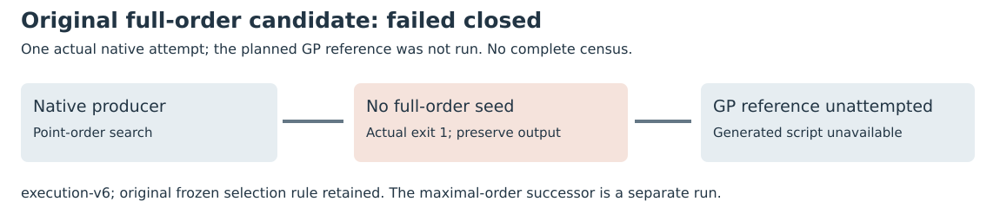

# Full-order twist seed: explicit failed candidate

Run: **generator-full-order-v1**.

The original candidate required a twist point whose order equals the whole rational twist group. The frozen native producer exits 1 with no full-order seed in fixed search; the output directory contains no complete RECORDS.json or GP script. One native execution was attempted, and the planned GP reference was unattempted. Do not report a completed 120-case census or infer missing costs as zero.

Source 9643e917922cca9c50ae91709ba12f4ea9d6bfa1; protocol 248a8120237f48e6cd74022bf964582a898c876bc9b8ecc73aed834fc031d8d2. Native cap600 seconds,4GiB,64MiB/file. The successor independently finds a noncyclic twist with structure C7 x C119; that group has no point of order833. The original rule remains unavailable there, rather than being silently changed.

The faithful actual-execution export passes standalone schema/file validation. Full protocol binding retains four findings for the absent GP execution. The initial planned-row export was also rejected because the schema forbids attempts=0; both records are retained. No reference execution is invented to make the checker green.

Raw archive 976 bytes, SHA256 998844edb84d13ff70db937d6983215ff22f91b9e5b4bc740489056bc93ef839; 3 file members verified after fresh download. The separate successor changes the rule for every fixture before its own data.

Local L0 managed Xeon Platinum 8573C/KVM, one native thread; no native time, calibrated field operations, GAE, fastest-external or full IC/rho result. The existing authorized local fallback follows the documented EKS access/image gap. Source, binaries, actual argv/env, exits, limits and input hashes are versioned; no paid resource or IAM change.

The inputs are all ten original public toy fixtures with registered source/twist identities. No target, shift, base size or observed yield enters seed selection. Final E28 labels 32–63 remain unopened. This is standard finite-group order/selection work, not a novelty or NIST-security result. Literature reviewed before design: predecessor reports/atlas, existing field/group source and local primary PARI ellorder/ellcard/ellgroup help.

Both raw archives use the user-confirmed Setec content-addressed store. Fresh downloads verify every member and identical deterministic repacking. Original failed data and the separately frozen successor remain distinct; no failed attempt is silently replaced.

Sources: [execution-v6/PROTOCOL.md](../../../execution-v6/PROTOCOL.md), [execution-v6/FAILURE.json](../../../execution-v6/FAILURE.json), [execution-v6/experiment.export.json](../../../execution-v6/experiment.export.json), [execution-v6/RAW_VERIFICATION.json](../../../execution-v6/RAW_VERIFICATION.json).
