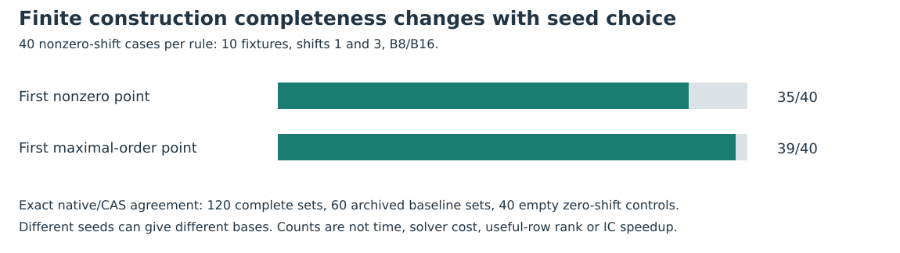
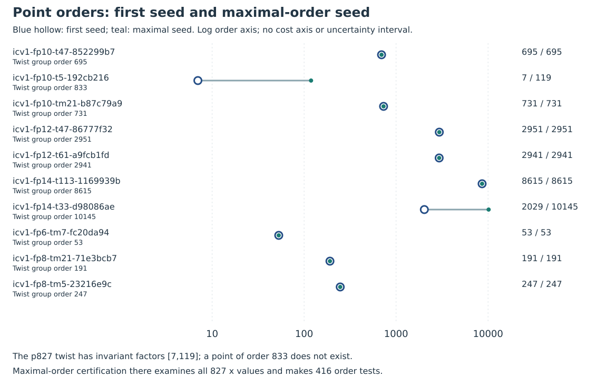

# Maximal-order twist seeds: exact construction improvement

Run: **generator-maximal-order-v1**.

All ten fixtures and all120 complete base sets pass independent native/PARI replay. The sixty archived first-seed sets match exactly; all forty zero-shift sets remain empty. Among forty nonzero-shift cases per rule, the first-seed rule fills35 and the maximal-order rule fills39. The derived change is 39-35=4 additional filled cases; different sets are not a same-output speedup.

The p827 source icv1-fp10-t5-192cb216 has rational group order823. Its twist has structure C7 x C119, cardinality833. The original point has order7; the maximal point has order119. Native exhaustive order search and independent GP ellgroup/canonical-seed checks agree. The maximal-order certificate examines827 candidate x values and performs416 point-order tests. Those discovery activities are retained, not priced as calibrated operations or hidden as free setup.

The p10111 twist also changes from point order2029 to10145, without a fill failure in the original tested prefixes. The remaining underfilled successor case is icv1-fp6-tm7-fc20da94, p59, shift3,B16: only14 coordinates are collected after the whole52-term nonidentity orbit. It is retained; no refill or shift change. All ten source/twist rational group-order gcds are1. No source-generator scalar transfer is supplied.

Source f98f2935d5b7ccc41b10c4da5a7839b9225910a0; protocol 18feca459aa82923d4b3a89ad81ca4f019d53a0f112fd6288ae7c22beb32c404. The maximal-order rule was frozen for the entire unchanged panel after explicitly preserving the failed full-order predecessor. It searches every canonical point when whole-group order is unavailable, retaining the lexicographically first maximal-order tie.

Actual native/CAS executions independently check both cardinalities, source generator orders, seed selection, point orders, complete coordinate sets and aggregate fill counts. Source-generator, p7 prime/cyclic/noncyclic and zero-shift controls pass. The full structured protocol/export/file binding has zero findings. Native600s/4GiB/64MiBfile; GP300s/4GiB with64MB initial stack and strict clean-output admission. Full native package release tests pass serially; the six unchanged incoming root-library regressions remain documented in execution-v4.

Raw archive 7364 bytes, SHA256 d4f6b99b131b0e9c82646b0aff3ff014b5bd2cde22e51ebc761d621c918039d0; 5 members verified after fresh download. Group/seed discovery, failed fill attempts and all original data remain recorded. No cost of decomposition, independent useful rows, matrix rank, scalar recovery or complete IC is measured here; construction completeness is the result.

Next discrimination: cold complete costs using the corrected generator rule, with matched ordinary bases, same-base group/PDP controls, verified useful rows and strongest matched rho. A second generator/coset construction on the noncyclic twist is another separate hypothesis. No new scalar-preserving map is drawn on canonical curve graphs; validated pipeline/leaderboard graphs remain unchanged.

Local L0 managed Xeon Platinum 8573C/KVM, one native thread; no native time, calibrated field operations, GAE, fastest-external or full IC/rho result. The existing authorized local fallback follows the documented EKS access/image gap. Source, binaries, actual argv/env, exits, limits and input hashes are versioned; no paid resource or IAM change.

The inputs are all ten original public toy fixtures with registered source/twist identities. No target, shift, base size or observed yield enters seed selection. Final E28 labels 32–63 remain unopened. This is standard finite-group order/selection work, not a novelty or NIST-security result. Literature reviewed before design: predecessor reports/atlas, existing field/group source and local primary PARI ellorder/ellcard/ellgroup help.

Both raw archives use the user-confirmed Setec content-addressed store. Fresh downloads verify every member and identical deterministic repacking. Original failed data and the separately frozen successor remain distinct; no failed attempt is silently replaced.

Sources: [execution-v7/PROTOCOL.md](../../../execution-v7/PROTOCOL.md), [execution-v7/FROZEN.json](../../../execution-v7/FROZEN.json), [execution-v7/ADMISSION.json](../../../execution-v7/ADMISSION.json), [execution-v7/experiment.export.json](../../../execution-v7/experiment.export.json), [execution-v7/RAW_VERIFICATION.json](../../../execution-v7/RAW_VERIFICATION.json).
