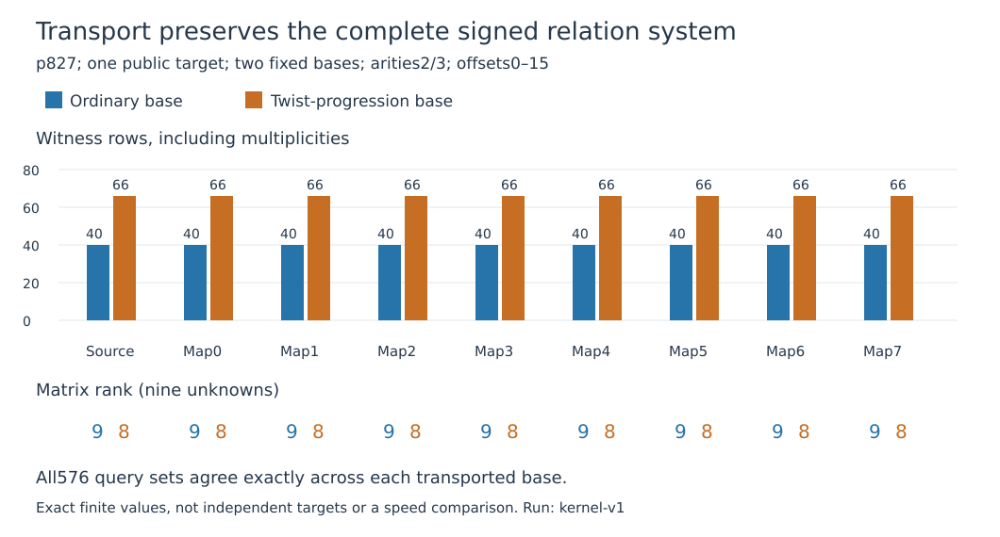

# Twist torsion gives executable relation-preserving isogenies

All **eight** cyclic7-kernels from the p827 twist's full7-torsion give certified
rational degree7 maps from the source. Each map carries the generator, target
and complete signed relation rows with the same scalar. This establishes a
concrete connection through standard isogeny theory. It supplies no additional
information for the transported base and establishes no solving speedup.

The fixed public source is `icv1-fp10-t5-192cb216`, y²=x³+x+15 over F827,
order823, G=(2,5), Q=37G. Its d2 twist y²=x³+4x+120 has order833 and
structure C7×C119. The two groups have no common nontrivial rational odd-order
component. The new construction uses twist torsion as isogeny kernels; it
does not add twist-rational points to mixed source relations.

The anti-Frobenius embedding is (X,Y)↦(X/2,Y·ω/4), ω²=2. Native checks cover
all49 torsion points and all2,401 pairs. Each seven-point line is Frobenius
stable. The three paired x-roots construct a normalized Vélu map
ψ(x,y)=(N/H²,yM/H³), M=N′H−2NH′. Exact polynomial curve identities,
squarefreeness, coprimality, degrees, poles and infinity are checked. Reverse
maps come from the image of the full7-torsion, followed by inverse7 coordinate
scaling. Both generic compositions equal[7]; inversion on the source subgroup
is [588]∘dual since7·588=1+5·823.

| Line | Quotient y²=x³+a x+b | Canonical model |
|---:|---|---|
|0|a54,b121|`icv1-fp10-t5-44c1ec1d`|
|1|a211,b695|`icv1-fp10-t5-bdd22a81`|
|2|a27,b514|`icv1-fp10-t5-aa4928b9`|
|3|a11,b543|`icv1-fp10-t5-3b71719e`|
|4|a229,b473|`icv1-fp10-t5-b4defb92`|
|5|a17,b601|`icv1-fp10-t5-abb926d8`|
|6|a665,b221|`icv1-fp10-t5-6c3bd6f1`|
|7|a367,b162|`icv1-fp10-t5-0f8036c6`|

Every quotient has order823. Native generic checks verify16 dual compositions;
exhaustive rational checks cover6,584 forward and6,584 reverse points, including
identity. Independent PARI constructs all maps and reverse maps with
`ellisogeny`, checks exact formulas/compositions and verifies public-point
recovery. Eight corrupt-map controls are rejected.

Two fixed target-blind bases contain eight oriented points including G. One
uses ascending source coordinates; the other uses shifted coordinates from
the lexicographically first maximal-order twist seed, order119. Each mapped
base uses the actual image points with preserved signs. All arity2/3 witnesses
for Q+jG, j0–15, are enumerated:64 source plus512 destination cases. Every
index/sign witness set and resulting coefficient matrix agrees exactly with
the corresponding source base. There are1,593 F3 checks,144 explicit identity
first-pair exceptions and954 rejected flipped-sign controls.

The ordinary base has40 witness rows, rank9 and verified scalar37. The twist
base has66 rows but rank8; the frozen full-system solver returns no complete
solution. Counts include repeated-index/sign multiplicities, not distinct
independent rows. The [separate target-identifiability diagnostic](../relation-rank-20261027/RESULTS.md)
confirms that the twist-base target itself remains ambiguous. All nine models
retain each outcome. These are correlated queries for one public target,
not18 independent DLPs. No factor-base logs or known37 enter elimination.

Source93a8281dbf29a51ba4be3ba57dce3d6222402bc8; frozen protocol
44d59074bd25ea258211b1ef482cfbdd30c96bf8e74e66a4df9a541ef482d153.
Native producer and complete native replay pass; independent GP passes strict
exit/output/hash checks (only its exact declared stack-size warning). Two
whole-panel arms complete. Full protocol/export/file binding has zero findings.
Native/CAS bounds are300s each,4GiB,CPU0,one thread. Managed Xeon Platinum8573C
KVM, L0; operational timestamps are not performance observations. The documented
EKS access/image fallback applies. No paid compute or IAM change.

Four Lean declarations check the structural group implication:
`TwistKernelRelations.recovery`, `.injective`, `.relation_iff`,
`.scalar_transport`. They assume additive group laws, homomorphisms, the
degree7 dual identity and823-torsion. Their proofs establish recovery,
injectivity and relation/scalar equivalence; the concrete curve/map/dual bridge
is **not formalized**. Fresh axiom audit uses only propext, Classical.choice,
Quot.sound; no custom axioms, sorry or trusted native evaluation.

The standard descent/Vélu construction is prior art: Sutherland, MIT18.783
Fall2025 Lecture5, Theorems5.11/5.15 and Remarks5.16–17. Primary source and
PARI help were read before implementation; atlas isogeny/torsion obstructions
were reviewed. [Review](../../execution-v8/LITERATURE.md).

Exact [model manifests](../../execution-v8/EC1_MODELS.json) retain full curve UIDs;
[ordered routes](../../execution-v8/ORDERED_ROUTES.json) bind map artifacts and
direction. TWK1 identifiers are study map IDs, not a cross-repository ISO1
certification. Eight canonical model records and aliases are registered.
No scalar map to the twist's rational group, NIST-size route, novelty,
additional transported information, cheapest representative or full IC gain
is established. No leaderboard/benchmark row is promoted. Original campaigns
and final E28 labels32–63 remain open.

Raw archive:22,024 bytes,10 members, SHA256
58618a66dfec1cbdf743d56e8d0eedde83279bb3b9906adea1710b89f50dd768,
in the user-confirmed Setec content-addressed store. See
[reproduction](../../execution-v8/README.md), [admission](../../execution-v8/ADMISSION.json),
[export](../../execution-v8/experiment.export.json) and
[archive verification](../../execution-v8/RAW_VERIFICATION.json).

Next: separately freeze a cold complete decomposition cost panel on these
certified maps, with discovery/conversion charged, source/destination same-base
solver controls and ordinary group controls. Representation choice may change
equation-solving cost; exact transport alone leaves the relation information
unchanged. Existing canonical performance graphs stay unchanged because no
new performance result was measured; this report adds a correctness diagram.
