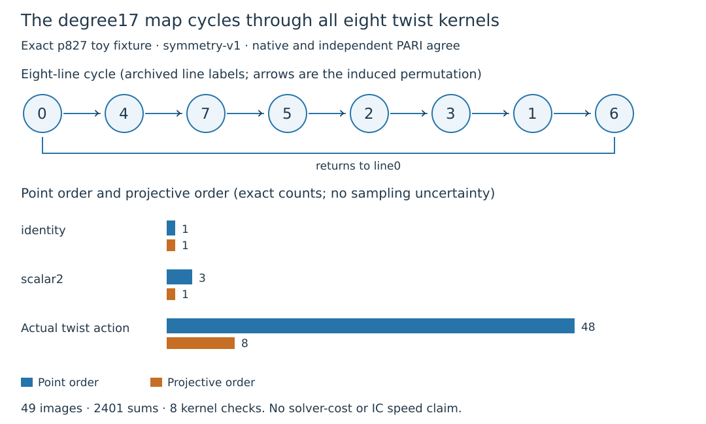

# Exact symmetry of the eight twist-derived kernels

On the fixed public p827 example, the certified degree17 endomorphism cycles
through all48 nonzero twist seven-torsion points and all eight kernel lines.
Native computation and independent PARI/GP agree. These are exact finite
computations, not measured relation-solving costs.

| Recorded quantity | Actual action | Identity control | Scalar2 control |
|:--|--:|--:|--:|
| Point order | 48 | 1 | 3 |
| Projective order | 8 | 1 | 1 |
| Direct point checks | 49 | — | — |
| Addition checks | 2401 | — | — |
| Direct kernel-root matches | 8 | — | — |

The source is $E:y^2=x^3+x+15$ over $\mathbb F_{827}$,
ICV1 `icv1-fp10-t5-192cb216`, order823, generator(2,5). Its quadratic twist
$T:Y^2=X^3+4X+120$ has order833. The unchanged archived basis of $T[7]$ is
$T_1=(0,51)$ and $T_2=(6,130)$; labels$(i,j)$ mean $iT_1+jT_2$.
The endomorphism is the previously certified $\alpha=(\pi+[1])/[7]$.

In that basis its independently recovered matrix and eighth power are

$$M=\begin{pmatrix}3&1\\5&5\end{pmatrix}\pmod7,
\qquad M^2-M+3I=0,\qquad M^8=3I.$$

The complete nonzero point set is one48-cycle. Kernel labels are
$\langle T_1+cT_2\rangle$ for $c=0,\ldots,6$, followed by
$\langle T_2\rangle$ as line7. Their single cycle is
$0\to4\to7\to5\to2\to3\to1\to6\to0$.
Every image line was checked by matching its three paired kernel
x-coordinates against the archived v8 kernel polynomial roots.

## Method, proof and scope

Native evaluation embeds into $E(\mathbb F_{827^2})$, applies the frozen
normalized degree17 Vélu map and inverse-scale7 isomorphism, then unembeds.
GP independently reconstructs Vélu with `ellisogeny` and evaluates the rational
twist map $(X,Y)\mapsto(2R(X/2),Y S(X/2))$. Each implementation reconstructs
the matrix from point labels and checks every point, all2401 additions,
complete point/line cycles, trace1 and determinant3. A corrupted coefficient
is detected on42/49 points; swapping two line images yields2/8 mismatches.

The proof is finite: a cyclic basis $(v,Mv)$ conjugates the matrix to
$C=\left(\begin{smallmatrix}0&4\\1&1\end{smallmatrix}\right)$ over$\mathbb F_7$.
Exhaustion establishes $C^8=3I$, $C^{48}=I$, no shorter positive point
period for any nonzero vector, and no shorter positive line period than8.
The full raw orbit, point and kernel records are retained.

Four Lean declarations in `lean-v7/TwistKernelSymmetry.lean` prove these
companion-module statements by kernel-checked finite arithmetic:

- `eighth_scalar`: eighth power is scalar3.
- `forty_eighth_identity`: forty-eighth power is the identity.
- `nonzero_point_period`: every nonzero point has period48.
- `projective_period`: every nonzero line has period8.

Pinned Lean4.34.1/mathlib revision
`d13f23b723b8a846827a245b89c10fc7d3f11612`; frozen replay and fresh native
transitive axiom audit pass with standard foundations only, no trusted
`native_decide`. The concrete elliptic-curve/torsion-basis/map-to-matrix bridge
remains unformalized. The v1 identity-certificate format fixes a different
prime modulus and cannot certify this characteristic7 action; the exact
native/GP and Lean evidence are the applicable certificates.

This supplies a finite symmetry relating all eight kernels. Induced explicit
maps between their quotient curves and any saving in constructing or solving
relations remain unmeasured. The point order48 on$T[7]$ differs from the
known scalar action's order274 on$E(\mathbb F_{827})$. No degree1 automorphism,
cheap rho fold, novelty, full-IC improvement or NIST applicability is inferred.

## Reproducibility and execution

Source revision `ee305333dfb7c7acc19169794de12e6c6538a3be`;
frozen protocol hash
`49ac79e28023c2e4a23f27e299419b8cb15ac577ba50a531ad43d6e0a2ac07dd`.
The frozen record was committed and Setec gate passed before data. Native
and GP each completed their single300s-capped run on the managed Xeon8573C
KVM host, one thread/CPU0/4GiB, L0; no clocks are admitted.

Flow: planned2, attempted2, completed2, not completed0, interrupted0, resumed0,
excluded0. Both strict admissions pass. Unified export binds protocol,
source, script, inputs and actual raw files with zero findings. Independent
implementation shares author/host; no separate-runner review exists.

Raw archive is5432bytes/eight files, SHA256
`1f0992c77000041a0d7d2be6d8642b5d5e1614442b3d07abc4d7bd22c51e36d5`,
in the user-confirmed `s3://setec-astronomy-artifacts/store`. See execution-v11
for member inventory, deterministic recipe, fresh remote verification and
all exact commands. Synthetic native tests pass18/18; all standalone runner
tests pass. The prior full-root-suite validation gap remains open separately.

Preserved development issues: missing finite-product Lean import was fixed;
draft placeholders/short SHA were rejected before freeze; the initial export
omitted host memory metadata and was retained, then corrected with no science
changes. Fresh ECR readiness remains access-denied, so the documented authorized
local fallback applies. No paid resources or permissions were changed.

Literature: Andrew Sutherland, MIT18.783 Fall2025
[Lecture5](https://math.mit.edu/classes/18.783/2025/LectureNotes5.pdf)
Theorems5.11/5.15, [Lecture13](https://math.mit.edu/classes/18.783/2025/LectureNotes13.pdf)
Theorems13.6/13.8, accessed/read2026-10-28; repository
`RESEARCH_ISOGENY_LOOP_GLV.md` and atlas GLV/isogeny-loop lead. These support
the standard construction and distinction from unknown-log recovery.

Canonical progress/IC/curve graphs were checked: this exact module census
does not change a performance row, model identity or previously verified
edge. Prior graphs and frozen waves remain unchanged.
