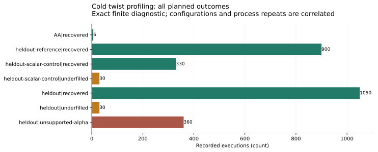
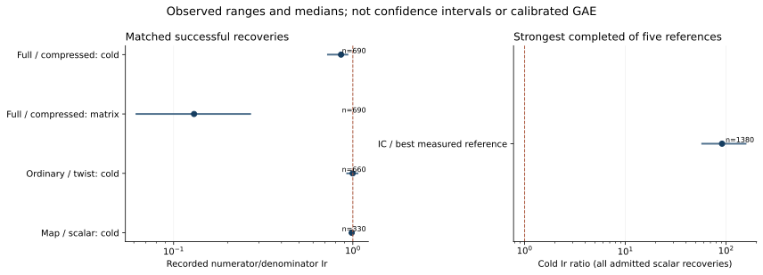

# Larger frozen-model twist diagnostic

**Status:** independently replayed finite software-count diagnostic; benchmark admission remains incomplete.

The fixed plan contains 2706 profiles and 2706 attempted executions. There are 60 distinct public DLP targets in this cohort. Configurations and process repetitions are correlated; a recovered execution is not another independent target.

| Recorded cohort and outcome | Executions |
|:--|--:|
| AA / recovered | 6 |
| heldout-reference / recovered | 900 |
| heldout-scalar-control / recovered | 330 |
| heldout-scalar-control / underfilled | 30 |
| heldout / recovered | 1050 |
| heldout / underfilled | 30 |
| heldout / unsupported-alpha | 360 |

The ratios below use only successful matched recoveries, with every unsuccessful attempt retained in the table above. Endpoints are observed ranges, not confidence intervals.

| Numerator / denominator | Median [min, max]; pairs |
|:--|:--|
| Full / compressed, cold | 0.85955 [0.72674, 0.93308], n=690 |
| Full / compressed, matrix | 0.13003 [0.062042, 0.26743], n=690 |
| Ordinary / twist, cold | 0.99748 [0.93023, 1.0604], n=660 |
| Map / scalar, cold | 0.98548 [0.98099, 0.98928], n=330 |
| IC / strongest completed measured reference | 91.231 [58.013, 156.14], n=1380 |

Ratios below 1 favor the numerator. Compression cost more in every successful matched cold pair in this implementation. The map/scalar saving is available to ordinary bases too. The ordinary/twist ratios do not establish a consistent twist-specific advantage. Five references share each Q: native rho, negation/cycle-escape rho, BSGS, negation BSGS and GP elllog. The strongest completed member is not a global fastest-rho certificate.

Twelve models were fixed by public coefficient/order criteria before their DLP profiles, at minimum16/18/20 subgroup bits. One minimum18 case actually has19 bits. General-model degree17 maps are unsupported and retained as failed method attempts. Original E28 final labels32–63 remain unopened.

All raw instruction sums and completed source/map/full-fiber computations pass independent native/GP checks. Initial GP references were strictly rejected for undeclared automatic stack-growth warnings. Their unchanged-script successors use a larger initial stack and pass the same strict policy. No attack profile was repeated.

The original summary stopped on identical missing query hashes in pre-query failures. A versioned post-data guard correction preserves successful-pair eligibility and formulas. Both versions remain. The pre-data machine protocol also encoded the explicit flat plan in fields the canonical checker treats as a rectangular product. Export schema checks pass, but full protocol/export admission fails (including the analysis-source correction). These are descriptive diagnostics, not promoted benchmark or leaderboard rows. The exact pre-data plan is complete; the checker finding is not evidence of missing planned profiles.

The unit is single-event guest instructions Ir, including actual resident-GP instructions in each exclusive phase. Cold setup, queries, complete decomposition, signs/deduplication, matrix work and source-point verification are charged per target. Input/program loading and result/trace serialization are excluded. No clock, cycle or primitive/GAE conversion is used.

Conditional affine Lean lemmas retain their stated hypotheses. Concrete arithmetic, rank/kernel spans and map fidelity are checked externally; a fully formal concrete bridge is open. Literature and access gaps are in the frozen protocol.

\newpage

Sources: [frozen protocol](../../execution-v18/PROTOCOL.md), [native data manifest](../../execution-v18/analysis-v2/.artifacts.json), [source/byte pins](../../execution-v18/FROZEN.json). [Independent GP admission](../../execution-v18/audit-v2/ADMISSION.json), [reporting correction](../../execution-v18/ANALYSIS_CORRECTION_V2.json).

Reproduction and raw-object manifests are linked from the evidence directory.
The user-confirmed store is `setec-astronomy-artifacts`, region us-east-2.
No NIST, asymptotic, novelty or calibrated-GAE result is established.
