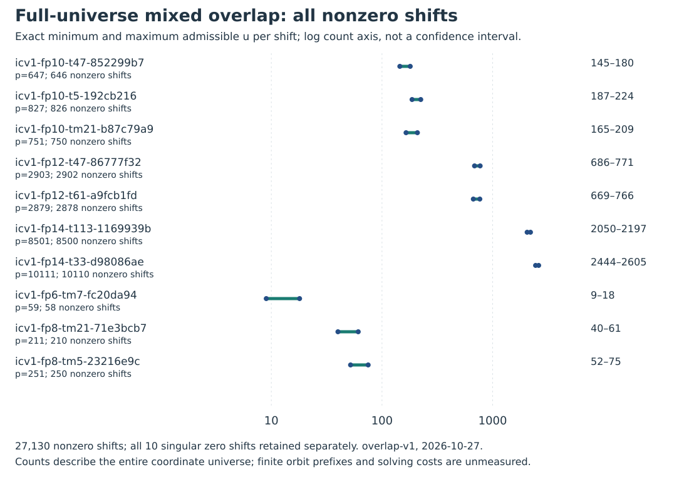
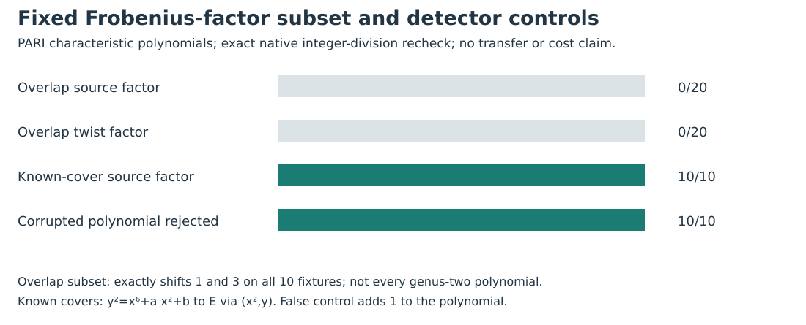

# Shifted twist overlap and genus-two factor checks

Run: **overlap-v1**, 2026-10-27.

The complete fixed panel has 27,140 shifts on all ten original public toy fixtures. Independent Euler-character and square-root-multiplicity implementations agree on every mixed/ordinary count and genus-two affine count. All 27,130 nonzero shifts pass polynomial coprimality and the integer Weil-bound check. Ten singular zero shifts remain explicit controls; 27,140 false plus-one counts are rejected. These are exact finite counts, not independent targets or timing samples.

The classical connection is that four times the full-coordinate twist-to-source overlap equals the rational point count of D_c: y²=f(u)f(u+c)/d for nonzero shift c. Its nonsquare leading coefficient gives no rational points at infinity. The standard genus-two Weil bound puts this supply near p/4. This does not bound a short orbit prefix or a decomposition algorithm. For p=10111 the nonzero-shift range is 2444–2605 eligible coordinates from 5072 full twist x-coordinates.

On the predeclared shifts 1 and 3, none of the twenty genus-two Frobenius polynomials has the source or twist elliptic factor. All ten known elliptic-cover positive controls are detected, and all ten corrupted-polynomial controls are rejected. PARI point counts match the native census; native integer division independently verifies factor flags. This does not test the remaining shifts for factors, prove absolute simplicity, construct a scalar map, or measure any DLP advantage.

Scientific source 069fb43cd486b24b604ce9320d01caa9f8fb64b3 and binary/input hashes are frozen in execution-v5/FROZEN.json. Protocol b7e3139b59da38041808bdd4d0028b8d8ac8348e2baa9e9ec6f4da7fe436a61d precedes panel data. Two actual executions process the same complete panel: producer and independent verifier. The full structured export/protocol/file binding passes with zero findings; this does not repair the predecessor cost panel metadata.

Commands: frozen worker transport RECEIPT produce PRIOR_PLAN RAW; transport RECEIPT verify PRIOR_PLAN RAW AUDIT; native GP transport; frozen admit; frozen export. Producer/verifier each have 600 seconds, 4 GiB and 64 MiB/file; GP has 300 seconds, initial 64 MB stack and 4 GiB maximum. L0 managed Xeon Platinum 8573C/KVM; the standing authorized local fallback applies. No native clock, cost, GAE, external speed ranking or independent-host claim.

Before affected GP outputs, primary help exposed an API mismatch: polrem was undefined. A recorded preload polrem(a,b)=a%b supplies the intended remainder operation. The main script, native census, cases, thresholds and stderr gate remain unchanged. This explicit compatibility amendment is later than the initial freeze and is linked in the export. Source/hash receipts preserve each stage.

Three Lean theorems prove the ring expansion, signed indicator and conditional finite permutation identity, with a fresh native axiom audit and no sorry, custom axioms or trusted native evaluation. IDC1ha81899274c038263 adds 32 issuer and 64 extra checker probes plus false-plus-one rejection. Legendre, projective-model and Weil formal bridges remain open. Local primary GP help and repository/atlas sources were read; online PARI/IACR/MIT requests failed, so no completed novelty review is claimed.

The deterministic raw archive has 102176 bytes and SHA256 d66823361504cce4e14bf4e8f265982eb4cb939fdca1cd0cf8c5ea085e075d23. A fresh Setec download verifies all 17 members and an identical repack. Figures use native aggregates only. No full-campaign, NIST, useful-relation rank or whole-IC/rho requirement is discharged; final E28 labels 32–63 remain unopened.

| Source identity | p | Nonzero shifts | Mixed min | Mixed max |
| --- | --- | --- | --- | --- |
| icv1-fp10-t47-852299b7 | 647 | 646 | 145 | 180 |
| icv1-fp10-t5-192cb216 | 827 | 826 | 187 | 224 |
| icv1-fp10-tm21-b87c79a9 | 751 | 750 | 165 | 209 |
| icv1-fp12-t47-86777f32 | 2903 | 2902 | 686 | 771 |
| icv1-fp12-t61-a9fcb1fd | 2879 | 2878 | 669 | 766 |
| icv1-fp14-t113-1169939b | 8501 | 8500 | 2050 | 2197 |
| icv1-fp14-t33-d98086ae | 10111 | 10110 | 2444 | 2605 |
| icv1-fp6-tm7-fc20da94 | 59 | 58 | 9 | 18 |
| icv1-fp8-tm21-71e3bcb7 | 211 | 210 | 40 | 61 |
| icv1-fp8-tm5-23216e9c | 251 | 250 | 52 | 75 |

Sources: [execution-v5/PROTOCOL.md](../../execution-v5/PROTOCOL.md), [execution-v5/LITERATURE.md](../../execution-v5/LITERATURE.md), [execution-v5/ADMISSION.json](../../execution-v5/ADMISSION.json), [execution-v5/overlap-audit-v1/AUDIT.json](../../execution-v5/overlap-audit-v1/AUDIT.json), [execution-v5/experiment.export.json](../../execution-v5/experiment.export.json), [execution-v5/GP_COMPATIBILITY_AMENDMENT_V2.md](../../execution-v5/GP_COMPATIBILITY_AMENDMENT_V2.md), [lean-v4/README.md](../../lean-v4/README.md).

Canonical IC leaderboard/scoreboard, progress timeline and curve/cover map graphs were checked: no validated pipeline row or new scalar-preserving map changes their data, so they remain unchanged. This finite geometry report adds no performance benchmark row. The next discriminator is a target-blind twist-generator order/finite-prefix comparison, with charged discovery and matched ordinary generators; the full-universe count does not answer it.
