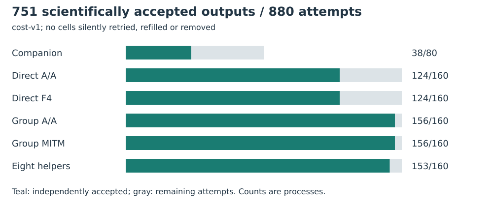
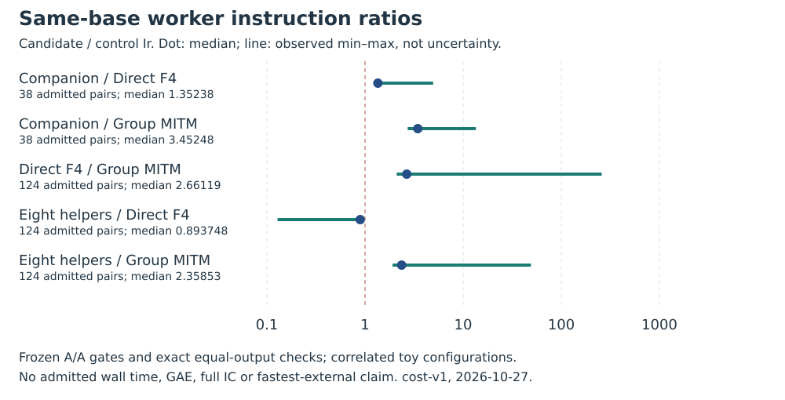

# Progression bases and companion equations: cold worker costs

Run: **cost-v1**.

All 880 planned cells were attempted: 751 independently accepted outputs, 105 cooperative-budget exits and 24 unsupported underfilled bases. The standardized export counts 775 conclusive process completions, including those 24 unsupported failures; scientific acceptance remains 751. By arm: direct F4 124/160, its A/A 124/160, helpers 153/160, companion 38/80, group MITM 156/160 and its A/A 156/160.

The companion completes 38 arity-two cases and no arity-three cases under the registered budget. In the 38 admitted same-base comparisons it costs 1.2943715012885497–4.948801810455357 times direct F4 (median 1.352375384073076). Missing comparisons are not zero-cost results. Redundant auxiliary square equations do not impose a zero sum on auxiliary twist points.

Eight helpers cost 0.12837712863374748–0.9085067663602162 times direct F4 across 124 admitted pairs (median 0.8937482746077081). This is an existing ordinary encoding effect. Direct F4 and helpers both lose to ordinary group MITM in every admitted comparison, medians 2.6611915882806296 and 2.3585326491871 times group Ir. Companion/group median is 3.4524782516950037 on 38 pairs.

Within-base outputs are exactly equal under the independent signed-tuple census; decisive ratios require direct and group A/A checks within 5%. Across different constructors the answer sets differ. Their near-one raw cost ratios are descriptive only; they are not same-output speedups or costs per independent useful relation.

Callgrind guest instructions Ir include cold process startup/parsing, target-blind base discovery, conversion and lifts, equation construction/F4, roots/signs, exceptional charts, deduplication, source verification and serialization. Parent/kernel, independent replay, relation-log linear algebra and full scalar recovery are excluded. Grevlex D32, GM1, linear roots enabled. Per worker: 2-second cooperative solver budget after construction, 4-second hard limit plus 1-second grace, 4 GiB, 32 MiB/file; global 2400 seconds/1 GiB.

Actual strict PARI admission checks 1841 positive sums and the same number of wrong-sign controls. Frozen masked analysis preceded labelled inspection; native unmasking verifies equal distributions. Numerical signatures can reveal method roles; the analyst and host are not independent. Command: frozen harness run PLAN.json WORKER runs/cost-v1, audit PLAN COST CENSUS cost-audit-v1, blind, unmask, then strict admit after the unchanged GP replay with a larger initial stack.

No new twist-specific index-calculus speedup is established. Larger fields, other transformations, arity four, scalar-preserving maps, fastest-external full-root comparison, independent-host replay, calibrated full-IC costs and matched rho remain open. The original complete campaign cards are not closed by this bounded diagnostic.

Scientific source d01d7bb63cc577a4299200ae3c560767b6d68650; binary hashes and build inputs are pinned in execution-v4/FROZEN.json. All ten prior public odd-prime-order fixtures are retained with their registered source/twist identities. No outcome-based seed or fixture selection; final E28 labels 32–63 remain unopened.

Backend: authorized local fallback after CodeBuild monitor and ECR readiness reads were denied; no EKS Job or paid launch. Intel Xeon Platinum 8573C, five visible logical CPUs, KVM, one worker/thread; L0. Host metadata captured after the run. Native wall time, RSS, calibrated operations and cycles are not admitted.

Raw files: execution-v4/runs.tar.xz, artifact SHA256 225c00f390768d6a3bae8b89e3635fc51101b09be4452991dec54a9c59fe9f56. Fresh Setec download verifies all 5,867 member hashes and identical deterministic repack. Extract the archive before native replay. The independent verifier shares this host/author; separate code and PARI are not independent-host review.

Structured exports pass standalone schema/file validation. Full binding to the frozen generic factorial protocol is rejected: configuration count and separate controls were encoded incorrectly for its balanced-panel model. The native 880-cell plan was fixed before data and is unchanged. See EXPORT_LIMITS.md; no validation-gated row is promoted.

Prior work: Semaev, Summation polynomials and the discrete logarithm problem on elliptic curves, IACR ePrint 2004/031; established quadratic-twist/Frobenius theory and prior execution-v3 reports. Primary IACR PDF requests returned HTTP 403, so the literature/novelty review has an access gap. The atlas leads on generic-table decomposition, structured-base coincidences and special-j x-line symmetry were reviewed. No novelty is established.

| Candidate/control | Pairs | Min | Median | Max |
| --- | --- | --- | --- | --- |
| companion-curve/direct-chain | 38 | 1.2943715012885497 | 1.352375384073076 | 4.948801810455357 |
| companion-curve/group-mitm | 38 | 2.7197190982590165 | 3.4524782516950037 | 13.496649565420908 |
| direct-chain/group-mitm | 124 | 2.1011889519751707 | 2.6611915882806296 | 258.37602285298715 |
| hybrid-eight/direct-chain | 124 | 0.12837712863374748 | 0.8937482746077081 | 0.9085067663602162 |
| hybrid-eight/group-mitm | 124 | 1.9080664835900645 | 2.3585326491871 | 49.05657843514646 |

Sources: [execution-v4/cost.protocol.json](../../../execution-v4/cost.protocol.json), [execution-v4/cost-audit-v1/AUDIT.json](../../../execution-v4/cost-audit-v1/AUDIT.json), [execution-v4/cost-audit-v1/ADMISSION.json](../../../execution-v4/cost-audit-v1/ADMISSION.json), [execution-v4/blind-v1/UNMASKING.json](../../../execution-v4/blind-v1/UNMASKING.json), [execution-v4/EXPORT_LIMITS.md](../../../execution-v4/EXPORT_LIMITS.md).
