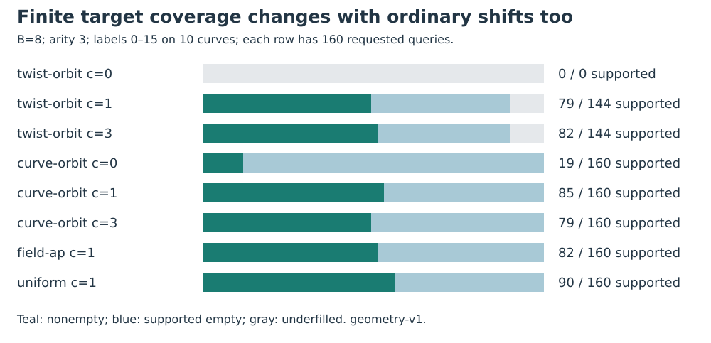

# Shifted progression bases: exact finite census

Run: **geometry-v1**.

The native producer emits 240 constructions and 7,680 finite query records in one execution. Independent square-table, Euclidean-inverse and affine-group code reproduces every base and all query counts. Of the requested bases, 214 fill; the other 26 remain explicitly unsupported. B is 8 or 16, shifts are 0, 1 and 3, arities are 2 and 3, and public target labels are 0–15.

The unshifted twist produces no nonzero source lifts, as required. Shifted twist progressions do produce valid original-curve bases. Ordinary source progressions also change coverage after a shift. This finite census establishes construction and relation counts, not a twist-specific solving advantage. Sorted-first-pair tuple counts are not independent relations or matrix rank.

Command: frozen worker followup progression-census execution-v3/decomposition-20261026/PLAN.json execution-v4/runs/geometry-v1; frozen harness audit-geometry execution-v4/PLAN.json CENSUS AUDIT. Geometry cap: 600 seconds, 4 GiB, 64 MiB/file. Measured quantity: exact finite counts only. All zero and underfilled cases are retained.

Scientific source d01d7bb63cc577a4299200ae3c560767b6d68650; binary hashes and build inputs are pinned in execution-v4/FROZEN.json. All ten prior public odd-prime-order fixtures are retained with their registered source/twist identities. No outcome-based seed or fixture selection; final E28 labels 32–63 remain unopened.

Backend: authorized local fallback after CodeBuild monitor and ECR readiness reads were denied; no EKS Job or paid launch. Intel Xeon Platinum 8573C, five visible logical CPUs, KVM, one worker/thread; L0. Host metadata captured after the run. Native wall time, RSS, calibrated operations and cycles are not admitted.

Raw files: execution-v4/runs.tar.xz, artifact SHA256 225c00f390768d6a3bae8b89e3635fc51101b09be4452991dec54a9c59fe9f56. Fresh Setec download verifies all 5,867 member hashes and identical deterministic repack. Extract the archive before native replay. The independent verifier shares this host/author; separate code and PARI are not independent-host review.

Structured exports pass standalone schema/file validation. Full binding to the frozen generic factorial protocol is rejected: configuration count and separate controls were encoded incorrectly for its balanced-panel model. The native 880-cell plan was fixed before data and is unchanged. See EXPORT_LIMITS.md; no validation-gated row is promoted.

Prior work: Semaev, Summation polynomials and the discrete logarithm problem on elliptic curves, IACR ePrint 2004/031; established quadratic-twist/Frobenius theory and prior execution-v3 reports. Primary IACR PDF requests returned HTTP 403, so the literature/novelty review has an access gap. The atlas leads on generic-table decomposition, structured-base coincidences and special-j x-line symmetry were reviewed. No novelty is established.

Sources: [execution-v4/geometry.protocol.json](../../../execution-v4/geometry.protocol.json), [execution-v4/geometry-audit-v1/AUDIT.json](../../../execution-v4/geometry-audit-v1/AUDIT.json).
