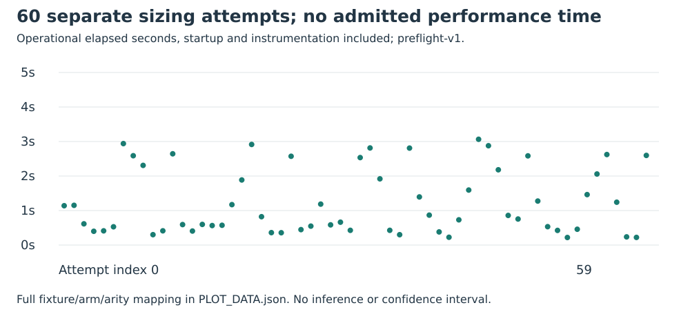

# Operational sizing: separate preflight

Run: **preflight-v1**.

The predeclared smallest fixture in each original field-bit class, ordinary curve progression, shift 1, B=8 and both arities supplies 60 worker attempts over six applicable arms. This is operational sizing only, excluded from primary cost analysis. No primary metric, threshold, fixture or sample size was selected from these outcomes.

The native preflight estimator records mean process duration 1.2299063341833336 seconds and projected worker-duration sum 1082.3175740813335 seconds for the already fixed 880 cells. These L0 durations include startup, instrumentation and contention. They are not native performance observations or whole-IC time. The full per-call range and raw process outcomes remain in PREFLIGHT_RUNTIME.json and RECORDS.json.

Command: frozen harness run PREFLIGHT_PLAN.json WORKER runs/preflight-v1, then preflight-runtime PREFLIGHT_PLAN.json RECORDS.json PREFLIGHT_RUNTIME.json. Limits: 2-second cooperative solver budget after base construction, 4-second hard limit plus 1-second grace, 4 GiB, 32 MiB/file; prospective outer preflight watchdog 360 seconds. No independent correctness/performance admission is claimed for this operational phase.

Scientific source d01d7bb63cc577a4299200ae3c560767b6d68650; binary hashes and build inputs are pinned in execution-v4/FROZEN.json. All ten prior public odd-prime-order fixtures are retained with their registered source/twist identities. No outcome-based seed or fixture selection; final E28 labels 32–63 remain unopened.

Backend: authorized local fallback after CodeBuild monitor and ECR readiness reads were denied; no EKS Job or paid launch. Intel Xeon Platinum 8573C, five visible logical CPUs, KVM, one worker/thread; L0. Host metadata captured after the run. Native wall time, RSS, calibrated operations and cycles are not admitted.

Raw files: execution-v4/runs.tar.xz, artifact SHA256 225c00f390768d6a3bae8b89e3635fc51101b09be4452991dec54a9c59fe9f56. Fresh Setec download verifies all 5,867 member hashes and identical deterministic repack. Extract the archive before native replay. The independent verifier shares this host/author; separate code and PARI are not independent-host review.

Structured exports pass standalone schema/file validation. Full binding to the frozen generic factorial protocol is rejected: configuration count and separate controls were encoded incorrectly for its balanced-panel model. The native 880-cell plan was fixed before data and is unchanged. See EXPORT_LIMITS.md; no validation-gated row is promoted.

Prior work: Semaev, Summation polynomials and the discrete logarithm problem on elliptic curves, IACR ePrint 2004/031; established quadratic-twist/Frobenius theory and prior execution-v3 reports. Primary IACR PDF requests returned HTTP 403, so the literature/novelty review has an access gap. The atlas leads on generic-table decomposition, structured-base coincidences and special-j x-line symmetry were reviewed. No novelty is established.

Sources: [execution-v4/preflight.protocol.json](../../../execution-v4/preflight.protocol.json), [execution-v4/PREFLIGHT_RUNTIME.json](../../../execution-v4/PREFLIGHT_RUNTIME.json).
