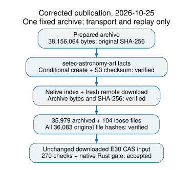

# Corrected artifact publication: Setec Astronomy

The exact prepared twist follow-up archive is now published in
`s3://setec-astronomy-artifacts/store`. An immutable conditional upload,
native store registration, fresh-cache download and remote verification all
succeeded. The earlier access denials used the wrong repository-default
bucket, `crypto-autoresearcher`. They did not establish a permissions problem
with the intended destination. The proposed policy for that other bucket is
superseded and was never applied.

## Requested scope and observed result

The user corrected the destination to Astronomy artifacts. Read-only bucket
discovery returned the exact name `setec-astronomy-artifacts`. Publication
used the existing prepared archive, with no repacking or scientific changes.

| Requirement | Observed result |
| --- | --- |
| Correct destination | `setec-astronomy-artifacts`, with the existing `store/sha256/` layout |
| Immutable upload | Conditional PutObject succeeded; S3 returned the expected SHA-256 checksum |
| Native registration | Native push registered the exact name, digest and 38,156,064-byte size |
| Fresh remote download | New empty download cache; downloaded bytes and SHA-256 match |
| Remote verification | Native store reports cache OK and remote OK |
| Archived-member integrity | All 35,979 archived files match the original manifest |
| Complete tree reconstruction | All 104 separately tracked metadata files restored and checked; 36,083 files total |
| Frozen downloaded-input replay | Original 270-cell E30 incidence input passes PARI replay and the Rust gate |
| Scope of replay | Same host, one unchanged frozen input; full scientific rerun and independent-host replay remain open |

Archive SHA-256:

```text
6fb0de2cf9ad5c2b9acd1703372560550433da7c095f5f42202100aba31ef167
```

Logical artifact name:

```text
evidence/twist_routes_1_3_20261021/execution-v2-20261023/runs.tar.xz
```



## Execution and evidence

The conditional write uses `If-None-Match: *` and SHA-256 verification. The
subsequent native push reports `uploaded: false` because that immutable object
already exists after the successful conditional write; the combined receipt
records the actual successful write. No object or existing name was replaced.
No IAM or bucket policy was changed.

The study now has an explicit [store config](../../store/config.json) and
[native index](../../store/index.json). [Reproduction](../../store/README.md)
sets both store selectors from the repository root. This keeps this artifact
bound to the intended bucket without redirecting unrelated index entries.

The fresh download was extracted in a separate staging tree. Every file is
hashed against the original full manifest, including the 104 loose metadata
files restored from the checkout. Unexpected extracted files are rejected.
The original E30 CAS script from that tree is byte-identical to the frozen
2026-10-23 input. Its PARI executable is also byte-identical to the prior run.
The original Rust gate accepts the output marker, exit status, script/output
hashes and error checks. All 270 original incidence checks replay; no new
fixture, target, solver comparison or scientific experiment was introduced.

- [Destination discovery](../../execution-v2/publication-20261025-destination-discovery-v2/RECEIPT.json)
- [Upload, native registration, fresh pull and remote verification](../../execution-v2/publication-20261025-setec-v1/RECEIPT.json)
- [Complete member-hash check](../../execution-v2/publication-20261025-setec-v1/ARCHIVE_CHECK.json)
- [Fresh CAS transport receipt](../../execution-v2/publication-20261025-setec-replay/gp.json)
- [Native CAS adjudication](../../execution-v2/publication-20261025-setec-replay/adjudication/ADJUDICATION.json)
- [Current raw manifest](../../execution-v2/RAW_ARTIFACTS.json)
- [Validation logs](../../execution-v2/publication-20261025-setec-checks/)

Transport receipts retain exact nonsecret arguments, binary/source hashes,
output hashes and UTC intervals. Credentials entered through non-echoing stdin
and were passed only in child environments. No credential values, unrelated
bucket names or caller identity values are persisted. The inherited native
store binary's exact compiled source revision remains unknown; its binary
hash is retained. This uncertainty does not change the checked byte identity.

The replay uses the unchanged native experiment binary from source revision:

```text
644f1dbef70c5935db211a7d3a70ec7bb0601336
```

Its bounds are a 600-second cap, 4 GiB address space and one worker at
isolation L0. No wall time is admitted as performance
evidence. The [editable diagram](DIAGRAM.dot), rendered diagram and inspected
PDF accompany this report under the repository's research-visuals guidance.

## Correction and remaining requirements

The [earlier denied attempts and wrong-bucket policy](../publication-20261025/REPORT.md)
are preserved as historical evidence. Their access diagnosis is superseded.
No change to that bucket's permissions is requested.

Remote publication and exact archive recovery are verified. A full rerun of
every original scientific checker is not claimed. All sixteen research cards
retain their blocked, unfunded states and their original mathematical/cost
requirements. E26--E28 remain unrun. No calibrated IC speedup, novel attack,
NIST logarithm or independent-host result is established.

The twelve previously committed oversized Git blobs still need a permitted
owner/reviewer resolution, and exact-head CI and review remain required.
[Tracked remaining hold](../../../../problems/twist-followup-evidence-publication.md).
The IC leaderboard, progress timeline and scientific geometry/energy figures
are unchanged because this correction changes artifact availability only.
