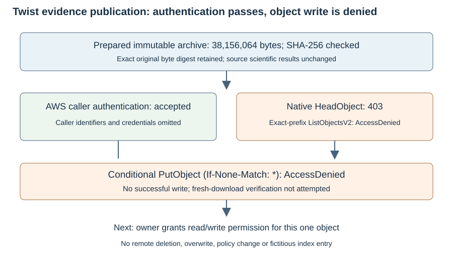

# Artifact publication attempt, 2026-10-25

The supplied credentials authenticate successfully with AWS STS. S3 denies access to the configured artifact bucket: native HeadObject returns 403, exact-prefix listing returns AccessDenied, and an atomic conditional PutObject also returns AccessDenied. **No successful upload or fresh remote download occurred.**

The prepared archive remains 38,156,064 bytes. The store index is unchanged.

Archive SHA-256:

```text
6fb0de2cf9ad5c2b9acd1703372560550433da7c095f5f42202100aba31ef167
```

 This is a publication/access result; no new mathematical, performance, NIST-DLP or independent-host claim follows. The 2026-10-23 scientific report remains a historical record.



## Evidence and scope

The native store client attempted the original expected logical name in s3://crypto-autoresearcher/store. A read-only diagnostic established valid authentication without retaining caller identity values. The create-only fallback targets the exact content-addressed object and uses If-None-Match plus the expected SHA-256 checksum; it cannot overwrite an existing object. It also fails with AccessDenied, so the failure is not only a listing restriction. No IAM/bucket policy was changed and no remote object was deleted.

Credentials entered through non-echoing stdin and were passed only in child-process environments. Stored outputs redact credential values; the STS receipt stores only authentication success, not account/user identifiers. No credential values are included in the source, reports, artifact index or PR update.

[Native attempt](../../execution-v2/publication-20261025-v2/RECEIPT.json), [authentication diagnostic](../../execution-v2/publication-20261025-auth-diagnostic/RECEIPT.json), [conditional-write attempt](../../execution-v2/publication-20261025-v3/RECEIPT.json), [machine assessment](ASSESSMENT.json), [current manifest](../../execution-v2/RAW_ARTIFACTS.json). Each transport receipt records binary hashes, exact nonsecret argv and redacted output hashes. The uploader binary is inherited; its exact compiled source revision is not inferred from the checkout revision.

## Required access and next action

[REQUIRED_OBJECT_POLICY.json](REQUIRED_OBJECT_POLICY.json) is a proposed IAM identity-policy statement for GetObject and PutObject on this exact artifact ARN. It has not been applied. The owner must authorize the supplied identity through the relevant identity and bucket policies. The conditional-write path does not require bucket listing. Once access is granted, rerun the publisher into a fresh receipt directory, verify the fresh-cache download against the original digest, and commit the real store index entry.

The separate existing oversized-Git-file merge hold is unchanged. Publication remains blocked by access. Failed preflight, denied calls and the original prepared evidence are preserved.
