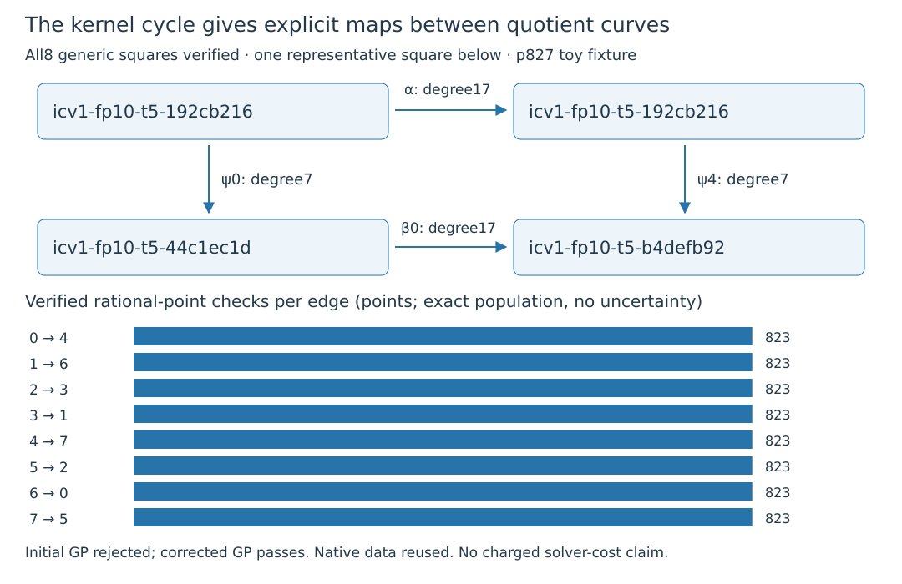

# Explicit maps along the twist-derived quotient cycle

All eight degree17 quotient-to-quotient maps are constructed and independently
verified on the public p827 example. Both coordinates of each generic
commuting square agree, and all6584 rational-point/136 kernel-point checks
pass. The initial GP script failed strict verification; an explicitly frozen
identifier-only correction verifies the unchanged native data.

| Recorded result | Exact count |
|:--|--:|
| Degree17 maps and generic squares | 8 |
| Rational-point checks | 6584 |
| Kernel-point checks, including infinity | 136 |
| Wrong-sign rejections | 6576 |
| Corrupted curve maps rejected | 8 |

The source $E:y^2=x^3+x+15$ over$\mathbb F_{827}$ has order823 and generator
$G=(2,5)$; ICV1 `icv1-fp10-t5-192cb216`. All eight archived degree7 maps
$\psi_i:E\to E_i$ and the certified degree17 endomorphism
$\alpha=(\pi+[1])/[7]$ are unchanged. The previously verified kernel cycle
is $0\to4\to7\to5\to2\to3\to1\to6\to0$.

For every archived line$i$ and its fixed successor$j$, the new explicit
$\beta_i:E_i\to E_j$ satisfies

$$\beta_i\circ\psi_i=\psi_j\circ\alpha.$$

Both sides are verified generically as reduced rational functions; their
x-coordinate numerator has degree119. On every rational point$P$,
$\beta_i(\psi_i(P))=[353]\psi_j(P)$. Transporting both generator and target
preserves their DLP scalar; relative to the original next-quotient generator,
the factor353 is inverted by415 modulo823.

## Construction and independent checks

Let$K_{17}$ be the archived kernel of$\alpha$. For each$i$, native Rust forms
all17 points of$\psi_i(K_{17})$, checks their order/anti-Frobenius property,
and constructs normalized degree17 Vélu$W_i$ from eight paired x-roots.
The prescribed coordinate scale7 gives$\beta_i$. Exact curve polynomial,
degree, coprimality, kernel/poles/infinity and generic square checks pass.
All6584 per-point records are retained, rather than a sampled witness list.

PARI/GP independently reconstructs$\psi_i$ and$\alpha$ with `ellisogeny`,
then uses rational twists of$E_i$ to build each17-kernel and$W_i$ without
sharing the native extension-field engine. It checks all coefficients,
generic identities and finite/kernel cases. Negating the output y-coordinate
still gives a map to the correct curve but fails the commuting check on
all822 nonidentity points per edge; curve membership alone would miss it.

Two Lean declarations, `quotient_descent` and `quotient_descent_unique`,
prove the abstract quotient-homomorphism existence and uniqueness from
$H\subseteq\alpha^{-1}(K)$. Frozen replay/fresh native transitive axiom audit
pass under Lean4.34.1 and pinned mathlib, standard foundations only. The
concrete elliptic-curve groups/morphisms, field, kernel inclusion and degree
bridge remains unformalized. The fixed-modulus v1 identity-certificate format
does not certify these characteristic827 identities; exact native/GP and
conditional Lean evidence have their stated scope.

This extends the finite kernel symmetry to executable isogenies between its
quotient curves, using standard theory. Complete discovery/evaluation/solver
costs and any additional independent relations remain unmeasured. No novelty,
cheap degree1 automorphism, IC advantage or NIST applicability is inferred.

## Original failure, amendment and reproduction

The original native source is `9e612b707a85ed291f470386126b5b7143628c02`;
protocol hash
`14c12589c69bb260a9736a8fc332f251c1e18a85c7bba88d981dabb9e54af812`.
Native passed. GP used reserved constant `Pi` as a variable, returning0 and
the final sentinel with parser/type errors. Strict stderr admission rejected
that run. Its script/output/archive and correctly failed export remain intact.

The new script changes only64 literal `Pi`→`iso_i` occurrences. Source
`dc2dddf630c968bc1dcbe6fed5599041b3f8438d`, protocol-v2 hash
`eb1830642eb242ea23e616cef59ec8515434f07039249849c76e40a9d9a9dcf0`,
freeze/commit and Setec gate precede its single new GP execution. Native strict
admission verifies exact replacement bytes and unchanged native data hashes,
process0, sole sentinel and only the declared stack-size warning.

Each export has flow planned2/attempted2/process-completed2/interrupted0/
resumed0/excluded0. Original reference verification fails; successor passes.
The successor reuses the identical native run. Combined actual total is
three processes: native1, failed GP1, corrected GP1; never four independent
runs. Both full protocol/file bindings pass. Same author/host, independent
implementation; no separate-runner review or statistical inference.

Runs were one thread/CPU0/4GiB/300s each on the managed Xeon8573C KVM host,
L0, under the documented EKS access/image fallback. No clocks are admitted,
paid resources created or permissions changed. New native controls16/16 and
complete standalone runner tests pass; the earlier full-root-suite gap remains.

Exact intermediate ICV1 records and24 generator-bound EC1 model records are
in execution-v12, with eight ordered routes. Each endpoint retains
$\beta_i(\psi_i(G))$, distinct from the unscaled$\psi_j(G)$; the geometric
cycle does not silently equate those generator-bound identities.

Raw v12 archive:75692bytes/nine files, SHA256
`c1d62b826606698abb30fd7bc8210a30e4ff0c83ca26bebaa9dea357a1448f08`.
V13 reference archive:1192bytes/six files, SHA256
`6f6158ccf368277e9431a6712d57d6e54cf34ac7bedbefd182e797895db14dae`.
Both live in user-confirmed `s3://setec-astronomy-artifacts/store`, with fresh
downloads/all-member hashes/identical deterministic repacks. Execution-v12/v13
READMEs give hydration, exact pins and commands; old waves are unchanged.

Literature read before implementation: MIT18.783 Fall2025
[Lecture5](https://math.mit.edu/classes/18.783/2025/LectureNotes5.pdf),
Theorem5.11/function-field uniqueness proof, Corollaries5.10/5.12 and
Theorem5.15; [Lecture13](https://math.mit.edu/classes/18.783/2025/LectureNotes13.pdf),
Frobenius/endomorphism-ring setting. Also repository GLV/isogeny-loop note
and atlas lead. These are existing constructions, not evidence of novelty.

Canonical progress/IC/curve diagrams were checked: no cost row changes.
This report adds exact maps, not a full volcano census. Original full research
campaigns, rank repair, charged solving and concrete formal bridges stay open.
