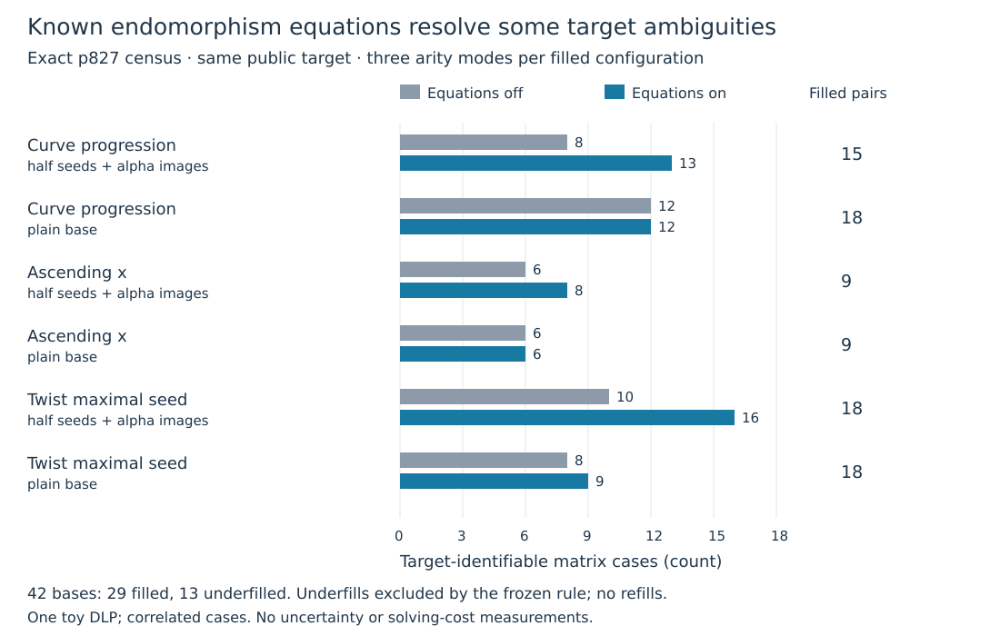

# Target recovery with matched endomorphism equations

The fixed 42-configuration panel has independently verified native/PARI results.
Twenty-nine bases fill; thirteen remain underfilled. Of 252 planned matrix cases,
174 are analyzed and 78 are excluded by the predeclared underfill rule. Adding
known endomorphism equations resolves 14 previously ambiguous cases. Ordinary
bases benefit as well as twist-derived bases. This is one public toy DLP with
correlated matrix cases, not 114 independently recovered targets or a cost result.

| Base rule and transform | Analyzed off/on pairs | Target fixed, off | Target fixed, on | Newly fixed |
|:--|--:|--:|--:|--:|
| Curve progression, half seeds plus alpha images | 15 | 8 | 13 | 5 |
| Curve progression, plain | 18 | 12 | 12 | 0 |
| Ascending x, half seeds plus alpha images | 9 | 6 | 8 | 2 |
| Ascending x, plain | 9 | 6 | 6 | 0 |
| Maximal-seed twist progression, half seeds plus alpha images | 18 | 10 | 16 | 6 |
| Maximal-seed twist progression, plain | 18 | 8 | 9 | 1 |

These are recorded exact counts from `execution-v14/SUMMARY.json`. The 14-case
change is the sum of its newly-fixed counts, $5+2+6+1$. Unequal denominators,
overlapping arity modes and reused target forbid treating this table as a
population success-rate comparison. The first-seed twist rules are absent from
the filled table because all twelve underfill; their full records remain.

## Exact task and controls

The unchanged source is $E:y^2=x^3+x+15$ over $\mathbb F_{827}$, order823,
$G=(2,5)$, ICV1 `icv1-fp10-t5-192cb216`; public $Q=[37]G$.
Its rational twist is $T:Y^2=X^3+4X+120$, order833, group $C_7\times C_{119}$.
The given first seed $(0,51)$ has order7 and maximal seed $(2,386)$ has order119.
The certified degree17 map $\alpha=(\pi+[1])/[7]$ acts as353 on $E(\mathbb F_{827})$.
Map discovery was an input to this diagnostic and is not charged here.

For each B8/12/16, seven fixed rules use ascending x, curve progressions at
shifts1/3, and first/maximal twist progressions at shifts1/3. Orbit coordinates
are lifted on the original curve after the fixed shift; twist X is divided by2
first. G anchors each base. The plain transform requests B seed points; the
other requests B/2 and unions them with canonical alpha images. There is no
post-outcome refill, replacement, truncation or base selection using Q or its log.

All ordinary and twist bases receive the same map checks and known scalar
information. Internal canonical edges give $u_j-c u_i=0\pmod{823}$ with
$c=353$ or $-353$, depending on orientation. Compare these equations off/on.
An internal edge is known information, not a newly sampled query relation.

Every filled base collects all signed two-/three-term witnesses for $Q+[j]G$,
$j=0,\ldots,15$, including repetitions and multiplicities. Each base has
arity2, arity3 and their union, crossed with equations off/on. The single native
execution retains 928 attempted queries, 402 zero-witness queries and 5389 raw
witnesses. The remaining planned queries were not attempted on underfills.
All395 base-point map/scalar controls pass, including rejection of scalar354.
Two archived bases and all64 corresponding query witness sets match v8 exactly.

All twelve first-seed twist configurations underfill: their final sizes are
3/6 for shift1 plain/augmented and1/2 for shift3. The remaining underfill is
B16 curve-shift1 augmented, final size15 after a collision. All13 records and
their78 excluded matrix cells are explicit. No extra queries were sampled.

## What changed, and what stayed ambiguous

The archived B8 maximal-twist shift1 plain base still gives66 raw witnesses,
15 distinct equations, rank8 in9 unknowns, and an ambiguous target. It has
no internal alpha edge, so enabling the equations changes nothing.

For B8 maximal-twist shift3 with half seeds plus alpha images, arity3 gives
19 raw witnesses and8 distinct query equations. Known equations raise rank6
to9 in9 unknowns and determine the public target scalar37. This verifies
one modified twist-derived base that resolves the earlier type of ambiguity;
it does not repair the original base or prove a twist-specific mechanism.

The ordinary B8 curve-shift3 augmented base gives an informative counterpoint:
arity2 has3 distinct query equations; adding known equations raises rank3 to7
in9 unknowns, and the target is fixed although other unknown logs remain free.
The maximal-twist B16 shift1 plain arity2 case also fixes the target at rank12
in17 unknowns. Thus full column rank is sufficient but unnecessary for recovery.

The analysis keeps the rank of anchor/alpha equations separate from the new
rank contributed by query equations. It does not credit known scalar edges as
independent sampled relations. Across all174 analyzed cells, 114 fix the target
and60 leave it ambiguous; every fixed scalar passes the original public point
check. Every ambiguous case includes two distinct target coordinates satisfying
every equation. The eliminator receives no factor-base log table or scalar37.

## Independent and formal verification

For $Mx=b$, a particular solution $x_0$ and a complete kernel basis describe
the affine fiber $x_0+\ker M$. The target coordinate is fixed exactly when its
projection vanishes on the whole kernel. Native exact RREF records this fiber,
not just rank. PARI independently rebuilds every base and alpha map using
`ellisogeny`, every edge, witness, deduplicated equation, rank, kernel dimension
and span, particular solution, target projection and recovery/ambiguity check.

Both scientific processes complete successfully. Strict admission checks process
status, all script/output hashes, sole marker `ALL_TWIST_RANK_REPAIR_OK 42`, and
empty stderr or only the predeclared GP stack-size warning. The combined export
has two planned, two attempted and two completed processes; zero interrupted,
resumed or excluded processes.
Base underfills are within-run exclusions, not missing process rows.

In namespace `TwistTargetIdentifiability`, the Lean declarations
`target_fiber_iff_kernel` and `kernel_witness_changes_target` prove the general
additive-homomorphism fiber criterion and an explicit ambiguity witness.
Lean4.34.1, pinned mathlib
`d13f23b723b8a846827a245b89c10fc7d3f11612`, frozen build and fresh native
transitive axiom audit pass for both theorems, standard foundations only.
The concrete finite matrix, field, complete kernel basis and elliptic-curve
extraction bridge remain outside these formal proofs. This is not a formally
checked proof of every concrete matrix. No characteristic827 symbolic identity
is being promoted through the fixed-modulus identity-certificate format.

The native diagnostic's19 tests and full standalone runner package pass.
Before freeze, synthetic F101 controls exposed two GP matrix-shape defects;
both failed attempts are preserved, followed by a successful corrected control.
The first Lean development import failure is retained with the successful
development/frozen replays. The main panel ran once with no retry/amendment.
The earlier named full-root validation gap remains open; this package pass
does not imply a complete root suite or CI pass.

## Pins, reproduction and scope

Source `d377251611bc9fd3da22096c3b128862816ef268`; committed freeze before data;
protocol hash `e031cee91eef30ca50d2ddef24cd36c7ca6ee739a3f173bd9885005efb7c61bf`.
Inputs, binaries, commands and caps are in execution-v14 FROZEN/PROTOCOL files.
Native and GP use one thread, CPU0, 4GiB and300s each on the managed Xeon8573C
KVM host, L0, under the recorded EKS image-access fallback. No clocks, paid
allocation or external-tool performance comparison is claimed. The controls
use independent implementations on the same host/author, not independent review.

Raw archive:61888bytes/ten files, SHA256
`2fd7a36e7a9755ea9687e93d7cc86bec661943dcf6fb63853968432b52d41e13`.
It is in the user-confirmed `s3://setec-astronomy-artifacts/store`; publication
verification records the fresh download, all member hashes and deterministic
repack separately. See [execution-v14](../../execution-v14/README.md) for commands,
the complete42/252-cell records, unified export and exact validation receipts.

Literature reviewed before implementation: repository factor-base/GLV synthesis,
v8/v9 rank evidence and v10 map construction; primary MIT18.783 Fall2025
[Lecture13](https://math.mit.edu/classes/18.783/2025/LectureNotes13.pdf),
Theorems13.6/13.8; official
[PARI matrix documentation](https://pari.math.u-bordeaux.fr/dochtml/html-stable/Vectors__matrices__linear_algebra_and_sets.html)
and installed help for `matker`, `matrank`, `matinverseimage`. Affine-kernel
linear algebra and endomorphism scalar equations are standard methods.

This completes the bounded relation-repair diagnostic in its filed card,
including the matched augmentation extension. It leaves the separately frozen
complete cold-cost panel, strongest ordinary/group/external controls, larger
held-out curves, original E00–E29 campaigns and concrete formal bridges open.
The result provides no novelty, IC speedup, asymptotic or NIST conclusion.
Canonical progress timeline, IC scoreboard, curve diagrams and performance
charts were checked: no model/map or admitted cost value changes, so those
graphs are unchanged. The new quantitative graph records this diagnostic only.
