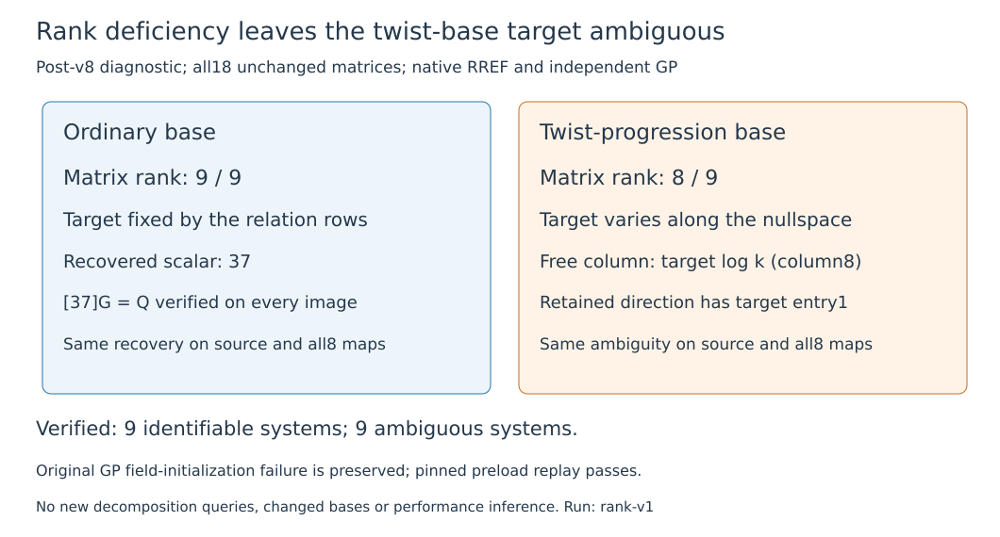

# Check the target coordinate, not just full-system rank

The post-v8 diagnostic verifies all18 unchanged relation systems. The ordinary
base fixes the target log on all nine models; the twist-progression base leaves
it ambiguous on all nine. Native RREF and independent PARI `matker` and
`matinverseimage` agree. No new decomposition query or changed base is used.

For each mod823 matrix, the native program retains a particular solution and
full nullspace basis and verifies every affine row/direction. A target is
identifiable exactly when every nullspace vector has zero target entry. Thus
rank deficiency alone is not used as evidence of failed target recovery.
Separate controls cover deficient matrices with identifiable and ambiguous
target coordinates.

The ordinary system has rank9 for9 unknowns and verifies k37 on public points.
The twist system has rank8, free column8 (the target), particular solution
`[1,39,0,29,2,809,739,21,0]` and nullspace direction
`[0,3,822,3,822,820,816,1,1]`. Adding a multiple of that direction changes k
while satisfying every recorded relation. Those rows alone therefore do not
determine k. Both patterns persist exactly under every certified isogeny.

Original source a3da15bda17804c75b48bbe487e48cb4ae5cb560;
protocol fdf1d7d301ad748eee6220c080f8bb15d118a361985496874075c757a85aaea1.
The native run passes. The first GP process returns0 and prints its final
marker but emits errors: the p assignment was parsed inside the checker
definition, so the first matrix used a symbolic field. **That reference fails
strict verification.** All bytes and the faithful failed-row export remain.

Before the second GP run, amendment/protocolv2 pins an explicit p823 preload.
The main GP script, native output, matrix entries, ranks and expected flags
are unchanged. The corrected replay has empty stderr, exact marker and exit0.
Its protocol hash is 8c34026c04da1c26a9ff63735245a515069723d61f255eeee098e4ff080bbf82.
Both original and corrected exports pass their complete schema/protocol/file
binding. They reference the **same single native attempt**, plus the respective
actual GP attempt; do not pool them as four independent executions. Across
both exports there are three actual processes: native1, GP2, with the first
GP verification failed. A separate GP control initially used a vector in
place of a one-row matrix; that failure and corrected passing control remain.

The original failed-row serializer used the wrong outcome class and its
checker rejection is preserved; the corrected export still says verification
error/statusfailed, with outcomecompleted meaning the process finished.
No failure is converted to a verified result. All clocks remain null/unadmitted.

Bounds:300s per native/GP process,4GiB,CPU0,one thread,L0 managed Xeon
Platinum8573C/KVM. Primary PARI help and existing native elimination source were
read; this is elementary linear algebra, not a novel attack. The post-v8
motivation is disclosed; it is not a pre-v8 prediction or a fresh target sample.
No cost, timing, NIST or complete-IC improvement follows.

The raw archive retains all three actual processes and their receipts:
2,712 bytes,11 members, SHA256
80052a20f9d52aa5bad20dc1f1295bd878f76b24c290f7bcee78310a96fdde34.
See [reproduction](../../execution-v9/README.md), [admission](../../execution-v9/ADMISSION.json),
[failed original export](../../execution-v9/experiment.original.export.json),
[corrected replay export](../../execution-v9/experiment.export.json),
[amendment](../../execution-v9/PARI_AMENDMENT_V2.md) and
[archive verification](../../execution-v9/RAW_VERIFICATION.json).

This identifies which information is missing from this particular short
progression base. The next distinct questions are whether another frozen
target-blind base fixes the rank defect and whether any certified quotient
reduces fully charged decomposition cost. Neither is measured here. Existing
performance graphs stay unchanged; this diagnostic adds a correctness figure.
