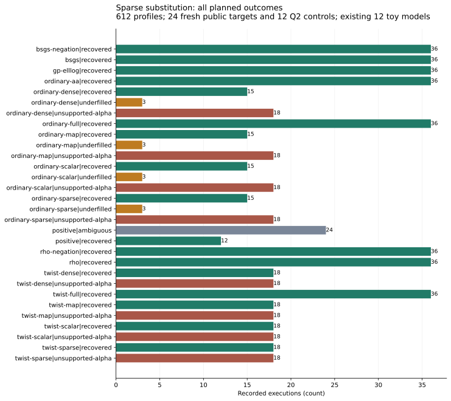
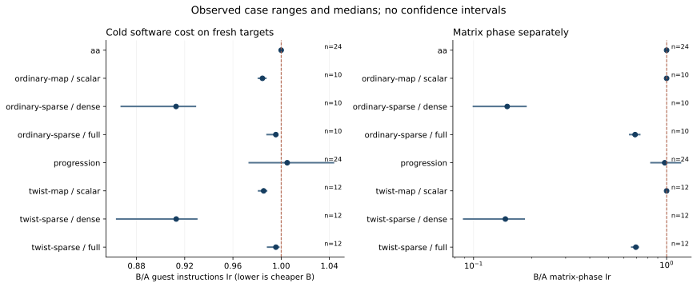

# Sparse affine substitution: complete cold software costs

The sparse implementation lowers cold guest instructions in every eligible successful comparison against both dense compression and matched uncompressed augmentation. The frozen native summary records the following values. Each pair solves the same original public target using the same base, known equations and complete signed relation rows.

| Candidate / matched baseline | Cold Ir ratio: median [min, max]; pairs | Matrix Ir ratio: median [min, max]; pairs |
|:--|:--|:--|
| Ordinary: sparse / dense | 0.9128141 [0.8674047, 0.9288431]; n=10 | 0.1493742 [0.09986979, 0.1867933]; n=10 |
| Twist: sparse / dense | 0.9129475 [0.8636211, 0.9299975]; n=12 | 0.1461326 [0.08891192, 0.1828289]; n=12 |
| Ordinary: sparse / uncompressed map | 0.9955857 [0.9883420, 0.9969586]; n=10 | 0.6866483 [0.6444095, 0.7256114]; n=10 |
| Twist: sparse / uncompressed map | 0.9956286 [0.9887932, 0.9980363]; n=12 | 0.6928620 [0.6598903, 0.7127575]; n=12 |
| Ordinary: map / scalar | 0.9844571 [0.9811234, 0.9872640]; n=10 | 1.000124 [0.9999962, 1.000191]; n=10 |
| Twist: map / scalar | 0.9854769 [0.9812807, 0.9878889]; n=12 | 1.000002 [0.9999212, 1.000264]; n=12 |
| Twist full / ordinary full | 1.005008 [0.9735474, 1.043346]; n=24 | 0.9773432 [0.8299697, 1.178714]; n=24 |
| Ordinary A/A copy / original | 1.000000 [0.9999982, 1.000000]; n=24 | 1.000000 [1.000000, 1.000000]; n=24 |

Ratios below 1 favor the candidate. These are observed case ranges, not confidence intervals. The sparse/dense medians correspond to about 8.7% fewer cold instructions; sparse/uncompressed medians to about 0.4% fewer. This is an engineering improvement in the affine substitution implementation, shared by ordinary and twist constructions. The full-progression comparison has outcomes in both directions.

## Frozen experiment and flow

The original campaign ran once from 2026-10-30T07:21:32Z to 07:32:09Z, with no retry or restored measurement. The November resume recovered its final receipt; it did not rerun profiles. Source bfcf5b743775327a0273b2ae4d53f1d982d29c10, freeze c65f4ed58, worker/harness/summary pins and the exact pre-data plan are retained. The protocol digest is beb4cdd13b41904ccb8f3ba1e6e17bf4d4105137bbe7cded6ec50ebe3bc3e387.

| Flow | Recorded count |
|:--|--:|
| Planned profiles | 612 |
| Attempted and completely counted computations | 612 |
| Unstarted, interrupted, resumed or excluded profiles | 0 |
| Arms crossed with each workload | 17 |
| Fresh public DLP target points | 24 |
| Q=2G control workloads | 12 |
| Existing toy curve models | 12 |

There are two fresh target points per model, one process per arm/workload. The same twelve models were used previously, so this is a fresh-target confirmation on existing models. Primary ratios use only fresh targets. All twelve Q2 positive controls recover 2; the smaller positive arm is not a cost competitor. A/A uses the identical ordinary implementation. Successful pairs require both source scalars verified and all five complete problem hashes equal; missing pre-query failure data never enters a successful ratio.

| Arm / actual DLP outcome | Profiles |
|:--|--:|
| bsgs-negation / recovered | 36 |
| bsgs / recovered | 36 |
| gp-elllog / recovered | 36 |
| ordinary-aa / recovered | 36 |
| ordinary-dense / recovered | 15 |
| ordinary-dense / underfilled | 3 |
| ordinary-dense / unsupported-alpha | 18 |
| ordinary-full / recovered | 36 |
| ordinary-map / recovered | 15 |
| ordinary-map / underfilled | 3 |
| ordinary-map / unsupported-alpha | 18 |
| ordinary-scalar / recovered | 15 |
| ordinary-scalar / underfilled | 3 |
| ordinary-scalar / unsupported-alpha | 18 |
| ordinary-sparse / recovered | 15 |
| ordinary-sparse / underfilled | 3 |
| ordinary-sparse / unsupported-alpha | 18 |
| positive / ambiguous | 24 |
| positive / recovered | 12 |
| rho-negation / recovered | 36 |
| rho / recovered | 36 |
| twist-dense / recovered | 18 |
| twist-dense / unsupported-alpha | 18 |
| twist-full / recovered | 36 |
| twist-map / recovered | 18 |
| twist-map / unsupported-alpha | 18 |
| twist-scalar / recovered | 18 |
| twist-scalar / unsupported-alpha | 18 |
| twist-sparse / recovered | 18 |
| twist-sparse / unsupported-alpha | 18 |

## Implementation, checks and accounting

Dense substitution loops through every base coordinate for every known-kernel column. Sparse substitution caches the nonzero column supports and applies only the nonzero query coefficients. It uses exactly the same affine parameterization, columns, constants and elimination. Cache construction and allocation are charged to setup; each application is charged to linear algebra. Both choices are in one pinned worker, selected explicitly per cell. Dense/sparse equality tests include affine offsets, arbitrary rows and zero-dimensional kernels. This is standard sparse linear algebra. Main relation arms use generic group decomposition; this comparison does not introduce a new algebraic summation-polynomial solver.

The cost unit is actual single-event user-space guest instructions Ir. The interval starts before method setup and ends after original source-point scalar verification. Setup/discovery, queries, complete decomposition, signs/verification/deduplication, matrix work and recovery are exclusive phases, with resident-GP instructions included. Input construction/parsing, loading and record serialization are excluded equally. Each target pays its own setup. The recorded host is x86-64 Linux, pinned CPU0/one thread, L0; clocks were used only for resource caps.

The frozen native audit independently recomputes every raw counter and checks 612 records. A separate strict PARI/GP process verifies 249 distinct mathematical payloads, 141 complete signed witness inventories and six maps, including original/reduced solution fibers and source scalars. It passed with the sole expected marker and declared stderr; all source/runtime/binary pins remain equal. The complete rectangular protocol/export/file-binding check passes with zero findings. The main v17/v18 analysis-guard correction was incorporated before this new source and protocol froze; v19 needs no post-data scientific-source correction.

Native rho, negation/cycle-escape rho, BSGS, negation BSGS and external PARI elllog share every target. Their per-target costs and strongest completed measured references are retained in SUMMARY.json. The table below reports this experiment's requested reference comparison in the same Ir unit. The five implementations do not certify the fastest implementation for every curve class; a same-input sparse-linear-algebra performance comparison with FLINT/Magma is also still owed.

| Arm | Cold Ir / strongest completed of five references: median [min, max]; fresh targets |
|:--|:--|
| bsgs | 1.381343 [1.024072, 1.790769]; n=24 |
| bsgs-negation | 1.268990 [1.000000, 1.573439]; n=24 |
| gp-elllog | 1.000000 [1.000000, 1.027660]; n=24 |
| ordinary-aa | 82.47157 [59.89425, 119.9894]; n=24 |
| ordinary-dense | 90.56813 [66.09931, 130.5444]; n=10 |
| ordinary-full | 82.47157 [59.89428, 119.9894]; n=24 |
| ordinary-map | 82.73872 [61.59930, 114.3091]; n=10 |
| ordinary-scalar | 83.99382 [62.66246, 115.9779]; n=10 |
| ordinary-sparse | 81.84740 [61.39589, 113.6521]; n=10 |
| rho | 2.768657 [1.138028, 3.758035]; n=24 |
| rho-negation | 2.238160 [1.197390, 5.632720]; n=24 |
| twist-dense | 89.42789 [66.96837, 138.2770]; n=12 |
| twist-full | 81.53565 [61.47055, 121.4096]; n=24 |
| twist-map | 81.85871 [62.00841, 121.9607]; n=12 |
| twist-scalar | 82.91830 [63.04731, 123.4559]; n=12 |
| twist-sparse | 81.69797 [61.75862, 121.5022]; n=12 |

## Evidence and next step

The 9,581,956-byte deterministic original raw archive has SHA-256 d78c4da409ce88afa2f252361988651a735e201e8947ebb207f238fc43e22296. A fresh download from the user-confirmed Setec store checks all 10,241 member hashes and an identical deterministic repack. Scientific source/data remain immutable; the failed operational receipt-name attempt and root validation records remain available. Conditional affine Lean lemmas retain their hypotheses; native/GP replay supplies the concrete implementation checks. Full benchmark promotion still needs ecbench/calibrated pricing and independent-host validation.

Next, profile the remaining setup and elimination work and test target-only recovery against full-kernel recovery, retaining the full-span independent verifier. That proposed implementation is not part of this result. Reuse the sparse implementation as the matched substitution baseline in subsequent engineering tests.

\newpage

\newpage

Sources: [protocol](../../execution-v19/PROTOCOL.md), [exact pins](../../execution-v19/FROZEN.json), [counter and GP admission](../../execution-v19/audit-v1/ADMISSION.json), [native summary manifest](../../execution-v19/analysis-v1/.artifacts.json), [complete export/file check](../../execution-v19/export-binding.stdout), [raw archive/member verification](../../execution-v19/RAW_VERIFICATION.json).
