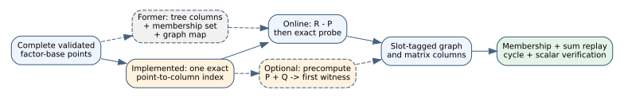

# Unifying exact point indexes for two-slot index calculus

2026-11-27. Design and falsifiable cost plan; no experiment or speedup result. The shared exact-index implementation was added later on this PR; see `IMPLEMENTATION.md`. The pair-sum plan remains a proposal. [pcc:unverified]

## Finding

The current collector builds several views of the **same validated factor-base points**. A shared, immutable per-trial snapshot can eliminate duplicate point keys and bind relation lookup, matrix columns, and graph vertices to one checked source. The larger potential change for small bases and many targets is an optional exact hash of **all pair sums**, built once and queried by target. Its quadratic memory cost makes admission essential. Coordinate-bit LSH is a useful negative control; it supplies no known additive locality.

The diagram separates the former optimized lookup (gray dashed) from the implemented shared exact index (amber solid); pair-sum storage remains dashed and proposed. Every successful route reaches the existing membership, sum, dependency and scalar replay. None is a certificate by itself.

## Source audit and scope

This proposal covers the prime-field, two-slot, prime-order-subgroup native solver. At the main source snapshot `f37c4458dcb099e0f582e94d46a359628c86418b`, `reduction::indexed_bases` enumerates each base into `BTreeMap<Point, usize>`; `PairTable::from_indexes` copies those keys, checks selectors, sorts them, and builds two `HashSet<Point>` values. `optimized::solve` uses the tree maps for matrix rows and graph vertices. The separate graph PR at `a1c121dea7c979afe8f4a54816477e1151ffe4b4` adds optional `HashMap<Point, usize>` graph columns and rechecks membership. The separate LSH PR at `d937eac9149af5989f174ffc185ad96e2fdee04d` adds optional coordinate-bit buckets while retaining the exact sets. These PR heads are reviewed here as source snapshots, not treated as merged. See `source-inputs.sha256`.

`Point` is already an affine canonical enum with full `Hash`/`Eq`; this route needs no new projective-key convention. The pair-table query scans the first slot in selector order, computes `R - P`, probes the other slot, then replays factor-base membership and `P + Q = R`. Its first-hit policy depends on **selector threshold**, with ties retaining slot zero. The graph uses distinct vertices for equal physical points in different slots. The v1 certificate still requires the exact `N+1` relation rows. [pcc:unverified]

## Proposed shared snapshot

Build one `PreparedBasis` per slot from the existing complete enumeration. Store:

1. `points_by_selector: Vec<Point>` for the current deterministic scan;
2. `exact: HashMap<Point, Column>` where `Column` carries the existing global column and slot-local vertex number;
3. a compact column-to-point permutation or indices for any path that needs the original `BTreeMap` key order;
4. optional *views* that store indices into the same point array, never another copy of the full point key.

The constructor checks the curve/base binding, selector range, uniqueness, column contiguity, duplicate points and resource limits before publishing the object. The original enumeration and validation remain the trust boundary. A lookup returns only a column/candidate; it never proves point validity or relation correctness. A public checked query still validates subgroup membership. A sealed internally generated query retains its existing provenance check. All witness replays and final certificate verification remain mandatory. [pcc:unverified]

The design calls for `PairTable`, `matrix_row`, and `RelationGraph` to consume that snapshot. With graph and LSH options off, a single exact map replaces the prepared membership set and the matrix tree map after conversion. With graph on, it also replaces the graph-specific map. LSH buckets can share point-array indices; they must finish with exact `Point` equality. Source changes in both still-open feature branches must be integrated only after their separate dispositions, then checked against both parents. The separate graph and LSH branches are not merged by this implementation.

## Two query plans from the same snapshot

**Online complements (default).** For each target `R`, scan `B` selector-ordered points from the slot selected by the current threshold rule, compute `R-P`, and probe the exact map. `B` is that slot's realized cardinality; it need not equal `min(B0,B1)`. Cost is roughly `M B` group subtractions and probes over `M` target attempts, with early-hit savings. Sharing the index removes duplicate setup and graph/matrix lookups but cannot remove the `B` complement computations. The map lookup is already expected constant time; a new hash family alone has no asymptotic gain.

**Pair-sum table (opt-in, only within a memory budget).** Precompute `P+Q` for all `B0 B1` ordered pairs and hash each canonical sum to the earliest witness under the current selector order. Then each target has an exact expected constant-time lookup plus the unchanged replay. Preparation costs `B0 B1` group additions and up to `B0 B1` entries, including collision lists if the bounded alternative-witness policy needs them. This can help only when enough targets reuse one base and the complete table fits. A rough cost break-even is

`M * B * C_sub > B0 * B1 * C_add + M * C_probe + C_setup_extra`,

where costs include normalization, allocation, hashing and verification. This is a **planning inequality**, not a measured threshold. Query order and RNG can remain unchanged if the table is fully prepared before any target draw and only the first deterministic witness is returned. The extra-witness policy needs its own versioned ordering proof. For large `B`, quadratic storage likely rules this out; a bounded or target-batched join would have different stopping/RNG semantics and needs a separate protocol.

For equal slot sizes, the candidate pair counts are 65,536 at `B=256`, 1,048,576 at `B=1024`, and 16,777,216 at `B=4096`, before any point keys or collision lists. This makes the full table a plausible lower-bit-size experiment only after measured peak-memory admission; these counts alone say nothing about runtime or relation yield.

For a uniform independent target in a subgroup of order `r`, the exact hit probability is the number of distinct pair sums divided by `r`, hence at most `B0 B1/r`. Uniformity of the solver's generated target stream and the effect on useful dependencies are separate questions; a point hash does not increase the number of algebraic relations in the base.

## Why LSH is lower priority

The current optional bit-sampling index projects affine `x,y` bits into buckets, then checks full equality. Indyk and Motwani's LSH is for approximate neighbors in a metric with a useful near/far collision gap. Here the target is the **exact** group complement `R-P`; coordinate proximity does not imply a small additive relation. The exact map already answers membership directly, so bit sampling adds projection, bucket setup and memory unless a measured implementation-specific effect offsets them. Keep it as an opt-in ablation and collision stress test. It must never decide a witness without full equality and arithmetic replay.

A small quotient homomorphism cannot supply a lossless additive bucket on a prime-order subgroup: any homomorphism from a group of prime order `r` to a group of order below `r` is trivial. This elementary group fact does not exclude non-homomorphic heuristic partitions, but it limits a tempting “hash that preserves addition” rationale.

## Falsifiable development and study plan

1. **Correctness prototype:** construct the shared snapshot from exactly one complete enumeration per fresh-seed trial. Compare sorted columns, selector order, first witness, misses, RNG state, full relation rows, graph dependencies, and final certificates byte-for-byte with current exact paths on tiny exhaustive and cofactor fixtures. Force hash collisions, equal points across slots, identity/exceptional additions, duplicate selectors, and every resource-limit boundary. Errors must remain errors, not misses. [pcc:unverified]
2. **Three local accounting controls:** old exact path; shared exact map; shared exact map plus LSH. Count full point key clones, hash probes, tree probes, group additions/subtractions, replay calls, allocations and peak bytes. Counts are development controls, not runtime evidence.
3. **Pair-sum control:** compare first-witness and certificate identities under a hard memory cap. Record all preparation additions and unused table entries. Evaluate only sizes where `B0 B1` fits; reject admission before allocation otherwise. Include hit positions, misses and repeated target streams.
4. **Future matched run:** freeze source hashes, public curves, base seeds, target seeds, accepted memory ceiling, compilation and execution images, reference solver, raw timing and peak RSS collection. Report cold build + all failed attempts + matrix/graph + verification, plus amortized curves over `M`. Use paired held-out seeds, preserve failures/timeouts, and predeclare a decision rule. A stage-only gain is a stage result. A complete end-to-end improvement requires its own run; no such run was made here.

Fresh current-source S3 checkpoint upload/readback and authenticated exact native execution/image/L2 admission remain outstanding for a scientific run. This proposal does not use chat credentials, an unrelated fixture or local timing as substitute evidence. Existing v1 `N+1` policy, binary challenge pipeline, challenge scalars and independent full audit stay open. [pcc:unverified]

## Sources and evidence limits

- Crypto main source at `f37c4458dcb099e0f582e94d46a359628c86418b`: the native `curve`, `prepared`, `reduction`, `optimized` and `relation_graph` modules. Graph and LSH PR heads are pinned above; exact paths and digests are in `source-inputs.sha256`.
- Prior internal design: `research/point_hash_next_leads_20261116/reports/REPORT.md`, especially L2-L4 and its unrun decision gates. The cycle-law warning is `research/ic_cycle_closure_20261125/README.md`.
- Petit et al., [*Algebraic approaches for the Elliptic Curve Discrete Logarithm Problem over Prime Fields*](https://people.maths.ox.ac.uk/petit/files/16PKC_primeECDLP.pdf), section 2.1: factor-base relation collection and summation-polynomial setting. A lookup implementation is not a new relation theorem.
- Godsil and Guo, [*Cycle Spaces of Digraphs*](https://arxiv.org/pdf/1609.09118), sections 2-3: incidence/cycle structure. The solver's finite-field signed, slot-preserving weights and target projection need their own checks.
- Indyk and Motwani, [*Approximate Nearest Neighbors: Towards Removing the Curse of Dimensionality*](https://graphics.stanford.edu/courses/cs468-06-fall/Papers/06%20indyk%20motwani%20-%20stoc98.pdf): LSH applies to approximate metric neighbors; no EC-coordinate locality follows.

**KB unavailable:** no `research-kb` MCP tool was exposed; `scripts/research-kb status` exited 127 (“no executable found”). Direct repository and primary-paper reads supplied this scoped review. No novelty or exhaustive prior-art claim is made.
