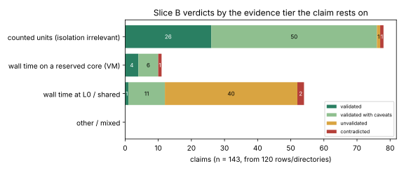

# Validation sweep, slice B: `benchmarks/README.md`

Audit of the performance, improvement and comparison claims in `benchmarks/README.md` (repository `aburan28/crypto`, `main` at `cb2ec6873`, 2026-10-19). Slice B of the validation sweep across `crypto`, `cryptanalysis` and `crypto-autoresearcher`. The audit records verdicts and repairs nothing; no research state, row or evidence file outside this directory was changed.

Graphs: [fig1](fig1_verdict_by_tier.svg), [fig2](fig2_verdict_by_date.svg). Machine-readable verdicts: [`verdicts.jsonl`](verdicts.jsonl) (143 claim records). Per-claim table: [`VERDICT_TABLE.md`](VERDICT_TABLE.md). Entries with no verdict: [`NULL_ROWS.md`](NULL_ROWS.md).

## 1. Result in one paragraph

Of 143 claims (122 in 99 README rows and 21 in 21 directories under `benchmarks/` that have no README row), 31 are **validated**, 67 **validated with caveats**, 41 **unvalidated** and 4 **contradicted**. 17 README rows and 16 unlisted directories make no speedup, improvement or comparison claim (null or descriptive) and get no verdict. The pattern is sharp: claims that rest on a counted unit (group operations, field multiplications, word XORs, callgrind instructions) mostly survive, usually with caveats about intervals and chronology; claims that rest on wall or CPU time on a shared L0 host mostly do not, because the tier cannot support them. The four contradictions are all about what was compared to what, not about arithmetic: an empty-table rho used as the reference (rows 104, 108, 110) and a candidate best repetition set against a baseline median (row 44).

| evidence the claim rests on | validated | validated w/ caveats | unvalidated | contradicted | claims |
|:--|:--|:--|:--|:--|:--|
| counted units (isolation irrelevant) | 26 | 50 | 1 | 1 | 78 |
| wall time on a reserved core (VM) | 4 | 6 | 0 | 1 | 11 |
| wall time at L0 / shared | 1 | 11 | 40 | 2 | 54 |
| all claims | 31 | 67 | 41 | 4 | 143 |

## 2. Prior (written before reading the evidence)

Expected breakage, in order: (1) wall-time speedups measured on shared cloud VMs and macOS laptops and then reported as ratios; (2) 'identical output' claims that have no committed comparison; (3) rho references that are not the strongest available (empty DP table, no negation map, an inefficient walk); (4) preregistration that git cannot show; (5) headlines that do not match the committed raw files; (6) raw data on Google Drive or a local SSD. All six occurred; (1) and (3) are the costly ones.

## 3. Coverage

* `benchmarks/README.md` has **116** table rows, not about 150. Two entries are listed twice: rows 8 and 22 (`20261017-two-sylow-fp64`) and rows 38 and 47 (`20261016-isogeny-round5`). Their verdicts are recorded twice with `duplicate_of`.
* **37** directories under `benchmarks/` have no README row (mostly the 2026-10-11 and 2026-10-12 integrations). They were traced at the same depth as README rows and verdicts are in `verdicts.jsonl` with `in_readme_table: false`. Three of them (`20261012-f4-fp-vs-msolve`, `-f4-f5-fused-readback`, `-f4-f5-dense-packing`) hold only figures: nothing to verdict.
* Order: rows dated 2026-10-10 or later first, then backwards. Every README row is dated 2026-10-11 to 2026-10-19, so the whole table falls in the first group.

## 4. Method and the model split

1. **Trace.** `scripts/trace_rows.py` (deterministic) resolves each row to its evidence directories, lists committed raw files, and quotes every line mentioning A/A, isolation, identical outputs, off-repo storage and class words.
2. **Recompute (Haiku 5.5).** Twenty frozen command cards (`cards/`, hashes in `cards/INDEX.json`, 8-10 rows each) were relayed by path to Haiku subagents. Each one wrote one script per row (`scripts/recompute/<row>.py`, run with `python3 -I`, reading only committed files) and a JSON record per row (`recompute/SWB-RECOMPUTE-NN.jsonl`): claimed value, computed value, definition used, status (match / mismatch / no_raw_in_repo / cannot_define / partial), identical-output comparison counts, off-repo references, A/A and isolation lines, and `git` first-add dates of protocol and first raw file. Totals over 153 records: 833 claims match, 42 mismatch, 37 have no raw in the repo, 71 cannot be defined from the repo, 129 are partial.
3. **Review (Sonnet 5.5, this session).** I read every row's evidence pack and the recompute records, re-derived the load-bearing mismatches myself from the raw files (row 44 in particular, see section 6), assigned the claimed and actual class, the isolation tier, the A/A status, rho fairness and the verdict. Every verdict is mine; Haiku output was never used as a verdict.
4. **Reproducibility of the Haiku step.** All 153 scripts were re-run by me (`scripts/rerun_status.tsv`): 153/153 exit 0. Re-running two of them appended duplicates to their output files, which gave a free check: the 15 rows concerned reproduced claim for claim. The duplicates were reverted. Bootstrap and permutation intervals could not be recomputed where the resampler or seed is not committed (129 partial).

**Policy applied (stated before the verdicts).**
* A counted-unit claim is judged on recompute, controls, identical outputs and class. Isolation does not apply to it.
* A wall-time or CPU-time **speedup** on a shared or unisolated host (L0) is `unvalidated`, however large the effect and however clean the A/A: the tier cannot support it. Null results, negative results and comparisons that go against the method (the method loses) are not speedup claims and may be validated.
* A reserved core via `tools/isolated_bench.py` on a cloud VM is treated as L1-class: it can support a wall claim only with an A/A spread smaller than the effect, and the VM neighbours (outside the tool's reach) keep it at caveats.
* `contradicted` is reserved for a claim that the committed evidence or a matched reference refutes.

## 5. Cross-cutting findings

**F1. Wall time at L0 carries most of the unvalidated verdicts.** 54 claims rest on wall or CPU time at L0, of which 40 are unvalidated and 2 contradicted. Effects are often large and direction-safe (rows 14, 29, 106, 107), but the tier rule is not about direction. Where a counted corroboration exists (rows 27, 28, 32, 35, 92) the counted claim is validated and the wall claim stands alone.

**F2. Git cannot show that protocols were frozen before data.** For 91 of 143 claims the protocol and the first raw record were added in the same commit (most in `ca00c1517`, 2026-10-17, which carries the bulk of the research tree), and for 36 there is no protocol file in the study tree. 'Preregistered' and 'frozen before timing' are therefore the studies' assertions, not verifiable properties. A commit-before-run convention would fix it.

**F3. A/A controls are present for most counted comparisons and absent for most wall ones.** Wall or CPU ratios claimed at L0 with no A/A arm (some have an unchanged-code or same-binary control, which is not an A/A): rows 21, 25, 29, 30, 34, 36, 40, 42, 43, 44, 47, 50, 51, 57, 58, 59, 76, 79, 106, 116. Rows 23 and 33 are the clean examples (A/A envelope per workload, reserved core, interleaved), and even they stay at caveats because the host is a VM.

**F4. Identical-output claims mostly hold where a comparison is committed, and are unevidenced elsewhere.** Verified with n compared and 0 differing: rows 8 (64), 14 (266), 15 (51), 22 (6), 27/28 (4), 30 (54), 31/32 (1,600 each), 35 (8), 37 (562), 42 (128), 44 (192), 49 (15), 50 (128), 51 (182), 55 (248), 79 (48), 89 (1,320), 95 (288), 97, 99 (816), 101-103 (96), 1007 (627). One partial failure: row 112, 37 of 38 digests equal (one rf-mitm record with 79 of 80 root sets checked). **No raw comparison exists in the repo** for the bit-identical claims in rows 29, 36, 38, 47, 52, 43; for row 19 only 400 of 3,000 claimed seeds are committed.

**F5. Rho fairness (section 7 has the table).** The strongest results are the corrections: row 24 (precomputed-table rho beats IC in every matched pair) and row 74 (Bernstein-Lange rho with equal advice is 53-317x faster online) refute the 7.29x, 12.29x, 13.9x and 18.5x online ratios that rows 87, 104, 108 and 110 still carry. Row 105's model crossover was computed against rho without the negation map (the row says so). Rows 1-3 show the hyperelliptic rho walk itself at S_walk 1.82-2.10 against an ideal 1.25 at large N, so any earlier IC-versus-rho ratio using that walk as its reference understated rho.

**F6. Headlines that do not match the committed raw data.** Section 6.

**F7. Off-repo evidence.** Rows 7, 10, 12, 13 (the volcano surveys) point their complete data to Google Drive; row 20's provider ZIP is at `/Volumes/SSD990`; rows 48 and 52 keep the full-class and production data on local volumes. Many study records name `/Volumes/SSD990*` only as build-target paths. All four Drive rows are null/descriptive. Five README rows (5, 34, 38/47 and 43) have no committed raw measurement records for their main claim; rows 6, 79 and 80 lack them for part of the headline.

**F8. Class labels.** Where I disagree with the row's own class: row 3 ('accounting correction' for a change to the rho walk that cut counted steps 29%: engineering); rows 104, 108, 110 (online speedups that are not improvements); row 105 (the 48x constant is engineering and stands, the crossover claim does not); row 45 ('ADVANCES (exponent)' for a 0.015-0.034 shift over a fit range, with the local exponent still 0.031 from 4/3: constant); row 73 (an 'advance' against a weak q^1.91 incumbent, not against rho); row 44 (a mis-aggregated ratio). No row labelled engineering was found to be an advance. Relabelling in the AGENTS.md section 3 sense (headline count down, total cost up) is **not** found in this table; accounting rows (4, 24, 69, 74, 80, 108) are labelled as such.

## 6. Blockers: contradicted claims

| row | date | entry | claim | why contradicted |
|:--|:--|:--|:--|:--|
| 44 | 2026-10-16 | u64-rootbatch | Rank stage 2.95x and per-target median 6.09x | CONTRADICTED by the committed timing records: the README table's candidate 'median' cells (rank_stage 10,261 ms, target_median 213 ms) are the candidate's fastest repetition (rep 3), while the baseline cells are medians (30,333 / 1,298). True medians give 30,333/12,303 = 2.47x and 1,298/259.5 = 5.00x. Asymmetric aggregation inflates both headline ratios (checked directly against raw/s3-*.txt). |
| 104 | 2026-10-14 | n71-n83-hosted-single-target | Online speedup rho/IC median 7.29x (n=71) and 12.29x (n=83) with strong rho rung 3 on the same public points | CONTRADICTED by README row 24 and by the row's own annotation: median of per-workload ratios overstates (ratio of means 2.80x, IC slower online on 4/16); rho started with an empty DP table while IC's 760 s setup is excluded; with a precomputed-table rho the precomputed arm wins every matched pair (3.74x-395x); cold end to end IC is 133.7x slower than rho. Not matched to the strongest reference. |
| 110 | 2026-10-13 | n83-dense-root | K1798 dense-root N83: one-target online 63.324 ms vs same-point rho 1,173.293 ms (18.528x exploratory) | CONTRADICTED by row 24: against a precomputed-table rho the IC loses every matched pair; the 18.5x is an empty-table-rho ratio on one target (n=1) at L0. The within-IC comparison K1798 vs K1500 dense (paired difference 130,952 probes, bootstrap [52,058, 209,991]) is a counted result and recomputes (10/11 recompute; two K1500 regular 900 s timeouts retained). |
| 108 | 2026-10-13 | ecbench-frontier | Admitted retained-setup online frontier is n61 rho/IC 13.9x [9.8, 19.1]; N83 exploratory at 18.528x; compact orbit best… | The online 13.9x and 18.5x ratios are against rho without a precomputed table: superseded by rows 74 and 24 (BL rho 53-317x faster online at equal advice; precomputed rho faster in every N83 matched pair). The cold frontier statement (signed-Frobenius rho remains best; orbit 9.985x matched rho) stands. Replay audit 15/15 identical; root-finder session 120/168 with 48 solver-counter mismatches retained. |

### Material recompute mismatches (not all contradictions)

Each was checked against the committed records; the verdict column says how it affected the verdict.

| row | headline says | committed records give | verdict effect |
|:--|:--|:--|:--|
| 44 | rank stage 2.95x, per-target 6.09x | candidate cells are the fastest repetition (10,261 ms, 213 ms); baseline cells are medians. True medians 2.47x, 5.00x | contradicted (re-derived by me from raw/s3-*.txt) |
| 38/47 | SEA 2^127-1 1.14x (0.82-1.42); Phi_l main 9.4-9.6 s | geomean 1.125, range 0.71-1.72; main 9.57-9.74 s; sums 2.258/1.991 s | unvalidated |
| 42 | 8.566 ms, 2,187x at l=12 | 8.063 ms, 2,321x | unvalidated |
| 58 | 100.7x (run 3) | 98.1x from the file's own per-target values | unvalidated |
| 106 | 1.9x/4.1x/6.4x, 5.9 s at d=6 | 1.96x/4.19x/6.08x, 6.14 s | unvalidated |
| 107 | 350x, about 10,000x | 928x, 15,236x by ratio of medians | validated with caveats (headline understates) |
| 112 | 9.3 ms baseline at l=8 | 9.41 ms under the uncontended rule; one of 38 digests differs | validated with caveats |
| 21 | direct pack 1.006-2.173x on every cell | min 0.9974 (f5_n12_m12_d4, 4 threads) | unvalidated |
| 50 | 134,912 quartic solves (l=9) | 131,328 = 2^9(2^9+1)/2 | unvalidated |
| 63 | 474/474 logs verified | 746 of 748 progress-log entries correct | validated with caveats |
| 60 | 1 of 102 targets degenerate | 84 distinct (p, seed, target) committed | validated with caveats |
| 65 | positive control p = 0.001 on all cells | 12 of 12 non-degenerate cells; 3 w=1 cells p = 1.0 | validated with caveats |
| 66 | all 9 pipeline cells MATCH | 7 MATCHES and 2 ADVANCES at 1.5% and 4% (README footnote explains) | unvalidated (wall CPU at L0) |
| 70 | 37/37 one linear consequence short | 36 of 37 | unvalidated |
| 76 | 25-45x with assembly | 17.7-45.2x | unvalidated |
| 14 | rho 3.75x at 36 bits | 3.69x | unvalidated |
| 16 | 46,912 measured runs | 48,680 non-warmup records | validated with caveats |
| 88 | 70/70 verdicts exact | 69/69 finished (15 censored) | validated with caveats |
| 5 | 9 factor bases | 8 ic.pipeline children (+3 rho) | unvalidated (raw absent) |
| 11, 13 (null rows) | 58 and 56 exact completed comparisons | 46 and 44 of 48 checks in the committed match files | descriptive; recorded in NULL_ROWS.md |

## 7. Rho comparisons: gap to the matched reference

Distance remaining, not pass/fail (CLAUDE.md success criterion). 'Matched' means same curve, same targets, same protocol in the same session; 'strongest' means the best rho available for that curve class in the repository.

| rows | comparison | distance to rho / reference | fairness and verdict |
|:--|:--|:--|:--|
| 53 | all IC arms vs rho (ecbench, section 5a band) | compact orbit 3.8-15x signed-Frobenius rho (w=0); prime pair table 10.5 -> 101.8x rho-neg | matched, strong, A/A'd, priced across 0/0.1/1; verdict validated |
| 82 | orbit IC vs rho-frob / rho-strong | 2.96-18.2x rho-frob (n=13..41); 0.41x rho-strong at n=13 | rho-frob (stronger) is the reference; vs the weaker rho-strong IC wins at n=13 only; validated |
| 69, 65, 16 | PKM tower / cyclotomic / volcano IC | 17-137x, 2.7-30x, 30-60x | matched; counts lower bounds; validated with caveats |
| 97, 98, 105 | k=4 Gaudry IC | 1.39e6x (p=29^4 ladder), 6.7e8x (one target); 105: crossover 2^150 -> 2^135 | 97/98 matched (rho.negation); 105's crossover used rho without negation: contradicted on that figure |
| 96 | char-2 k=4 Frobenius form | IC/rho 6.06x at m=14, slope -0.248, crossover 2^68.1 extrapolated | matched at m<=14 only; extrapolation |
| 73, 75, 46, 45, 54, 56, 63 | genus-3 IC after cubic GHS | exponent 1.30-1.39 over 2^10-2^20 vs rho q^1.5 (fit model); local exponent 1.36-1.46; 0.16x raw rho at 2^14 (n=4) | rho is a fitted model at each size, not a matched measurement; caveats |
| 24, 74 | N83/n61 online vs precomputed (Bernstein-Lange) rho | IC 3.7x-395x slower time/memory-matched; BL 53-317x faster at equal advice | strongest reference; validated; supersedes rows 104/108/110/87 |
| 104, 108, 110, 87 | online rho/IC 7.29x, 12.29x, 13.9x, 18.5x | vs rho with an empty DP table | not the strongest reference: contradicted (104, 108, 110); 87 self-reports 'retired' |
| 107, 111, 85, 89, 36 | root-finder and decomposition IC vs rho | IC 2.9-25,116x (binary) and 29-141x (prime) rho; S3 52-280 bits slower than rho; IC > rho wall on every ranked curve | matched; negative; validated / with caveats |
| 5 | callgrind Ir, IC vs rho | 38-159x rho | raw Ir not in repo: unvalidated |
| 14 | BSGS/rho vs PARI elllog | candidate/PARI 0.020-0.167 | external reference rule not shown (no tuned rho/BSGS comparator); unvalidated |
| 37, 81 | vs FLINT/PARI; vs CADO-NFS | mixed, losses reported (FLINT faster at 61/511-bit; PARI faster SEA 127-bit); 1.93x vs CADO bwc | strongest externals named and losses reported; 81 wall at L0: unvalidated |

## 8. Entries with no verdict

33 entries (README rows 4, 20, 13, 12, 11, 10, 9, 7, 6, 17, 62, 61, 48, 100, 94, 93, 113; and 16 unlisted directories) are null or descriptive: they disclaim any speedup, make no between-method comparison, or are figure re-renders. They are listed with reasons in [`NULL_ROWS.md`](NULL_ROWS.md). Three carry a discrepancy worth noting without a verdict: rows 11 and 13 (58 and 56 'completed comparisons' against 46 and 44 of 48 checks in the committed match files) and row 9 ('60 s' against a recorded 61.51 s wall and a 90 s timeout).

## 9. What was not covered, and what would cover it

| not covered | command or action that would cover it |
|:--|:--|
| bootstrap, permutation and cluster intervals (129 partial, 71 cannot_define) | commit the resampler and seeds (ecbench `compare`, volcano-stats, the genus-3 fit tools) and rerun on the committed records |
| wall-time claims at L0 | rerun on an isolab L2/L3 runner (`ecbench-independent-runner` skill) with an A/A arm |
| rows with no committed raw (5, 34, 38, 43, 47 and parts of 6, 7, 10, 12, 13, 79, 80) | commit the callgrind outputs / timing records or a store entry (`crypto store push`) |
| identical-output claims in 29, 36, 38, 43, 47, 52 | commit the arm-vs-arm comparison output |
| protocol-before-data | an out-of-band timestamp or a protocol commit that precedes the run commit |
| independent blind re-derivation (sheriff B9) | not done: no independent reader beyond the Haiku recompute tier and this reviewer; the sheriff canary was run from the sibling checkout (`tools/sheriff.py canary`: 15 caught, none missed, no false positives), but the sheriff sweep and `check-case` were not (they target proof, Lean and zk surfaces outside slice B, and no `SHF-*` case is written here) |
| the 37 unlisted directories' own source studies below the first evidence level | same cards, one level shallower |

## 10. What this audit does not establish

It does not show any claim is *true*: validated means the committed evidence reproduces and the comparison is fair as far as checked, not that the measurement was repeated on other hardware. It does not rerun any experiment. Recompute reads committed files; where the raw files are aggregates, the audit inherits their errors. A `contradicted` verdict says the evidence or the reference refutes the claim as worded, not that the underlying method fails. No claim was moved to a different class in the repository: this audit changes nothing there.

## 11. Process notes

* Batch 12 stopped on a Conductor conflict (its own `conductor check` hit this session's T-1 claim); re-dispatched with the hold explained. Batch 08 skipped row 64 and batch 03 skipped row 19 plus three orphans whose evidence sits only in `benchmarks/`; card 20 covered them.
* Three Haiku subagents each made one unintended `create_session` call; the three stray sessions were interrupted where running and archived. One of them had received a placeholder prompt and took no action.
* Haiku scripts overwrote two earlier working copies (`9.py`, `15.py`); all scripts were re-run in their final state.
* Not added to `benchmarks/README.md` or the leaderboard: this is an audit, not a measurement, and it must not change the table it audits.
